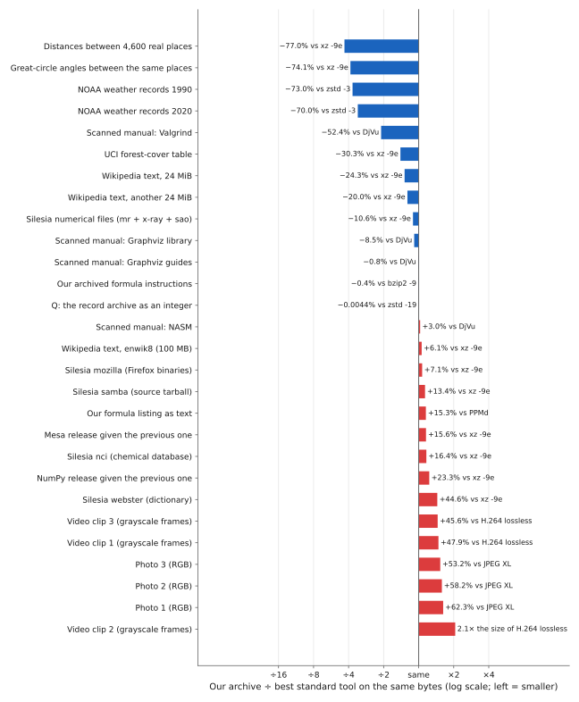

# Lossless Compression Lab

A research notebook (November 2026) on one question: **can a file be stored as something shorter that rebuilds it
exactly?** It started from a whiteboard formula (describe a whole file as one number divided by another) and
went on to cellular automata, matrix factorization, coincidence searches, data reshaping, specialised models and
finally our own context-mixing text compressor. Every idea was implemented, run on real data and on planted
controls, decoded byte for byte, and compared with the standard tools on the same bytes.

**[Read the report →](report/README.md)**

## The short answer

<picture><source media="(prefers-color-scheme: dark)" srcset="report/figures/scoreboard-real-dark.svg"></picture>

*Our best archive for each **real** input, relative to the best standard tool on the same bytes (left of
"same" = smaller = better). Standard tools: gzip, bzip2, xz, Zstandard, Brotli, PPMd, plus JPEG XL / WebP /
PNG for photos, H.264 lossless / FFV1 for video, DjVu / JBIG for scanned pages. Every archive decoded byte-exact.*

| Chapter | Question | Answer |
|---|---|---|
| [1 · Formulas](report/1-formulas.md) | Can a short formula, a digit sequence or a random seed regenerate real data? | **No.** Every planted control is found; on real data the best formula saved 0–0.004%. A search finds as many bits by luck as it costs to name what it found. |
| [2 · Automata and factors](report/2-dynamics.md) | Does running a reversible automaton backwards expose low-rank structure? | **Only in data built that way:** 2.6–15× smaller than standard tools on planted fields, 25% to 65× *larger* on every real input. |
| [3 · Reshaping](report/3-reshaping.md) | Does reordering bytes help a standard compressor? | **Yes, for tables and rasters:** splitting weather records into fields, predicting numerical grids. Not for prose. |
| [4 · Specialised models](report/4-specialised.md) | Do models written for one kind of data beat the usual tools? | **Sometimes:** glyph coding of scanned manuals beats DjVu on 3 of 4; photo and video models lose to JPEG XL and H.264. |
| [5 · Text](report/5-text.md) | How small can our own compressor make enwik8? | **17,811,463 bytes** with our context mixer CM3: better than xz, PPMd, GLZA and paq8l; 12% behind paq8px and 22% behind cmix. |
| [6 · The record archive](report/6-record-archive.md) | Can the Hutter-record archive itself be made smaller? | **By 0.075%** (73 kB), by recognising the executable and model weights inside it. A new prize award needs at least 1% (about 1 MB). |

What survives: **predictive modelling** (chapter 5) and **format-aware reshaping** (chapters 3–4). What does not:
**describing real data with formulas, coincidences or automata** (chapters 1–2). Planted controls show those
detectors work; the data simply does not contain what they look for.

## Repository map

| Folder | Contents |
|---|---|
| [`report/`](report/README.md) | The written report: chapters, [methods](report/methods.md), [glossary](report/glossary.md), [every idea tried](report/ideas.md), figures and the scripts that draw them. |
| [`research/`](research/README.md) | One folder per method: source code, a short page (question, method, result, how to run), and its measurements. |
| [`research/large-scale/`](research/large-scale/README.md) | The benchmark runner (≥ 20 MiB inputs, separate decoder, byte comparison), all receipts and result tables. |
| [`experiments/`](experiments) | The sixteen original thesis experiments as small, tested codecs ([suite runner](suite.py)). |
| [`studies/`](studies) | Three experiments that combine several of the sixteen. |
| [`fixtures/`](fixtures/README.md) | Small frozen inputs for the test suites. |

## Run it

Linux, Python 3.10+, NumPy, a C/C++20 compiler, GMP, and the zstd/xz/bzip2/brotli/7z command-line tools.

```sh
python3 suite.py test                         # 16 codecs: round trips, empty and tiny inputs (about 1 minute)
make -C research -j4 && make -C research lab  # native code
python3 research/test.py                      # research codecs
```

Reproduce the measurements (each writes into a fresh folder under `runs/`):

```sh
python3 research/large-scale/datasets.py ../corpus runs/large/raw          # prepare the 20+ MiB inputs
python3 research/large-scale/rerun_all.py runs/rerun                        # replay every receipt, compare archives
python3 research/large-scale/baseline_panel.py runs/large/raw runs/panel.jsonl  # standard tools on every input
python3 research/large-scale/paired_panel.py runs/large/raw runs/paired.jsonl # our transforms → the same panel
CORPUS=../corpus bash research/lab-reruns.sh runs/lab                       # coincidence hunt, CM history, ...
CORPUS=../corpus bash research/lab-reruns-2.sh runs/lab                     # shape search, stride scans
python3 report/build_scoreboard.py && python3 report/make_figures.py        # tables and charts
python3 report/project_pages.py && python3 report/check_links.py            # project pages, link check
```

`CORPUS` must contain `enwik8/enwik8`, `silesia/*` and `canterbury/*` (public downloads; see
[inputs](research/large-scale/README.md#inputs) for every file's source and SHA-256). The record-archive inputs
of [chapter 6](report/6-record-archive.md) (Q, Neif) are derived from published Hutter Prize archives, which are
not redistributed here; the page says how each is built.

## Status of the numbers

Every number in the report is labelled **re-verified** (rerun for this report on November 28–29, 2026, with a
byte-for-byte round trip), **carried over** (verified earlier in the project; original log kept), or
**published** (third-party, with a link). See [methods](report/methods.md#labels-on-every-number).
