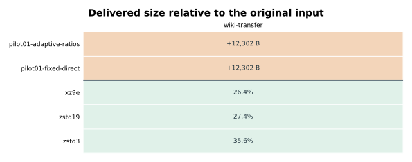
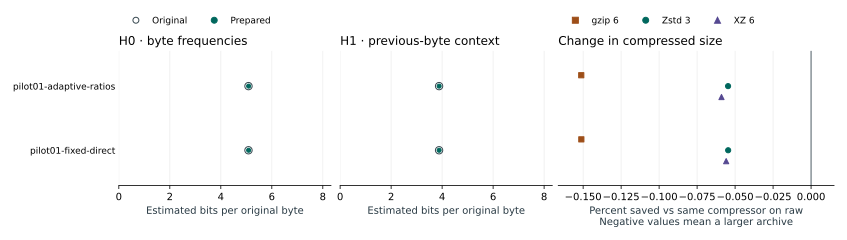
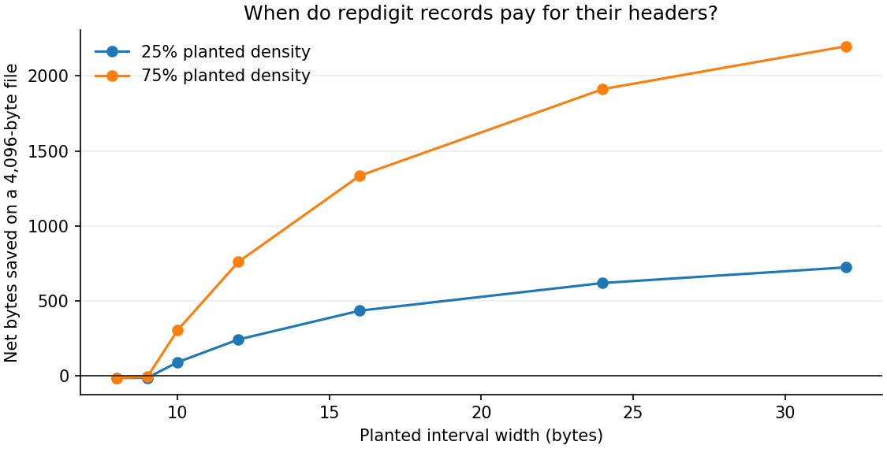

# Experiment 01 · Repdigit ratios and adaptive segmentation

> **Verdict: loses on real data.** Best real input: Wikipedia text, another 24 MiB, 3.8× larger vs xz -9e.
>
> Part of [chapter 1](../../report/1-formulas.md) of the [report](../../report/README.md). Terms: [glossary](../../report/glossary.md).

## Question

If a stretch of the file happens to equal a repeated-digit number (like 1111 in base 2 or 7777 in base 10), we can store the recipe instead of the bytes. How long must such a stretch be before recipe + position + length is shorter than the bytes themselves?

## How it works


The encoder scans the file for stretches that equal a repdigit or a ratio of two repdigits, and chooses where each stretch starts and ends to minimise the total. Everything not covered is stored literally.

<details><summary>Technical details</summary>

How long must a formula-generated byte interval be before transmitting its offset, width and recipe pays off? A repdigit is one digit repeated in a given base. For example, 111 in base 3 represents 13. A long string of binary ones divided exactly by 13 gives a second family of candidate values.

The original laboratory's RPS1 experiment reported 148,418 bytes for adaptive direct recipes and 116,299 bytes with exact quotients on a 184,958-byte planted input. This pilot uses the same wire fields with a smaller, explicitly bounded search catalog and new inputs. The historical figures describe the earlier implementation in the source workspace under lab/hutter/ragc/repdigit_split.

**Mechanism and test.** Long exact matches can pay for their positions and operands. The planted width sweep below locates that crossover. On prose, isolated matches still leave the surrounding literal text to encode.

| Profile | Permitted intervals | Arithmetic catalog |
|---|---|---|
| fixed-direct (control) | Whole 32-byte blocks and the final short block | Direct repdigits |
| adaptive-direct (A) | Any byte offset, up to 32 bytes | Direct repdigits |
| fixed-ratios (B) | Same fixed blocks | Direct and exact quotients |
| adaptive-ratios (A+B) | Same adaptive intervals | Direct and exact quotients |

For base b, digit c and repeat count r the value is c(bʳ−1)/(b−1). The catalog uses bases 2–10, repeat counts 3–256 and digits 1 through b−1. Denominators use digit 1, bases 2–5 distinct from the numerator base, and 3–5 repeats. Candidate values must fit in 32 bytes and their recipes in 28 meaningful bits. Equivalent values keep the shortest bit string, breaking ties lexicographically. Dynamic programming maximizes savings across disjoint intervals. Literal gaps are stored verbatim in every profile.

The RPS1 header contains a four-byte magic and two unsigned 32-bit big-endian fields for original size and record count. Each record has a four-byte offset, one-byte output width, one-byte recipe length and the recipe bytes. The first two bits select a direct value (00) or an exact quotient (01). Each operand stores b−1, r−2 and c as Elias gamma integers. The final byte is zero-padded. The decoder restores leading zero bytes to the transmitted width and fills the gaps from the trailing literal stream. The encoder's size ceiling is 2³²−1 bytes and its in-memory search is intended for small research inputs.

</details>

## Results on 20 MiB inputs

Every archive below decoded byte-exact. *Our archive* is this project's own format. *Our transform → standard tool* reshapes the bytes reversibly and hands the result to gzip, zstd or xz; it is listed only where it beats that same tool on the raw bytes. *Best standard tool* is the smallest of gzip, bzip2, xz, Zstandard, Brotli and PPMd (plus domain codecs for images, scans and video) on the raw bytes. *Difference* compares the better of our two columns with it; negative = ours is smaller.

| Input | Kind | Raw bytes | Our archive | Our transform → standard tool | Best standard tool | Difference |
|---|---|---:|---:|---:|---:|---:|
| Wikipedia text, another 24 MiB | real | 25,165,824 | 25,178,126 (`pilot01-adaptive-ratios`) | — | 6,637,336 (xz -9e) | 3.8× larger |

<details><summary>All profiles, timings and entropy measurements</summary>

<!-- BEGIN generated project measurements -->

Each archive passed a byte-for-byte round trip. *Bytes saved* is raw size minus archive (and any reference the decoder needs). Timings are one run on a shared desktop.

These tables list every measured profile. The comparison with the best standard tool on each input (gzip, bzip2, xz, Zstandard, Brotli, PPMd and the domain codecs) is the Results table above.

### Archive comparison across inputs



Read down a column to compare methods on identical input. Lower is better. 100% is the raw file size. Where available, standard codecs appear below the dividing line. Near 100%, cells give the exact byte difference from raw (+ means larger). Below 0.1%, they give the exact delivered total. A dash means the combination was unmeasured.

The paired figures below measure preprocessing separately. H0 measures byte frequencies. H1 conditions on the previous byte. The tables give both in bits per byte of their own stream. The figures express model costs per original byte. H0 counts every byte. H1 counts each adjacent pair, omitting the first byte’s marginal cost. Positive compressor savings mean a smaller compressed file.

### wiki-transfer · 25,165,824 raw bytes



Of 2 measured profiles on this input, 0 reduced gzip size, 0 reduced Zstandard size and 0 reduced XZ size. Exact ties count separately from improvements.

**Entropy before and after preprocessing**

| Profile | Prepared bytes | H0 before → after | H1 before → after | Post H0 per raw byte |
|---|---:|---:|---:|---:|
| `pilot01-adaptive-ratios` | 25,178,126 | 5.0850 → 5.0884 | 3.8807 → 3.8808 | 5.0909 |
| `pilot01-fixed-direct` | 25,178,126 | 5.0850 → 5.0884 | 3.8807 → 3.8808 | 5.0909 |

**Same compressor on original → prepared bytes**

| Profile | gzip 6 | Zstandard 3 | XZ 6 |
|---|---:|---:|---:|
| `pilot01-adaptive-ratios` | 9,232,082 → 9,246,045 (-0.15%) | 8,968,455 → 8,973,354 (-0.05%) | 6,743,812 → 6,747,788 (-0.06%) |
| `pilot01-fixed-direct` | 9,232,082 → 9,246,040 (-0.15%) | 8,968,455 → 8,973,349 (-0.05%) | 6,743,812 → 6,747,580 (-0.06%) |

**Standalone archives**

| Profile | Archive bytes | Bytes saved vs raw | Encode (s) | Decode (s) | Peak KiB (encode / decode) |
|---|---:|---:|---:|---:|---:|
| `pilot01-adaptive-ratios` | 25,178,126 | -12,302 | 454.629 | 0.665 | — / — |
| `pilot01-fixed-direct` | 25,178,126 | -12,302 | 24.882 | 2.690 | 25,012 / 23,544 |

Same-input baseline archives (bytes) · XZ 9 extreme 6,637,336 · Zstandard 19 6,891,038 · Zstandard 3 8,968,456

[Input hash and all measured codecs](../../research/large-scale/results/by-dataset.md#wiki-transfer)

### Reproduce the large-file comparison

From the repository root, with the pinned inputs and project dependencies installed, replay all published standalone profiles for this folder into a fresh directory.

```sh
python3 research/large-scale/primary.py runs/replay-01-repdigit-segmentation --project 01-repdigit-segmentation --all-profiles
```

[Dataset preparation](../../research/large-scale/README.md#inputs) · [Archive hashes and settings](../../research/large-scale/results/archives.jsonl)

A separate paired run also records entropy, stream hashes and the three backend sizes.

```sh
mkdir -p runs/paired
python3 research/large-scale/entropy_bench.py pilot01-adaptive-ratios runs/large/raw/wiki-transfer runs/paired/01-repdigit-segmentation.json
```

[All paired stream hashes and compressor versions](../../research/large-scale/results/preprocessing.jsonl)

<!-- END generated project measurements -->

</details>

## Small-scale results

The benchmark plants alternating direct and quotient values in a seeded 4,096-byte background and varies width and density independently. The first plant starts at byte 3. Later plants are evenly spaced, so the fixed grid can miss entire runs even on dense inputs. The random control is the same background without plants. The three real fixtures are compiled TZif time-zone tables copied from the local zoneinfo distribution labeled 2026f-dirty. Their hashes are recorded in the comparison CSV. Pass `--zoneinfo DIRECTORY` to test another distribution with the same three zone names. The search bounds and seed were fixed before measuring the evaluation inputs. No training step is required.

Each profile runs once per file in a fresh process. Wall times separate catalog construction, interval search plus serialization, and decoding. Peak resident memory in KiB includes the interpreter, catalog, encoder and decoder through verification. Metadata includes all headers and recipe bytes. The reference run verifies both RPS1 and Zstd level 3 by direct byte comparison. Timings are single observations.

Archive sizes assume a shared RPS1 decoder. Each trial also measures an executable Python zip archive containing the full codec source, a launcher and the payload, stored without additional compression. This delivery cost assumes the recipient has Python. The environment manifest identifies the exact decoder by SHA-256.

At each tested density, 10 bytes was the first tested width where the combined archive beat raw input. At 75% target density, moving from width 9 to 10 changed the combined archive from 4,101 to 3,789 bytes. A single record breaks even when its width equals six bytes plus its packed recipe length. The whole file also has to recover its 12-byte header.

| Input | Raw bytes | Fixed direct | Adaptive direct | Fixed ratios | Adaptive ratios | Gain over best component | Zstd |
|---|---:|---:|---:|---:|---:|---:|---:|
| 32-byte plants, 75% density | 4,096 | 4,108 | 3,004 | 4,108 | 1,900 | 1,104 | 1,160 |
| Random control | 4,096 | 4,108 | 4,108 | 4,108 | 4,108 | 0 | 4,109 |
| London | 3,664 | 3,676 | 3,676 | 3,676 | 3,676 | 0 | 1,990 |
| Paris | 2,962 | 2,974 | 2,950 | 2,974 | 2,942 | 8 | 1,597 |
| Zurich | 1,909 | 1,921 | 1,921 | 1,921 | 1,910 | 11 | 1,091 |

Paris saved 20 bytes against raw input. In Zurich the combination saved 11 bytes over either component and still finished one byte above raw size. All 72 RPS1 archives round-tripped. The crossover applies to this catalog, seed and placement schedule.



See the [width and density sweep](results/reference/comparison.csv), [per-profile measurements](results/reference/trials.csv) and [runtime versions](results/reference/environment.json).

## Run it

From this folder, use Python 3.10 or later for the codec and tests. The benchmark additionally requires Linux and the Zstd CLI on PATH. The output paths below must be available for creation.

```sh
python3 -m unittest -v
python3 codec.py encode fixtures/zoneinfo/Europe/Paris paris.rps --profile adaptive-ratios
python3 codec.py decode paris.rps paris.restored
cmp fixtures/zoneinfo/Europe/Paris paris.restored
python3 benchmark.py ../../runs/01-first-run
```

## Provenance

<details><summary>Where this code came from</summary>

These paths are relative to the original compression workspace. The pilot runs independently of that workspace.

| Original source | Role in this implementation |
|---|---|
| `lab/hutter/ragc/rfce_check/repdigits.py` | Repdigit arithmetic, Elias gamma fields, direct and quotient operators, and padding rules |
| `lab/hutter/ragc/repdigit_split/codec.py` | RPS1 header and patch layout, leading-zero widths and exact interval pricing |
| `lab/hutter/ragc/repdigit_split/scan.cpp` | Reference scanner used to generate the compatibility test vector. The pilot searches the bounded catalog in Python. |
| `lab/hutter/ragc/repdigit_split/benchmark.py` and `RESULTS.md` in that folder | Original planted-input generator, archived controls and historical comparison |

The pilot decoded the original 116,299-byte planted archive and reproduced all 184,958 input bytes. A second compatibility check encoded a mixed direct, quotient and literal input with each implementation and decoded it with the other. The test suite preserves the original encoder's output for that input, including its zero-run record.

</details>
