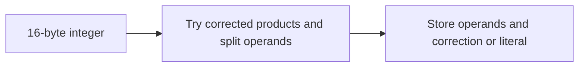
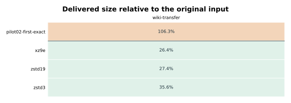

# Experiment 02 · Near-factorization and digit concatenation

> **Verdict: loses on real data.** Best real input: Wikipedia text, another 24 MiB, 4.0× larger vs xz -9e.
>
> Part of [chapter 1](../../report/1-formulas.md) of the [report](../../report/README.md). Terms: [glossary](../../report/glossary.md).

## Question

Can a number that is *almost* a product of two smaller numbers be stored as the two factors plus a small correction? Does writing a factor's digits side by side make it cheaper?

## How it works



For each block the encoder looks for a nearby value that factors well, then stores the factors and the signed difference. A variant splits a large factor into decimal digit groups and recurses into them.

<details><summary>Technical details</summary>

When does a nearby product pay for both factors and the signed correction? Can decimal concatenation make an otherwise expensive factor cheap?

The zero-gap study recovered a hidden factor of a constructed 260-bit product from known decimal geometry. A separate prime-index codec reduced a 130,001-byte planted file to 121,341 bytes.

**Mechanism and test.** A small factor is useful only if both operands and the signed correction are cheap to describe. Perturbed products test that condition directly. Searching more divisors can find shorter records at additional encode cost.

Read 16-byte big-endian words. For each signed correction in {0, ±1, ±2}, try divisors 2–129 and candidates near the integer square root. A product record stores its ZigZag correction and both operands. Each operand carries a decimal suffix width. Width zero stores one integer, while a positive width stores high and low parts, including any internal zero padding. A tag per word selects raw bytes or a product. The first strategy accepts the first improving divisor group. The best strategy retains the cheapest candidate found. Each uses the same 5 ms CPU ceiling per word.

The [codec](codec.py) defines the profiles in wire order. Pass a profile name with `encode --profile NAME`. The [benchmark protocol](../../PROTOCOL.md) specifies the common archive header, byte accounting and decoder delivery convention.

</details>

## Results on 20 MiB inputs

Every archive below decoded byte-exact. *Our archive* is this project's own format. *Our transform → standard tool* reshapes the bytes reversibly and hands the result to gzip, zstd or xz; it is listed only where it beats that same tool on the raw bytes. *Best standard tool* is the smallest of gzip, bzip2, xz, Zstandard, Brotli and PPMd (plus domain codecs for images, scans and video) on the raw bytes. *Difference* compares the better of our two columns with it; negative = ours is smaller.

| Input | Kind | Raw bytes | Our archive | Our transform → standard tool | Best standard tool | Difference |
|---|---|---:|---:|---:|---:|---:|
| Wikipedia text, another 24 MiB | real | 25,165,824 | 26,751,758 (`pilot02-first-exact`) | — | 6,637,336 (xz -9e) | 4.0× larger |

<details><summary>All profiles, timings and entropy measurements</summary>

<!-- BEGIN generated project measurements -->

Each archive passed a byte-for-byte round trip. *Bytes saved* is raw size minus archive (and any reference the decoder needs). Timings are one run on a shared desktop.

These tables list every measured profile. The comparison with the best standard tool on each input (gzip, bzip2, xz, Zstandard, Brotli, PPMd and the domain codecs) is the Results table above.

### Archive comparison across inputs



Read down a column to compare methods on identical input. Lower is better. 100% is the raw file size. Where available, standard codecs appear below the dividing line. Near 100%, cells give the exact byte difference from raw (+ means larger). Below 0.1%, they give the exact delivered total. A dash means the combination was unmeasured.

This project's published large-file trials measure complete archives. The effect on gzip, Zstandard or XZ after an isolated preprocessing step is unmeasured here.

### wiki-transfer · 25,165,824 raw bytes

**Standalone archives**

| Profile | Archive bytes | Bytes saved vs raw | Encode (s) | Decode (s) |
|---|---:|---:|---:|---:|
| `pilot02-first-exact` | 26,751,758 | -1,585,934 | 705.904 | 4.083 |

Same-input baseline archives (bytes) · XZ 9 extreme 6,637,336 · Zstandard 19 6,891,038 · Zstandard 3 8,968,456

[Input hash and all measured codecs](../../research/large-scale/results/by-dataset.md#wiki-transfer)

### Reproduce the large-file comparison

From the repository root, with the pinned inputs and project dependencies installed, replay all published standalone profiles for this folder into a fresh directory.

```sh
python3 research/large-scale/primary.py runs/replay-02-near-factorization --project 02-near-factorization --all-profiles
```

[Dataset preparation](../../research/large-scale/README.md#inputs) · [Archive hashes and settings](../../research/large-scale/results/archives.jsonl)

<!-- END generated project measurements -->

</details>

## Small-scale results

The generator draws hidden small factors and decimal factors with long internal zero runs. Only serialized products reach the encoder. Exact and perturbed products share the factors. Real inputs include a cofactor window and two executable prefixes.

CPU ceilings can change which candidate is reached on a different machine. The first strategy can finish early. This measures search under an equal upper bound, and actual elapsed search time is recorded.

The [benchmark driver](benchmark.py) freezes the corpus construction. The same seeded uniform control has the first planted input's length. Every profile runs once per file in a fresh worker. [Fixture provenance](../../fixtures/README.md).

On the perturbed products the best combined search used 236 bytes, saving 156 bytes over its better individual extension.

| Input | Raw bytes | Smallest profile (first on ties) | Archive bytes | Zstd bytes |
|---|---:|---|---:|---:|
| hidden-products | 512 | best-split | 236 | 203 |
| uniform | 512 | first-exact | 556 | 525 |
| perturbed-products | 512 | best-combined | 236 | 203 |
| integer.bin | 512 | first-exact | 556 | 525 |
| rusage.elf | 512 | first-exact | 556 | 173 |
| scanner.elf | 512 | first-exact | 556 | 179 |

All 48 profile archives decoded byte for byte. The [trial measurements](results/reference/trials.csv) give timings, peak RSS, metadata, bundle bytes and method details. The [full comparison](results/reference/comparison.csv) includes every profile and both baselines. [Environment and source hashes](results/reference/environment.json).

## Run it

Run from this folder on Linux with Python 3.10 or newer and the Zstd CLI. The codec writes new output files. Choose a fresh directory for each benchmark run.

```sh
python3 ../../lab.py 02 test
python3 ../../lab.py 02 encode ../../fixtures/integer.bin sample.lcx
python3 ../../lab.py 02 decode sample.lcx sample.restored
cmp ../../fixtures/integer.bin sample.restored
python3 ../../lab.py 02 benchmark ../../runs/recheck-02
```

## Provenance

<details><summary>Where this code came from</summary>

The zero-gap and prime-tree programs establish the arithmetic and literal-cost baselines. The bounded divisor and concatenation search is a new comparison. Paths below are relative to the original workspace.

- `lab/hutter/ragc/rfce_check/RESULTS.md`
- `lab/hutter/ragc/prime_index_tree_followup/RESULTS.md`
- `lab/hutter/ragc/rfce_check/zero_gap.py`
- `lab/hutter/ragc/prime_index_tree_followup/prime_tree.py`

</details>
