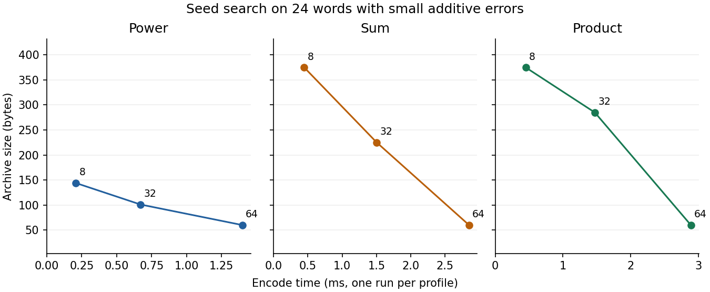

# Experiment 03 · Powers, generator sums and exact residuals

## Question and prior work

Which predictor family and correction operator produce the smallest exact archive for a fixed seed budget?

The QGS1 prototype encoded its own 4,096-byte generated control in 21 bytes using three 8-bit seeds. A separate integer-formula search tested powers, products and low-bit filters.

### Source files and compatibility

The QGS1 inverse supplies the domain-separated SHAKE idea. The integer search motivates powers, products and modular rejection. Paths below are relative to the original workspace.

- `lab/hutter/divisors/q-somma-generatori/misure.json`
- `lab/hutter/divisors/q-formula-intera/misure.json`
- `lab/hutter/divisors/q-somma-generatori/decoder.py`
- `lab/hutter/divisors/q-formula-intera/semi_brevi.py`

## Run the experiment

Run from this folder on Linux with Python 3.10 or newer and the Zstd CLI. The codec writes new output files. Choose a fresh directory for each benchmark run.

```sh
python3 ../../lab.py 03 test
python3 ../../lab.py 03 encode ../../fixtures/medical.bin sample.lcx
python3 ../../lab.py 03 decode sample.lcx sample.restored
cmp ../../fixtures/medical.bin sample.restored
python3 ../../lab.py 03 benchmark ../../runs/recheck-03
```

## Variants and format

Use 16-byte big-endian blocks. Generate a seventh power or the sum or product of two domain-separated SHAKE256 outputs derived from one seed. Reduce the prediction modulo the block width. Each tag carries the seed or the literal escape. Additive corrections use ZigZag LEB128. XOR corrections store a population count and the bit positions. A low-byte population bound prunes XOR candidates that already cost too much. Test seed budgets of 8, 32 and 64. The inverse requires only the profile, seed and residual.

The [codec](codec.py) defines the profiles in wire order. Pass a profile name with `encode --profile NAME`. The [benchmark protocol](../../PROTOCOL.md) specifies the common archive header, byte accounting and decoder delivery convention.

## Inputs and measurement

For each family, generate 24 words and perturb them with a small additive offset or two flipped bits. The real inputs are a cofactor window and medical-image bytes.

Each bounded family has one seed. The SHAKE construction differs from the original three-independent-seed QGS1 format. Timings include generating the catalog entries used by the profile.

The [benchmark driver](benchmark.py) freezes the corpus construction. The same seeded uniform control has the first planted input's length. Every profile runs once per file in a fresh worker. [Fixture provenance](../../fixtures/README.md).

## Results

For powers with small offsets, increasing the additive search budget from 8 to 32 to 64 seeds reduced the archive from 144 to 101 to 60 bytes.

| Input | Raw bytes | Smallest profile (first on ties) | Archive bytes | Zstd bytes |
|---|---:|---|---:|---:|
| power-small-offset | 384 | power-add-64 | 60 | 169 |
| uniform | 384 | power-add-8 | 420 | 397 |
| power-bit-flips | 384 | power-xor-64 | 108 | 181 |
| sum-small-offset | 384 | sum-add-64 | 60 | 361 |
| sum-bit-flips | 384 | sum-xor-64 | 108 | 361 |
| product-small-offset | 384 | product-add-64 | 60 | 362 |
| product-bit-flips | 384 | product-xor-64 | 108 | 362 |
| integer.bin | 512 | power-add-8 | 556 | 525 |
| medical.bin | 512 | power-xor-64 | 313 | 137 |

All 162 profile archives decoded byte for byte. The [trial measurements](results/reference/trials.csv) give timings, peak RSS, metadata, bundle bytes and method details. The [full comparison](results/reference/comparison.csv) includes every profile and both baselines. [Environment and source hashes](results/reference/environment.json).

### Search budget on additive power controls

| Seeds tested per word | Archive bytes | Encode time (ms) | Generated words |
|---:|---:|---:|---:|
| 8 | 144 | 0.208 | 24 |
| 32 | 101 | 0.671 | 24 |
| 64 | 60 | 1.398 | 24 |

Point labels give the number of seeds tested per word.




## Large-file benchmark

The [primary measurements for this experiment](../../research/large-scale/results/by-experiment.md#03-generator-residuals) list complete archives on raw inputs of at least 20 MiB. Each entry links to the same-input baselines and records the cost of any required reference.

## Connections

Experiment 14 can encode the XOR mask and experiment 16 can charge a generator seed when selecting intervals.
