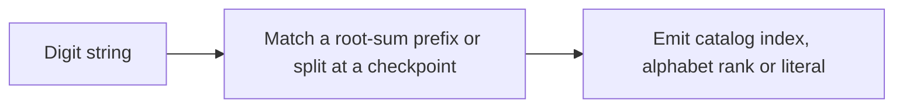
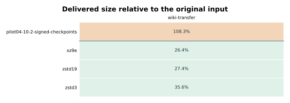

# Experiment 04 · Irrational sums, backtracking and checkpoints

[Method diagram](#method-diagram) · [Charts and benchmark tables](#large-file-benchmark)

## Question and prior work

When are signed sums of square roots cheaper than literal alphabet ranks, and when do extra segment indices repay their cost?

The interactive lab searches positive and signed combinations, certifies digit matches, and compares single-sum and checkpoint plans on short strings.

### Source files and compatibility

The browser lab supplies the root catalogs, signed coefficient search, literal ranks and checkpoint accounting. The Python port serializes these choices. Paths below are relative to the original workspace.

- `lab/irrational-sum.html`

## Run the experiment

Run from this folder on Linux with Python 3.10 or newer and the Zstd CLI. The codec writes new output files. Choose a fresh directory for each benchmark run.

```sh
python3 ../../lab.py 04 test
python3 ../../lab.py 04 encode ../../fixtures/identifiers-codec.txt sample.lcx
python3 ../../lab.py 04 decode sample.lcx sample.restored
cmp ../../fixtures/identifiers-codec.txt sample.restored
python3 ../../lab.py 04 benchmark ../../runs/recheck-04
```

## Variants and format

Treat each 12-byte group as a string, including the final short group. Use the first two or four roots of 2, 3, 5 and 7, with coefficients in {0,1} or {−1,0,1}. Scaled integer square-root bounds certify the entire fractional prefix in base 10 or 36. A one-byte tag gives the mode and span. Transmit raw bytes, a packed alphabet rank, or a one-byte index into the deterministic sum table. Checkpoint profiles use dynamic programming over splits and whole profiles require one segment. Alphabet and catalog settings are conveyed once by the file profile.

The [codec](codec.py) defines the profiles in wire order. Pass a profile name with `encode --profile NAME`. The [benchmark protocol](../../PROTOCOL.md) specifies the common archive header, byte accounting and decoder delivery convention.

### Method diagram



**Mechanism and test.** A catalog entry replaces many digits only when the decoder can regenerate the same prefix. Checkpoints recover partial matches but introduce tags. Packed alphabet ranks provide a separate explanation for savings on random digits.

## Inputs and measurement

Concatenate generated four-character prefixes or full 12-character catalog strings. Random alphabet controls complement uniform random bytes. Real controls use two collections of lowercase identifier tokens normalized to fixed-width records.

The pilot operates on fixed-width collections and on prefixes up to 12 digits. It exhausts these small coefficient catalogs and uses exact segmentation over that catalog.

The [benchmark driver](benchmark.py) freezes the corpus construction. The same seeded uniform control has the first planted input's length. Every profile runs once per file in a fresh worker. [Fixture provenance](../../fixtures/README.md).

## Results

The full signed four-root catalog encoded the 192-byte collection of generated 12-digit decimal prefixes in 44 bytes.

| Input | Raw bytes | Smallest profile (first on ties) | Archive bytes | Zstd bytes |
|---|---:|---|---:|---:|
| base10-prefix4 | 192 | 10-2-positive-whole | 108 | 110 |
| uniform | 192 | 10-2-positive-whole | 220 | 205 |
| base10-prefix12 | 192 | 10-4-signed-whole | 44 | 107 |
| random-base10 | 192 | 10-2-positive-whole | 108 | 106 |
| base36-prefix4 | 192 | 36-4-signed-checkpoints | 108 | 166 |
| base36-prefix12 | 192 | 36-4-signed-whole | 44 | 163 |
| random-base36 | 192 | 36-2-positive-whole | 156 | 165 |
| identifiers-codec.txt | 768 | 36-2-positive-checkpoints | 443 | 307 |
| identifiers-grammar.txt | 768 | 36-2-positive-checkpoints | 474 | 330 |

All 144 profile archives decoded byte for byte. The [trial measurements](results/reference/trials.csv) give timings, peak RSS, metadata, bundle bytes and method details. The [full comparison](results/reference/comparison.csv) includes every profile and both baselines. [Environment and source hashes](results/reference/environment.json).

### Checkpoint accounting for four-character planted base-36 prefixes

| Profile | Archive bytes | Segments | Catalog index bytes | Generated characters |
|---|---:|---:|---:|---:|
| 36-4-signed-whole | 156 | 16 | 0 | 0 |
| 36-4-signed-checkpoints | 108 | 48 | 48 | 192 |


## Large-file benchmark

On `wiki-transfer` (25,165,824 raw bytes), `pilot04-10-2-signed-checkpoints` produced 27,248,340 archive bytes. Zstandard level 3 used 8,968,456 bytes on the same input. [Input and timing](../../research/large-scale/results/by-dataset.md#wiki-transfer) · [All project measurements](../../research/large-scale/results/by-experiment.md#04-irrational-checkpoints)

<!-- BEGIN generated project measurements -->

Each archive passed a byte-for-byte round trip. Bytes saved subtracts the archive and any required reference from the raw input size. Timings are seconds from one run.

On the primary input `wiki-transfer`, `pilot04-10-2-signed-checkpoints` delivers 27,248,340 bytes, 18,279,884 bytes larger than standalone Zstandard 3 (8,968,456 bytes).

### Archive comparison across inputs



Read down a column to compare methods on identical input. Lower is better. 100% is the raw file size. Where available, standard codecs appear below the dividing line. Near 100%, cells give the exact byte difference from raw (+ means larger). Below 0.1%, they give the exact delivered total. A dash means the combination was unmeasured.

This project's published large-file trials measure complete archives. The effect on gzip, Zstandard or XZ after an isolated preprocessing step is unmeasured here.

### wiki-transfer · 25,165,824 raw bytes

**Standalone archives**

| Profile | Archive bytes | Bytes saved vs raw | Encode (s) | Decode (s) |
|---|---:|---:|---:|---:|
| `pilot04-10-2-signed-checkpoints` | 27,248,340 | -2,082,516 | 1143.816 | 2.338 |

Same-input baseline archives (bytes) · XZ 9 extreme 6,637,336 · Zstandard 19 6,891,038 · Zstandard 3 8,968,456

[Input hash and all measured codecs](../../research/large-scale/results/by-dataset.md#wiki-transfer)

### Reproduce the large-file comparison

From the repository root, with the pinned inputs and project dependencies installed, replay all published standalone profiles for this folder into a fresh directory.

```sh
python3 research/large-scale/primary.py runs/replay-04-irrational-checkpoints --project 04-irrational-checkpoints --all-profiles
```

[Dataset preparation](../../research/large-scale/README.md#inputs) · [Archive hashes and settings](../../research/large-scale/results/archives.jsonl)

<!-- END generated project measurements -->

## Connections

Experiment 01 also chooses interval boundaries. Experiment 11 can share recurring coefficient lists.
