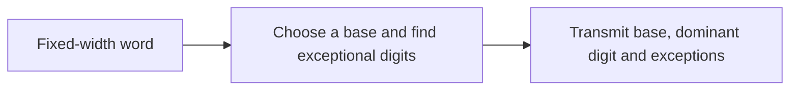
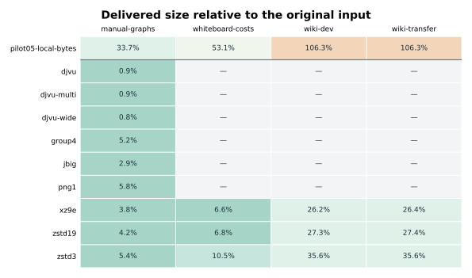

# Experiment 05 · Local bases and exceptional digits

> **Verdict: loses on real data.** Best real input: Wikipedia text, another 24 MiB, 4.0× larger vs xz -9e.
>
> Part of [chapter 1](../../report/1-formulas.md) of the [report](../../report/README.md). Terms: [glossary](../../report/glossary.md).

## Question

Every number can be written in any base. Is there a base in which a block has a few dominant digits, so that storing the base plus the exceptions is shorter?

## How it works



Per file or per block, the encoder picks a base from 2 to 257, codes the dominant digits cheaply and lists the exceptional digits. It compares choosing the base by entropy with choosing it by actual encoded size.

<details><summary>Technical details</summary>

Does the lowest-entropy numeral base also minimize the archive after dominant digits, exceptions and selectors are paid for?

The source prototype searches bases 2–257 and compares empirical entropy with the exact encodings of digit exceptions in fixed-width integer-tree leaves.

**Mechanism and test.** A cheap base has few exceptions with inexpensive positions. Compare local against global selection and entropy scoring against actual record length to separate better representation from uncharged selector cost.

Each 16-byte word has 13 candidate bases from 2 through 257. Represent it by a digit count, a dominant digit and a list of exceptional positions and values in least-significant-digit order. All fields use unsigned varints. Global profiles transmit one common base and per-word literal flags. Local profiles use one selector per word, including the raw escape. Entropy scoring uses per-digit empirical entropy. Byte scoring includes literal fallback. The decoder restores each word to its original byte width.

The [codec](codec.py) defines the profiles in wire order. Pass a profile name with `encode --profile NAME`. The [benchmark protocol](../../PROTOCOL.md) specifies the common archive header, byte accounting and decoder delivery convention.

</details>

## Results on 20 MiB inputs

Every archive below decoded byte-exact. *Our archive* is this project's own format. *Our transform → standard tool* reshapes the bytes reversibly and hands the result to gzip, zstd or xz; it is listed only where it beats that same tool on the raw bytes. *Best standard tool* is the smallest of gzip, bzip2, xz, Zstandard, Brotli and PPMd (plus domain codecs for images, scans and video) on the raw bytes. *Difference* compares the better of our two columns with it; negative = ours is smaller.

| Input | Kind | Raw bytes | Our archive | Our transform → standard tool | Best standard tool | Difference |
|---|---|---:|---:|---:|---:|---:|
| Scanned manual: Graphviz guides | real | 24,642,792 | 8,312,441 (`pilot05-local-bytes`) | — | 191,132 (DjVu) | 43.5× larger |
| Wikipedia text, 24 MiB | real | 25,165,824 | 26,744,147 (`pilot05-local-bytes`) | — | 6,602,488 (xz -9e) | 4.1× larger |
| Wikipedia text, another 24 MiB | real | 25,165,824 | 26,747,076 (`pilot05-local-bytes`) | — | 6,637,336 (xz -9e) | 4.0× larger |
| Census tables printed by our enumerator | self-generated | 33,554,432 | 17,808,940 (`pilot05-local-bytes`) | — | 2,203,672 (xz -9e) | 8.1× larger |

<details><summary>All profiles, timings and entropy measurements</summary>

<!-- BEGIN generated project measurements -->

Each archive passed a byte-for-byte round trip. *Bytes saved* is raw size minus archive (and any reference the decoder needs). Timings are one run on a shared desktop.

These tables list every measured profile. The comparison with the best standard tool on each input (gzip, bzip2, xz, Zstandard, Brotli, PPMd and the domain codecs) is the Results table above.

### Archive comparison across inputs



Read down a column to compare methods on identical input. Lower is better. 100% is the raw file size. Where available, standard codecs appear below the dividing line. Near 100%, cells give the exact byte difference from raw (+ means larger). Below 0.1%, they give the exact delivered total. A dash means the combination was unmeasured.

This project's published large-file trials measure complete archives. The effect on gzip, Zstandard or XZ after an isolated preprocessing step is unmeasured here.

### manual-graphs · 24,642,792 raw bytes

**Standalone archives**

| Profile | Archive bytes | Bytes saved vs raw | Encode (s) | Decode (s) | Peak KiB (encode / decode) |
|---|---:|---:|---:|---:|---:|
| `pilot05-local-bytes` | 8,312,441 | +16,330,351 | 302.298 | 29.921 | 27,736 / 23,628 |

Same-input baseline archives (bytes) · DjVu 214,067 · DjVu (separated foreground) 213,732 · DjVu (wide strips) 191,132 · CCITT Group 4 1,270,850 · JBIG 707,797 · 1-bit PNG 1,418,635 · XZ 9 extreme 930,864 · Zstandard 19 1,034,431 · Zstandard 3 1,325,134

[Input hash and all measured codecs](../../research/large-scale/results/by-dataset.md#manual-graphs)

### whiteboard-costs · 33,554,432 raw bytes

**Standalone archives**

| Profile | Archive bytes | Bytes saved vs raw | Encode (s) | Decode (s) | Peak KiB (encode / decode) |
|---|---:|---:|---:|---:|---:|
| `pilot05-local-bytes` | 17,808,940 | +15,745,492 | 819.370 | 67.864 | 29,728 / 23,616 |

Same-input baseline archives (bytes) · XZ 9 extreme 2,203,672 · Zstandard 19 2,286,184 · Zstandard 3 3,513,689

[Input hash and all measured codecs](../../research/large-scale/results/by-dataset.md#whiteboard-costs)

### wiki-dev · 25,165,824 raw bytes

**Standalone archives**

| Profile | Archive bytes | Bytes saved vs raw | Encode (s) | Decode (s) | Peak KiB (encode / decode) |
|---|---:|---:|---:|---:|---:|
| `pilot05-local-bytes` | 26,744,147 | -1,578,323 | 1503.476 | 4.334 | 24,932 / 23,676 |

Same-input baseline archives (bytes) · XZ 9 extreme 6,602,488 · Zstandard 19 6,873,848 · Zstandard 3 8,951,574

[Input hash and all measured codecs](../../research/large-scale/results/by-dataset.md#wiki-dev)

### wiki-transfer · 25,165,824 raw bytes

**Standalone archives**

| Profile | Archive bytes | Bytes saved vs raw | Encode (s) | Decode (s) |
|---|---:|---:|---:|---:|
| `pilot05-local-bytes` | 26,747,076 | -1,581,252 | 2761.713 | 2.306 |

Same-input baseline archives (bytes) · XZ 9 extreme 6,637,336 · Zstandard 19 6,891,038 · Zstandard 3 8,968,456

[Input hash and all measured codecs](../../research/large-scale/results/by-dataset.md#wiki-transfer)

### Reproduce the large-file comparison

From the repository root, with the pinned inputs and project dependencies installed, replay all published standalone profiles for this folder into a fresh directory.

```sh
python3 research/large-scale/primary.py runs/replay-05-local-bases --project 05-local-bases --all-profiles
```

[Dataset preparation](../../research/large-scale/README.md#inputs) · [Archive hashes and settings](../../research/large-scale/results/archives.jsonl)

<!-- END generated project measurements -->

</details>

## Small-scale results

The structured input contains repeated digits in changing local bases with a one-place perturbation. A cofactor window and quantized medical-image data exercise the same word format.

The base set is a frozen subset of the original search range. Details in the trial CSV count changed base choices, including blocks that subsequently take the raw escape, and the complete selector stream.

The [benchmark driver](benchmark.py) freezes the corpus construction. The same seeded uniform control has the first planted input's length. Every profile runs once per file in a fresh worker. [Fixture provenance](../../fixtures/README.md).

Local selection by encoded size saved five bytes over the better individual change on the planted mixed-base input.

| Input | Raw bytes | Smallest profile (first on ties) | Archive bytes | Zstd bytes |
|---|---:|---|---:|---:|
| mixed-local-bases | 512 | local-bytes | 236 | 288 |
| uniform | 512 | local-entropy | 556 | 525 |
| integer.bin | 512 | local-entropy | 556 | 525 |
| medical.bin | 512 | local-bytes | 343 | 137 |

All 16 profile archives decoded byte for byte. The [trial measurements](results/reference/trials.csv) give timings, peak RSS, metadata, bundle bytes and method details. The [full comparison](results/reference/comparison.csv) includes every profile and both baselines. [Environment and source hashes](results/reference/environment.json).

### Base selection on the mixed-base control

| Profile | Archive bytes | Transmitted selector bytes | Blocks where the two scoring rules differ |
|---|---:|---:|---:|
| global-entropy | 546 | 33 | 32 |
| local-entropy | 241 | 32 | 2 |
| global-bytes | 457 | 33 | 32 |
| local-bytes | 236 | 32 | 2 |

## Run it

Run from this folder on Linux with Python 3.10 or newer and the Zstd CLI. The codec writes new output files. Choose a fresh directory for each benchmark run.

```sh
python3 ../../lab.py 05 test
python3 ../../lab.py 05 encode ../../fixtures/medical.bin sample.lcx
python3 ../../lab.py 05 decode sample.lcx sample.restored
cmp ../../fixtures/medical.bin sample.restored
python3 ../../lab.py 05 benchmark ../../runs/recheck-05
```

## Provenance

<details><summary>Where this code came from</summary>

The original leaf scorer supplies the dominant-digit and entropy rules. This implementation prices an explicit list of exception position/value pairs. Paths below are relative to the original workspace.

- `lab/hutter/ragc/entropy_base_tree/trial.py`

</details>
