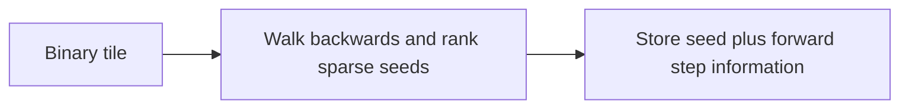
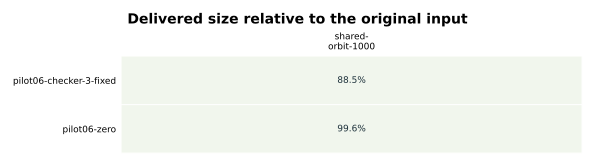
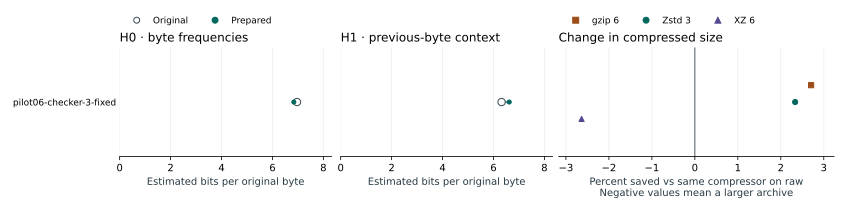

# Experiment 06 · Reversible automata and step counts

[Method diagram](#method-diagram) · [Charts and benchmark tables](#large-file-benchmark)

## Question and prior work

Can a simpler predecessor grid repay the cost of telling the decoder how many automaton steps to run?

The original 8×8 experiment reduced a 20,000-byte evolved-grid control from 17,050 to 12,189 bytes. Its executable test selected step zero on all 17 selected grids.

### Source files and compatibility

The native orbit encoder supplies Checkerboard parity and the asymmetric tie rules for legal step bounds. The Margolus profile uses its own fixed involution. Paths below are relative to the original workspace.

- `lab/hutter/automa-8x8-passo-byte/orbite/RISULTATI.md`
- `lab/hutter/automa-8x8-passo-byte/orbite/orbite.cpp`
- `lab/hutter/automa-8x8-passo-byte/scacchiera.cpp`

## Run the experiment

Run from this folder on Linux with Python 3.10 or newer and the Zstd CLI. The codec writes new output files. Choose a fresh directory for each benchmark run.

```sh
python3 ../../lab.py 06 test
python3 ../../lab.py 06 encode ../../fixtures/fax-mid.bin sample.lcx
python3 ../../lab.py 06 decode sample.lcx sample.restored
cmp ../../fixtures/fax-mid.bin sample.restored
python3 ../../lab.py 06 benchmark ../../runs/recheck-06
```

## Variants and format

Read each eight bytes as a 64-cell torus. Checkerboard uses the original alternating parity update. Margolus alternates two partitions with an explicit reversible four-cell substitution. Search backwards 3 or 15 steps, retaining the earliest minimum-minority state. Encode the seed by weight and combinadic rank. A fixed index uses the full step range. Restricted indices derive legal bounds by walking the orbit from the seed. Step bits are packed across blocks. Literal tags, seed widths, step padding and the verbatim tail are charged. The zero profile only considers the input state.

The [codec](codec.py) defines the profiles in wire order. Pass a profile name with `encode --profile NAME`. The [benchmark protocol](../../PROTOCOL.md) specifies the common archive header, byte accounting and decoder delivery convention.

### Method diagram



**Mechanism and test.** Many zero cells make a seed cheap to enumerate. The step count can spend that gain, particularly when every tile needs a different index. Zero-step coding isolates the benefit of the orbit search.

## Inputs and measurement

Three-particle seeds evolve under each of the two rules. The suite also tests fax bitmap and medical-image samples. Each trial reports seed bytes (including literal full grids), step bits and padded step bytes.

The restricted index uses a fixed bit width within the legal interval. The one-byte population or literal selector for each block is in the metadata stream.

The [benchmark driver](benchmark.py) freezes the corpus construction. The same seeded uniform control has the first planted input's length. Every profile runs once per file in a fresh worker. [Fixture provenance](../../fixtures/README.md).

## Results

On the Checkerboard control the zero-step profile needed 148 bytes. With a 15-step search, a fixed index used 97 and the restricted index used 95.

| Input | Raw bytes | Smallest profile (first on ties) | Archive bytes | Zstd bytes |
|---|---:|---|---:|---:|
| checker-sparse-orbits | 192 | checker-15-restricted | 95 | 167 |
| uniform | 192 | zero | 228 | 205 |
| margolus-sparse-orbits | 192 | margolus-15-fixed | 97 | 205 |
| fax.bin | 192 | zero | 37 | 22 |
| fax-mid.bin | 192 | zero | 71 | 61 |
| medical.bin | 192 | zero | 145 | 106 |

All 54 profile archives decoded byte for byte. The [trial measurements](results/reference/trials.csv) give timings, peak RSS, metadata, bundle bytes and method details. The [full comparison](results/reference/comparison.csv) includes every profile and both baselines. [Environment and source hashes](results/reference/environment.json).


## Large-file benchmark

On `shared-orbit-1000` (25,165,824 raw bytes), `pilot06-checker-3-fixed` produced 22,274,238 archive bytes. [Input and timing](../../research/large-scale/results/by-dataset.md#shared-orbit-1000) · [All project measurements](../../research/large-scale/results/by-experiment.md#06-reversible-automata)

<!-- BEGIN generated project measurements -->

Each archive passed a byte-for-byte round trip. Bytes saved subtracts the archive and any required reference from the raw input size. Timings are seconds from one run.

### Archive comparison across inputs



Read down a column to compare methods on identical input. Lower is better. 100% is the raw file size. Where available, standard codecs appear below the dividing line. Near 100%, cells give the exact byte difference from raw (+ means larger). Below 0.1%, they give the exact delivered total. A dash means the combination was unmeasured.

The paired figures below measure preprocessing separately. H0 measures byte frequencies. H1 conditions on the previous byte. The tables give both in bits per byte of their own stream. The figures express model costs per original byte. H0 counts every byte. H1 counts each adjacent pair, omitting the first byte’s marginal cost. Positive compressor savings mean a smaller compressed file.

### shared-orbit-1000 · 25,165,824 raw bytes



Of 1 measured profiles on this input, 1 reduced gzip size, 1 reduced Zstandard size and 0 reduced XZ size. Exact ties count separately from improvements.

**Entropy before and after preprocessing**

| Profile | Prepared bytes | H0 before → after | H1 before → after | Post H0 per raw byte |
|---|---:|---:|---:|---:|
| `pilot06-checker-3-fixed` | 22,274,238 | 6.9648 → 7.7281 | 6.3175 → 7.4767 | 6.8401 |

**Same compressor on original → prepared bytes**

| Profile | gzip 6 | Zstandard 3 | XZ 6 |
|---|---:|---:|---:|
| `pilot06-checker-3-fixed` | 22,067,549 → 21,470,554 (+2.71%) | 21,987,747 → 21,474,587 (+2.33%) | 20,184,408 → 20,716,428 (-2.64%) |

**Standalone archives**

| Profile | Archive bytes | Bytes saved vs raw | Encode (s) | Decode (s) | Peak KiB (encode / decode) |
|---|---:|---:|---:|---:|---:|
| `pilot06-checker-3-fixed` | 22,274,238 | +2,891,586 | 131.233 | 214.897 | 24,616 / 23,604 |
| `pilot06-zero` | 25,076,546 | +89,278 | 58.622 | 115.018 | 24,836 / 23,588 |

[Input hash and all measured codecs](../../research/large-scale/results/by-dataset.md#shared-orbit-1000)

### Reproduce the large-file comparison

From the repository root, with the pinned inputs and project dependencies installed, replay all published standalone profiles for this folder into a fresh directory.

```sh
python3 research/large-scale/primary.py runs/replay-06-reversible-automata --project 06-reversible-automata --all-profiles
```

[Dataset preparation](../../research/large-scale/README.md#inputs) · [Archive hashes and settings](../../research/large-scale/results/archives.jsonl)

A separate paired run also records entropy, stream hashes and the three backend sizes.

```sh
mkdir -p runs/paired
python3 research/large-scale/entropy_bench.py pilot06-checker-3-fixed runs/large/raw/shared-orbit-1000 runs/paired/06-reversible-automata.json
```

[All paired stream hashes and compressor versions](../../research/large-scale/results/preprocessing.jsonl)

<!-- END generated project measurements -->

## Connections

Experiment 07 uses the Checkerboard rule in a factorization tree. Experiment 14 can replace the combinadic seed code.
