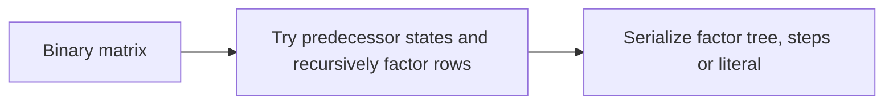
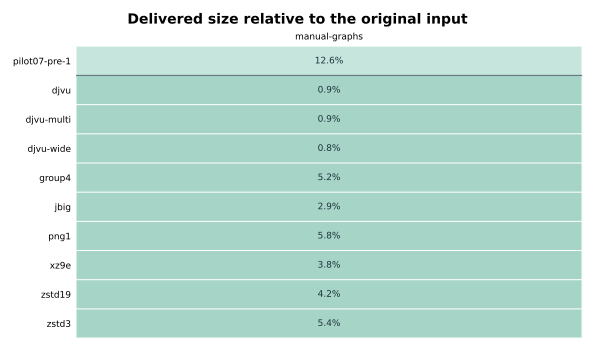
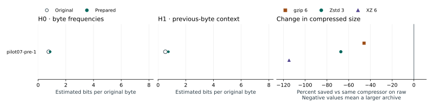

# Experiment 07 · Automata and recursive GF(2) factorization

> **Verdict: loses on real data.** Best real input: Scanned manual: Graphviz guides, 16.3× larger vs DjVu.
>
> Part of [chapter 2](../../report/2-dynamics.md) of the [report](../../report/README.md). Terms: [glossary](../../report/glossary.md).

## Question

Does running an automaton backwards before factoring a bit matrix make the matrix easier to factor, and does factoring the factors again help?

## How it works



Each 16×16 bit matrix is optionally evolved backwards, then written as basis rows times coefficient rows plus an error mask, recursively up to three levels.

<details><summary>Technical details</summary>

Does undoing a reversible transformation before factorization expose low rank, and does a third level of recursion help?

The original GFH1 study reported 8,205 bytes for leaf-only automata versus 4,492 with pre-factorization automata on 256 evolved rank-four matrices.

**Mechanism and test.** Repeated linear combinations can replace rows with basis references. An orbit helps only when the cheaper tree pays for its step. Depth and transform placement test different parts of this explanation.

Port the original 16×16 GF(2) row reduction, basis partitions, combinadic ranks and tree-node decoder. A node can emit raw cells, an enumerated mask, or independent row indices and three recursive child matrices. The step index allows a seed matrix to be evolved after reconstruction. The post profiles permit transformation on leaf encodings. Pre additionally tests transformed factorization roots. Cross each with depth one or three. Search four earlier states with beam width two. An outer file flag allows a literal fallback.

The [codec](codec.py) defines the profiles in wire order. Pass a profile name with `encode --profile NAME`. The [benchmark protocol](../../PROTOCOL.md) specifies the common archive header, byte accounting and decoder delivery convention.

</details>

## Results on 20 MiB inputs

Every archive below decoded byte-exact. *Our archive* is this project's own format. *Our transform → standard tool* reshapes the bytes reversibly and hands the result to gzip, zstd or xz; it is listed only where it beats that same tool on the raw bytes. *Best standard tool* is the smallest of gzip, bzip2, xz, Zstandard, Brotli and PPMd (plus domain codecs for images, scans and video) on the raw bytes. *Difference* compares the better of our two columns with it; negative = ours is smaller.

| Input | Kind | Raw bytes | Our archive | Our transform → standard tool | Best standard tool | Difference |
|---|---|---:|---:|---:|---:|---:|
| Scanned manual: Graphviz guides | real | 24,642,792 | 3,112,119 (`pilot07-pre-1`) | — | 191,132 (DjVu) | 16.3× larger |

<details><summary>All profiles, timings and entropy measurements</summary>

<!-- BEGIN generated project measurements -->

Each archive passed a byte-for-byte round trip. *Bytes saved* is raw size minus archive (and any reference the decoder needs). Timings are one run on a shared desktop.

These tables list every measured profile. The comparison with the best standard tool on each input (gzip, bzip2, xz, Zstandard, Brotli, PPMd and the domain codecs) is the Results table above.

### Archive comparison across inputs



Read down a column to compare methods on identical input. Lower is better. 100% is the raw file size. Where available, standard codecs appear below the dividing line. Near 100%, cells give the exact byte difference from raw (+ means larger). Below 0.1%, they give the exact delivered total. A dash means the combination was unmeasured.

The paired figures below measure preprocessing separately. H0 measures byte frequencies. H1 conditions on the previous byte. The tables give both in bits per byte of their own stream. The figures express model costs per original byte. H0 counts every byte. H1 counts each adjacent pair, omitting the first byte’s marginal cost. Positive compressor savings mean a smaller compressed file.

### manual-graphs · 24,642,792 raw bytes



Of 1 measured profiles on this input, 0 reduced gzip size, 0 reduced Zstandard size and 0 reduced XZ size. Exact ties count separately from improvements.

**Entropy before and after preprocessing**

| Profile | Prepared bytes | H0 before → after | H1 before → after | Post H0 per raw byte |
|---|---:|---:|---:|---:|
| `pilot07-pre-1` | 3,112,119 | 0.7646 → 6.8702 | 0.5291 → 5.9196 | 0.8676 |

**Same compressor on original → prepared bytes**

| Profile | gzip 6 | Zstandard 3 | XZ 6 |
|---|---:|---:|---:|
| `pilot07-pre-1` | 1,520,849 → 2,217,323 (-45.80%) | 1,325,130 → 2,215,382 (-67.18%) | 1,004,072 → 2,156,664 (-114.79%) |

**Standalone archives**

| Profile | Archive bytes | Bytes saved vs raw | Encode (s) | Decode (s) | Peak KiB (encode / decode) |
|---|---:|---:|---:|---:|---:|
| `pilot07-pre-1` | 3,112,119 | +21,530,673 | 64.787 | 100.498 | 31,096 / 23,624 |

Same-input baseline archives (bytes) · DjVu 214,067 · DjVu (separated foreground) 213,732 · DjVu (wide strips) 191,132 · CCITT Group 4 1,270,850 · JBIG 707,797 · 1-bit PNG 1,418,635 · XZ 9 extreme 930,864 · Zstandard 19 1,034,431 · Zstandard 3 1,325,134

[Input hash and all measured codecs](../../research/large-scale/results/by-dataset.md#manual-graphs)

### Reproduce the large-file comparison

From the repository root, with the pinned inputs and project dependencies installed, replay all published standalone profiles for this folder into a fresh directory.

```sh
python3 research/large-scale/primary.py runs/replay-07-recursive-gf2 --project 07-recursive-gf2 --all-profiles
```

[Dataset preparation](../../research/large-scale/README.md#inputs) · [Archive hashes and settings](../../research/large-scale/results/archives.jsonl)

A separate paired run also records entropy, stream hashes and the three backend sizes.

```sh
mkdir -p runs/paired
python3 research/large-scale/entropy_bench.py pilot07-pre-1 runs/large/raw/manual-graphs runs/paired/07-recursive-gf2.json
```

[All paired stream hashes and compressor versions](../../research/large-scale/results/preprocessing.jsonl)

<!-- END generated project measurements -->

</details>

## Small-scale results

Check matrices evolved by the decoder rule, matrices evolved by a different nonlinear rule, and hierarchical matrices with shared half-rows. Test low and high image bit planes from the frozen fixtures. Every measured archive is included under results/reference/archives. The trial details count decoded node types by depth.

LCX1 wraps the ported node stream. Its small orbit limit and Python search give it a different runtime and framing from the native GFH1 benchmark.

The [benchmark driver](benchmark.py) freezes the corpus construction. The same seeded uniform control has the first planted input's length. Every profile runs once per file in a fresh worker. [Fixture provenance](../../fixtures/README.md).

On the matched-rule control, permitting the automaton before the split reduced the depth-one archive from 778 to 355 bytes. Depth three tied depth one on that input.

| Input | Raw bytes | Smallest profile (first on ties) | Archive bytes | Zstd bytes |
|---|---:|---|---:|---:|
| matched-rule | 768 | pre-1 | 355 | 781 |
| uniform | 768 | post-1 | 781 | 781 |
| different-rule | 768 | post-1 | 774 | 781 |
| hierarchical | 768 | post-1 | 327 | 653 |
| fax.bin-plane0 | 64 | post-1 | 15 | 21 |
| fax.bin-plane5 | 64 | post-1 | 15 | 21 |
| fax-mid.bin-plane0 | 64 | post-1 | 29 | 37 |
| fax-mid.bin-plane5 | 64 | post-1 | 28 | 41 |
| medical.bin-plane0 | 64 | post-1 | 47 | 52 |
| medical.bin-plane5 | 64 | post-1 | 15 | 21 |

All 40 profile archives decoded byte for byte. The [trial measurements](results/reference/trials.csv) give timings, peak RSS, metadata, bundle bytes and method details. The [full comparison](results/reference/comparison.csv) includes every profile and both baselines. [Environment and source hashes](results/reference/environment.json). [Verified archives](results/reference/archives).

## Run it

Run from this folder on Linux with Python 3.10 or newer and the Zstd CLI. The codec writes new output files. Choose a fresh directory for each benchmark run.

```sh
python3 ../../lab.py 07 test
python3 ../../lab.py 07 encode ../../fixtures/fax-mid.bin sample.lcx
python3 ../../lab.py 07 decode sample.lcx sample.restored
cmp ../../fixtures/fax-mid.bin sample.restored
python3 ../../lab.py 07 benchmark ../../runs/recheck-07
```

## Provenance

<details><summary>Where this code came from</summary>

The port reuses the original factor, rank, subset, tree serialization and decoding routines. Its Python phase walk replaces the native predecessor search. The ported node decoder also restored the 4,492-byte historical GFH1 archive to its 8,192-byte reference input. Paths below are relative to the original workspace.

- `lab/hutter/divisors/neif-2-condiviso/ricorsivi/esperimenti-per-struttura/gerarchico-gf2/RISULTATI.md`
- `lab/hutter/divisors/neif-2-condiviso/ricorsivi/esperimenti-per-struttura/gerarchico-gf2/gerarchico.py`
- `lab/hutter/divisors/neif-2-condiviso/ricorsivi/esperimenti-per-struttura/gerarchico-gf2/orbita.cpp`

</details>
