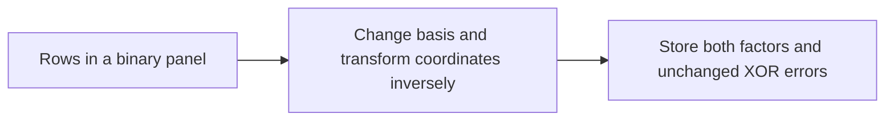
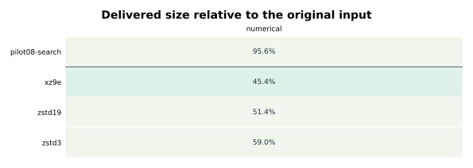

# Experiment 08 · Equivalent matrix factors and error masks

[Method diagram](#method-diagram) · [Charts and benchmark tables](#large-file-benchmark)

## Question and prior work

Can changing a GF(2) factor basis reduce the archive while preserving both the prediction and its exact error mask?

The matrix laboratory serializes U, V and E such that M = UV XOR E. The source thesis proposes the additional equivalent-basis comparison.

### Source files and compatibility

The original matrix encoding uses separate U, V and E streams. This experiment adds a two-dimensional change-of-basis search and checks the factor identity directly. Paths below are relative to the original workspace.

- `lab/hutter/divisors/q-correzioni-fattori/encoder-cofattori/cmix-neif-2.0/griglie-intere/encoding-matrici/RISULTATI.md`
- `lab/hutter/divisors/q-correzioni-fattori/encoder-cofattori/cmix-neif-2.0/griglie-intere/encoding-matrici/matrici.py`

## Run the experiment

Run from this folder on Linux with Python 3.10 or newer and the Zstd CLI. The codec writes new output files. Choose a fresh directory for each benchmark run.

```sh
python3 ../../lab.py 08 test
python3 ../../lab.py 08 encode ../../fixtures/medical.bin sample.lcx
python3 ../../lab.py 08 decode sample.lcx sample.restored
cmp ../../fixtures/medical.bin sample.restored
python3 ../../lab.py 08 benchmark ../../runs/recheck-08
```

## Variants and format

Treat 16 rows of eight bits as a matrix. Greedily choose two basis vectors from observed rows to reduce residual Hamming weight. For each row choose the nearest of four products. Test the initial basis, swaps, elementary XOR, and a search over the six invertible two-coordinate basis transforms. Apply the corresponding inverse operation to the coordinates. Serialize both coordinate columns and both basis rows as varints, and DEFLATE the unchanged E stream. Metadata gives the U and V lengths. Actual U, V and E bytes are recorded separately.

The [codec](codec.py) defines the profiles in wire order. Pass a profile name with `encode --profile NAME`. The [benchmark protocol](../../PROTOCOL.md) specifies the common archive header, byte accounting and decoder delivery convention.

### Method diagram



**Mechanism and test.** Equivalent bases reconstruct the same panel and preserve the error mask. Any size change at fixed residual comes from representing the factor coordinates and basis rows.

## Inputs and measurement

Construct rank-two matrices with two independent rows, then add four errors in isolated cells, a burst or a single row. Evaluate the same predictors on fax and medical-image bytes.

The factor budget is two columns. Degenerate inputs can use fewer independent vectors. Initial factors are fitted from observed rows, so the resulting E need not equal the planted noise.

The [benchmark driver](benchmark.py) freezes the corpus construction. The same seeded uniform control has the first planted input's length. Every profile runs once per file in a fresh worker. [Fixture provenance](../../fixtures/README.md).

## Results

The full equivalent-basis search reduced the isolated-error archive from 281 to 276 bytes with the same residual.

| Input | Raw bytes | Smallest profile (first on ties) | Archive bytes | Zstd bytes |
|---|---:|---|---:|---:|
| isolated | 384 | search | 276 | 386 |
| uniform | 384 | search | 559 | 397 |
| burst | 384 | search | 272 | 363 |
| one-row | 384 | search | 286 | 347 |
| fax.bin | 512 | initial | 157 | 22 |
| fax-mid.bin | 512 | initial | 195 | 80 |
| medical.bin | 512 | xor | 283 | 137 |

All 28 profile archives decoded byte for byte. The [trial measurements](results/reference/trials.csv) give timings, peak RSS, metadata, bundle bytes and method details. The [full comparison](results/reference/comparison.csv) includes every profile and both baselines. [Environment and source hashes](results/reference/environment.json).

### Factor and error bytes on the isolated-error control

| Basis search | Coordinate columns U | Basis rows V | Mask E |
|---|---:|---:|---:|
| initial | 124 | 73 | 70 |
| swap | 124 | 73 | 70 |
| xor | 123 | 72 | 70 |
| search | 121 | 71 | 70 |


## Large-file benchmark

On `numerical` (25,696,748 raw bytes), `pilot08-search` produced 24,565,555 archive bytes. Zstandard level 3 used 15,163,683 bytes on the same input. [Input and timing](../../research/large-scale/results/by-dataset.md#numerical) · [All project measurements](../../research/large-scale/results/by-experiment.md#08-equivalent-factors)

<!-- BEGIN generated project measurements -->

Each archive passed a byte-for-byte round trip. Bytes saved subtracts the archive and any required reference from the raw input size. Timings are seconds from one run.

On the primary input `numerical`, `pilot08-search` delivers 24,565,555 bytes, 9,401,872 bytes larger than standalone Zstandard 3 (15,163,683 bytes).

### Archive comparison across inputs



Read down a column to compare methods on identical input. Lower is better. 100% is the raw file size. Where available, standard codecs appear below the dividing line. Near 100%, cells give the exact byte difference from raw (+ means larger). Below 0.1%, they give the exact delivered total. A dash means the combination was unmeasured.

This project's published large-file trials measure complete archives. The effect on gzip, Zstandard or XZ after an isolated preprocessing step is unmeasured here.

### numerical · 25,696,748 raw bytes

**Standalone archives**

| Profile | Archive bytes | Bytes saved vs raw | Encode (s) | Decode (s) |
|---|---:|---:|---:|---:|
| `pilot08-search` | 24,565,555 | +1,131,193 | 800.557 | 29.549 |

Same-input baseline archives (bytes) · XZ 9 extreme 11,662,476 · Zstandard 19 13,213,336 · Zstandard 3 15,163,683

[Input hash and all measured codecs](../../research/large-scale/results/by-dataset.md#numerical)

### Reproduce the large-file comparison

From the repository root, with the pinned inputs and project dependencies installed, replay all published standalone profiles for this folder into a fresh directory.

```sh
python3 research/large-scale/primary.py runs/replay-08-equivalent-factors --project 08-equivalent-factors --all-profiles
```

[Dataset preparation](../../research/large-scale/README.md#inputs) · [Archive hashes and settings](../../research/large-scale/results/archives.jsonl)

<!-- END generated project measurements -->

## Connections

Experiment 07 compresses factors recursively. Experiment 14 benchmarks the actual residual masks produced here.
