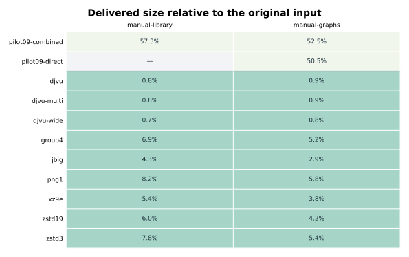

# Experiment 09 · Walsh–Hadamard prediction and bit planes

[Method diagram](#method-diagram) · [Charts and benchmark tables](#large-file-benchmark)

## Question and prior work

Do bit planes and sparse Walsh–Hadamard coefficients produce a better binary prediction once coefficient and residual bytes are counted?

The original hunt program identifies large Walsh coefficients and estimates the cost of correcting discordant bits. This experiment serializes the prediction and its inverse.

### Source files and compatibility

The spectral family in the C++ search supplies the signed Walsh predictor. The new wire format retains each coefficient and its exact correction. Paths below are relative to the original workspace.

- `lab/arena/hunt.cpp`

## Run the experiment

Run from this folder on Linux with Python 3.10 or newer and the Zstd CLI. The codec writes new output files. Choose a fresh directory for each benchmark run.

```sh
python3 ../../lab.py 09 test
python3 ../../lab.py 09 encode ../../fixtures/medical.bin sample.lcx
python3 ../../lab.py 09 decode sample.lcx sample.restored
cmp ../../fixtures/medical.bin sample.restored
python3 ../../lab.py 09 benchmark ../../runs/recheck-09
```

## Variants and format

Split into 32-byte blocks and optionally transpose to bit-plane order. Map bits to signed amplitudes, zero-pad to a power of two, and apply the fast Walsh–Hadamard transform. Try 0, 1, 2, 4 or 8 retained coefficients by actual record size. Transmit each coefficient index and ZigZag amplitude. Threshold the inverse transform and DEFLATE the exact XOR mask. All four profiles use the same residual backend and framing. The decoder reverses the plane layout after applying residuals.

The [codec](codec.py) defines the profiles in wire order. Pass a profile name with `encode --profile NAME`. The [benchmark protocol](../../PROTOCOL.md) specifies the common archive header, byte accounting and decoder delivery convention.

### Method diagram


**Mechanism and test.** A few coefficients can describe extensive regular patterns. Precision is recovered through the mask, whose size can exceed the avoided literals. Compare plane-only and predictor-only profiles to isolate the source of a change.

## Inputs and measurement

Use a periodic binary signal with 0, 16 or 128 flipped positions, plus fax masks and quantized medical-image bytes. A separate positive control contains exact Walsh basis signals. Trial details count how often each coefficient count is selected.

Each block starts a fresh DEFLATE stream. Its framing overhead is especially visible on the short real samples.

The [benchmark driver](benchmark.py) freezes the corpus construction. The same seeded uniform control has the first planted input's length. Every profile runs once per file in a fresh worker. [Fixture provenance](../../fixtures/README.md).

## Results

On the noiseless periodic control, plane separation reduced 284 bytes to 220. Adding spectral prediction produced the same size, while whole-file Zstd used 24 bytes. On the additional Walsh-basis positive control, the combined predictor used 276 bytes, three fewer than the better single component.

| Input | Raw bytes | Smallest profile (first on ties) | Archive bytes | Zstd bytes |
|---|---:|---|---:|---:|
| periodic-noise0 | 512 | planes | 220 | 24 |
| uniform | 512 | direct | 716 | 525 |
| periodic-noise16 | 512 | planes | 272 | 97 |
| periodic-noise128 | 512 | planes | 481 | 238 |
| planted-Walsh-basis | 512 | combined | 276 | 173 |
| fax.bin | 512 | direct | 220 | 22 |
| fax-mid.bin | 512 | direct | 310 | 80 |
| medical.bin | 512 | planes | 333 | 137 |

All 32 profile archives decoded byte for byte. The [trial measurements](results/reference/trials.csv) give timings, peak RSS, metadata, bundle bytes and method details. The [full comparison](results/reference/comparison.csv) includes every profile and both baselines. [Environment and source hashes](results/reference/environment.json).


## Large-file benchmark

On `manual-library` (24,283,584 raw bytes), `pilot09-combined` produced 13,922,627 archive bytes. Zstandard level 3 used 1,903,366 bytes on the same input. [Input and timing](../../research/large-scale/results/by-dataset.md#manual-library) · [All project measurements](../../research/large-scale/results/by-experiment.md#09-walsh-bitplanes)

<!-- BEGIN generated project measurements -->

Each archive passed a byte-for-byte round trip. Bytes saved subtracts the archive and any required reference from the raw input size. Timings are seconds from one run.

On the primary input `manual-library`, `pilot09-combined` delivers 13,922,627 bytes, 12,019,261 bytes larger than standalone Zstandard 3 (1,903,366 bytes).

Holding `pilot09-combined` fixed across the 2 measured input/reference settings with a standalone Zstandard 3 control gives **0 smaller, 0 equal and 2 larger** delivered archives. Each setting counts once.

### Archive comparison across inputs



Read down a column to compare methods on identical input. Lower is better. 100% is the raw file size. Where available, standard codecs appear below the dividing line. Near 100%, cells give the exact byte difference from raw (+ means larger). Below 0.1%, they give the exact delivered total. A dash means the combination was unmeasured.

This project's published large-file trials measure complete archives. The effect on gzip, Zstandard or XZ after an isolated preprocessing step is unmeasured here.

### manual-library · 24,283,584 raw bytes

**Standalone archives**

| Profile | Archive bytes | Bytes saved vs raw | Encode (s) | Decode (s) | Peak KiB (encode / decode) |
|---|---:|---:|---:|---:|---:|
| `pilot09-combined` | 13,922,627 | +10,360,957 | 1254.920 | 268.980 | 24,712 / 23,596 |

Same-input baseline archives (bytes) · DjVu 202,780 · DjVu (separated foreground) 202,666 · DjVu (wide strips) 175,164 · CCITT Group 4 1,678,602 · JBIG 1,049,864 · 1-bit PNG 1,996,848 · XZ 9 extreme 1,304,420 · Zstandard 19 1,457,017 · Zstandard 3 1,903,366

[Input hash and all measured codecs](../../research/large-scale/results/by-dataset.md#manual-library)

### manual-graphs · 24,642,792 raw bytes

**Standalone archives**

| Profile | Archive bytes | Bytes saved vs raw | Encode (s) | Decode (s) | Peak KiB (encode / decode) |
|---|---:|---:|---:|---:|---:|
| `pilot09-combined` | 12,936,974 | +11,705,818 | 424.479 | 123.117 | 24,808 / 23,620 |
| `pilot09-direct` | 12,437,412 | +12,205,380 | 43.868 | 33.618 | 24,680 / 23,352 |

Same-input baseline archives (bytes) · DjVu 214,067 · DjVu (separated foreground) 213,732 · DjVu (wide strips) 191,132 · CCITT Group 4 1,270,850 · JBIG 707,797 · 1-bit PNG 1,418,635 · XZ 9 extreme 930,864 · Zstandard 19 1,034,431 · Zstandard 3 1,325,134

[Input hash and all measured codecs](../../research/large-scale/results/by-dataset.md#manual-graphs)

### Reproduce the large-file comparison

From the repository root, with the pinned inputs and project dependencies installed, replay all published standalone profiles for this folder into a fresh directory.

```sh
python3 research/large-scale/primary.py runs/replay-09-walsh-bitplanes --project 09-walsh-bitplanes --all-profiles
```

[Dataset preparation](../../research/large-scale/README.md#inputs) · [Archive hashes and settings](../../research/large-scale/results/archives.jsonl)

<!-- END generated project measurements -->

## Connections

Experiment 08 offers a low-rank predictor. Experiment 14 compares the residuals obtained from both predictors.
