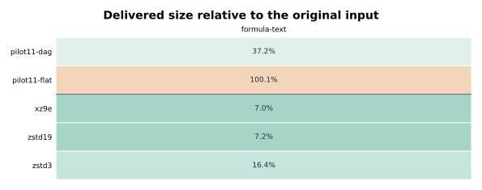
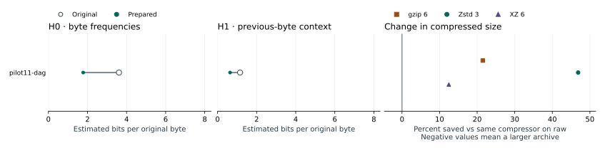

# Experiment 11 · Grammars and shared subexpressions

[Method diagram](#method-diagram) · [Charts and benchmark tables](#large-file-benchmark)

## Question and prior work

How often must an instruction or subexpression recur before a grammar definition pays for itself?

Statico M1 defines grammar symbols on first use and refers to them by frequency class and index. This study compares sequence and expression-aware sharing with a common literal alphabet.

### Source files and compatibility

The GLZ reference supplies the definition-before-reference grammar principle. The new byte-token format enables flat, pair-rule and expression-DAG comparisons. Paths below are relative to the original workspace.

- `statico/src/glz.hpp`

## Run the experiment

Run from this folder on Linux with Python 3.10 or newer and the Zstd CLI. The codec writes new output files. Choose a fresh directory for each benchmark run.

```sh
python3 ../../lab.py 11 test
python3 ../../lab.py 11 encode ../../fixtures/grammar-1061fc7.txt sample.lcx
python3 ../../lab.py 11 decode sample.lcx sample.restored
cmp ../../fixtures/grammar-1061fc7.txt sample.restored
python3 ../../lab.py 11 benchmark ../../runs/recheck-11
```

## Variants and format

Flat emits byte tokens. Grammar replaces frequent adjacent token pairs when measured savings exceed a definition. DAG discovers repeated balanced parenthesized expressions, processing nested definitions before parents. Both serialize a rule count, lengths and token bodies, followed by a root token stream. The first 126 rules have one-byte references. High-byte literals use an escape. Every profile uses the same literal representation. The decoder expands only references to previously defined rules.

The [codec](codec.py) defines the profiles in wire order. Pass a profile name with `encode --profile NAME`. The [benchmark protocol](../../PROTOCOL.md) specifies the common archive header, byte accounting and decoder delivery convention.

### Method diagram


**Mechanism and test.** Reuse repays the first definition only after sufficient repetition. The flat stream controls for token escaping. An expression DAG and a sequence grammar expose different kinds of repetition in the same input.

## Inputs and measurement

Sweep one through sixteen copies of a parenthesized expression, plus a sequence of distinct bytes. Render actual affine instructions as expression strings for two further tests. Each measured decoder runs a second time in a fresh process for its own peak RSS measurement.

Subtrees are recognized by their exact byte spelling. The sequence parser is greedy and considers its most frequent pair at each round. Rule storage in bytes and process RSS are reported separately.

The [benchmark driver](benchmark.py) freezes the corpus construction. The same seeded uniform control has the first planted input's length. Every profile runs once per file in a fresh worker. [Fixture provenance](../../fixtures/README.md).

## Results

One full expression already contains two copies of its inner subtree. DAG beat flat on that first input, and two full expressions were the first tested case where its 28-byte archive also beat the 31-byte source.

| Input | Raw bytes | Smallest profile (first on ties) | Archive bytes | Zstd bytes |
|---|---:|---|---:|---:|
| reuse-1 | 15 | dag | 24 | 28 |
| uniform | 15 | flat | 32 | 28 |
| reuse-2 | 31 | dag | 28 | 31 |
| reuse-3 | 47 | dag | 30 | 31 |
| reuse-4 | 63 | dag | 32 | 32 |
| reuse-8 | 127 | dag | 40 | 32 |
| reuse-16 | 255 | grammar | 55 | 32 |
| distinct | 128 | flat | 141 | 141 |
| affine-0.bin-expressions | 1,727 | grammar | 367 | 307 |
| affine-1.bin-expressions | 1,731 | grammar | 362 | 314 |

All 30 profile archives decoded byte for byte. The [trial measurements](results/reference/trials.csv) give timings, peak RSS, metadata, bundle bytes and method details. The [full comparison](results/reference/comparison.csv) includes every profile and both baselines. [Environment and source hashes](results/reference/environment.json).


## Large-file benchmark

On `formula-text` (25,165,824 raw bytes), `pilot11-dag` produced 9,357,678 archive bytes. Zstandard level 3 used 4,118,041 bytes on the same input. [Input and timing](../../research/large-scale/results/by-dataset.md#formula-text) · [All project measurements](../../research/large-scale/results/by-experiment.md#11-shared-subexpressions)

<!-- BEGIN generated project measurements -->

Each archive passed a byte-for-byte round trip. Bytes saved subtracts the archive and any required reference from the raw input size. Timings are seconds from one run.

On the primary input `formula-text`, `pilot11-dag` delivers 9,357,678 bytes, 5,239,637 bytes larger than standalone Zstandard 3 (4,118,041 bytes).

### Archive comparison across inputs



Read down a column to compare methods on identical input. Lower is better. 100% is the raw file size. Where available, standard codecs appear below the dividing line. Near 100%, cells give the exact byte difference from raw (+ means larger). Below 0.1%, they give the exact delivered total. A dash means the combination was unmeasured.

The paired figures below measure preprocessing separately. H0 measures byte frequencies. H1 conditions on the previous byte. The tables give both in bits per byte of their own stream. The figures express model costs per original byte. H0 counts every byte. H1 counts each adjacent pair, omitting the first byte’s marginal cost. Positive compressor savings mean a smaller compressed file.

### formula-text · 25,165,824 raw bytes



Of 1 measured profiles on this input, 1 reduced gzip size, 1 reduced Zstandard size and 1 reduced XZ size. Exact ties count separately from improvements.

**Entropy before and after preprocessing**

| Profile | Prepared bytes | H0 before → after | H1 before → after | Post H0 per raw byte |
|---|---:|---:|---:|---:|
| `pilot11-dag` | 9,357,678 | 3.6110 → 4.7847 | 1.1528 → 1.7253 | 1.7791 |

**Same compressor on original → prepared bytes**

| Profile | gzip 6 | Zstandard 3 | XZ 6 |
|---|---:|---:|---:|
| `pilot11-dag` | 2,958,719 → 2,322,775 (+21.49%) | 4,118,040 → 2,187,854 (+46.87%) | 1,856,404 → 1,625,172 (+12.46%) |

**Standalone archives**

| Profile | Archive bytes | Bytes saved vs raw | Encode (s) | Decode (s) | Peak KiB (encode / decode) |
|---|---:|---:|---:|---:|---:|
| `pilot11-dag` | 9,357,678 | +15,808,146 | 409.926 | 6.981 | — / — |
| `pilot11-flat` | 25,179,662 | -13,838 | 23.571 | 51.652 | 24,920 / 23,468 |

Same-input baseline archives (bytes) · XZ 9 extreme 1,773,272 · Zstandard 19 1,807,329 · Zstandard 3 4,118,041

[Input hash and all measured codecs](../../research/large-scale/results/by-dataset.md#formula-text)

### Reproduce the large-file comparison

From the repository root, with the pinned inputs and project dependencies installed, replay all published standalone profiles for this folder into a fresh directory.

```sh
python3 research/large-scale/primary.py runs/replay-11-shared-subexpressions --project 11-shared-subexpressions --all-profiles
```

[Dataset preparation](../../research/large-scale/README.md#inputs) · [Archive hashes and settings](../../research/large-scale/results/archives.jsonl)

A separate paired run also records entropy, stream hashes and the three backend sizes.

```sh
mkdir -p runs/paired
python3 research/large-scale/entropy_bench.py pilot11-dag runs/large/raw/formula-text runs/paired/11-shared-subexpressions.json
```

[All paired stream hashes and compressor versions](../../research/large-scale/results/preprocessing.jsonl)

<!-- END generated project measurements -->

## Connections

Experiment 10 provides the real operator stream. Experiment 04 offers repeated coefficient groups.
