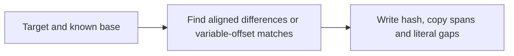
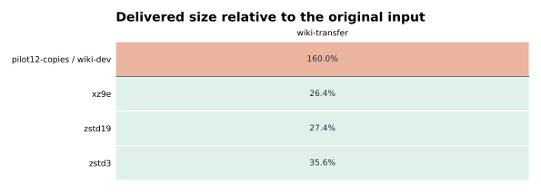

# Experiment 12 · Relative compression

[Method diagram](#method-diagram) · [Charts and benchmark tables](#large-file-benchmark)

## Question and prior work

How do fixed offsets, movable copies and insertion/deletion alignment compare when the recipient already has a related file?

The prior specialized patch for a 4,042,564-byte executable occupied 114,095 bytes with its required reference available to the decoder.

### Source files and compatibility

The specialized reference patch and its measurement motivate the shared-base cost model. The three portable patch builders are independent implementations. Paths below are relative to the original workspace.

- `lab/hutter/divisors/neif-2-condiviso/ricorsivi/esperimenti-per-struttura/comp9.json`
- `lab/hutter/divisors/neif-2-condiviso/ricorsivi/esperimenti-per-struttura/compagno.py`

## Run the experiment

Run from this folder on Linux with Python 3.10 or newer and the Zstd CLI. The codec writes new output files. Choose a fresh directory for each benchmark run.

```sh
python3 ../../lab.py 12 test
python3 ../../lab.py 12 encode ../../fixtures/logo-new.png sample.lcx --reference ../../fixtures/logo-old.png
python3 ../../lab.py 12 decode sample.lcx sample.restored --reference ../../fixtures/logo-old.png
cmp ../../fixtures/logo-new.png sample.restored
python3 ../../lab.py 12 benchmark ../../runs/recheck-12
```

## Variants and format

Every archive stores the reference SHA-256. Fixed XOR predicts the target from the same base offset with zero extension. Copies indexes four-byte prefixes and extends variable-offset matches. Alignment recursively finds common matching blocks with SequenceMatcher. Both matching profiles send literal-gap length, base offset and copy length for every retained span. Compress the residual or literal stream with the same DEFLATE backend. The decoder validates the base hash before applying instructions.

The [codec](codec.py) defines the profiles in wire order. Pass a profile name with `encode --profile NAME`. The [benchmark protocol](../../PROTOCOL.md) specifies the common archive header, byte accounting and decoder delivery convention.

### Method diagram



**Mechanism and test.** Moved content remains reusable if offsets travel with copy lengths. Compare patch bytes for a receiver holding the base and total delivery for a new receiver. A disjoint base can cost more to deliver than the target.

## Inputs and measurement

Test known insertions of 1, 16 and 64 bytes and a moved region. Real version pairs use actual Statico source revisions and two packaged Debian logo images. Apply an additional known insertion to each real target. The input and base hashes are recorded independently.

Archive bytes measure an update for an existing recipient. The comparison CSV also gives raw base plus patch for a new recipient, and bundle bytes include the base and decoder. The alignment heuristic uses matching blocks and does not optimize a general edit-distance objective.

The [benchmark driver](benchmark.py) freezes the corpus construction. The same seeded uniform control has the first planted input's length. Every profile runs once per file in a fresh worker. [Fixture provenance](../../fixtures/README.md).

## Results

One inserted byte produced a 62-byte update for a 513-byte target. Delivering the 512-byte base as well raised the cost to 574 bytes.

| Input | Raw bytes | Smallest profile (first on ties) | Archive bytes | Zstd bytes |
|---|---:|---|---:|---:|
| insert-1 | 513 | copies | 62 | 526 |
| uniform | 513 | fixed-xor | 568 | 526 |
| insert-16 | 528 | copies | 77 | 541 |
| insert-64 | 576 | copies | 128 | 589 |
| moved-region | 512 | copies | 61 | 525 |
| source-revisions | 967 | copies | 196 | 526 |
| source-revisions-insert16 | 983 | copies | 228 | 563 |
| logo-revisions | 1,678 | copies | 1,704 | 1,691 |
| logo-revisions-insert16 | 1,694 | copies | 1,723 | 1,707 |

All 27 profile archives decoded byte for byte. The [trial measurements](results/reference/trials.csv) give timings, peak RSS, metadata, bundle bytes and method details. The [full comparison](results/reference/comparison.csv) includes every profile and both baselines. [Environment and source hashes](results/reference/environment.json).


## Large-file benchmark

On `wiki-transfer` (25,165,824 raw bytes), `pilot12-copies` produced 15,112,062 archive bytes. Delivering the required reference as well costs 40,277,886 bytes. Zstandard level 3 used 8,968,456 bytes on the same input. [Input and timing](../../research/large-scale/results/by-dataset.md#wiki-transfer) · [All project measurements](../../research/large-scale/results/by-experiment.md#12-relative-patches)

<!-- BEGIN generated project measurements -->

Each archive passed a byte-for-byte round trip. Bytes saved subtracts the archive and any required reference from the raw input size. Timings are seconds from one run.

On the primary input `wiki-transfer`, `pilot12-copies` with candidate base `wiki-dev` delivers 40,277,886 bytes, 31,309,430 bytes larger than standalone Zstandard 3 (8,968,456 bytes).

### Archive comparison across inputs



Read down a column to compare methods on identical input. Lower is better. 100% is the raw file size. Where available, standard codecs appear below the dividing line. Near 100%, cells give the exact byte difference from raw (+ means larger). Below 0.1%, they give the exact delivered total. A dash means the combination was unmeasured.

This project's published large-file trials measure complete archives. The effect on gzip, Zstandard or XZ after an isolated preprocessing step is unmeasured here.

### wiki-transfer · 25,165,824 raw bytes

**Standalone archives**

| Profile | Archive bytes | Archive + required reference (bytes) | Bytes saved vs raw | Encode (s) | Decode (s) |
|---|---:|---:|---:|---:|---:|
| `pilot12-copies` (base `wiki-dev`) | 15,112,062 | 40,277,886 | -15,112,062 | 81.211 | 9.750 |

Same-input baseline archives (bytes) · XZ 9 extreme 6,637,336 · Zstandard 19 6,891,038 · Zstandard 3 8,968,456

[Input hash and all measured codecs](../../research/large-scale/results/by-dataset.md#wiki-transfer)

### Reproduce the large-file comparison

From the repository root, with the pinned inputs and project dependencies installed, replay all published standalone profiles for this folder into a fresh directory.

```sh
python3 research/large-scale/primary.py runs/replay-12-relative-patches --project 12-relative-patches --all-profiles
```

[Dataset preparation](../../research/large-scale/README.md#inputs) · [Archive hashes and settings](../../research/large-scale/results/archives.jsonl)

<!-- END generated project measurements -->

## Connections

Experiment 14 tests exceptions from the logo alignment. Experiments 15 and 16 can supply or choose a generated alternative.
