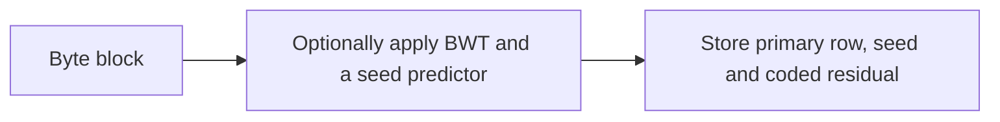
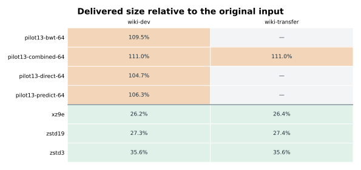

# Experiment 13 · Burrows–Wheeler transform and prediction

> **Verdict: loses on real data.** Best real input: Wikipedia text, 24 MiB, 4.0× larger vs xz -9e.
>
> Part of [chapter 3](../../report/3-reshaping.md) of the [report](../../report/README.md). Terms: [glossary](../../report/glossary.md).

## Question

Does the Burrows–Wheeler transform (the reordering used by bzip2) make the data easier for a generator or a residual coder to predict?

## How it works



The same predictors and the same residual coder run on the original bytes and on their BWT, so the effect of the reordering is isolated.

<details><summary>Technical details</summary>

Does the Burrows–Wheeler transform help a generator, the residual coder, or both?

The source compares seeded xorshift, linear congruential and cellular generators on direct and transformed archive windows, retaining the BWT primary row for inversion.

**Mechanism and test.** Reordering can expose adjacent contexts even when symbol counts stay fixed. Tiny blocks limit the context and pay framing repeatedly. Compare BWT, prediction and the combination at the same block width.

Cross BWT off/on with seed prediction off/on at block widths 16 and 64. Use the original sorted-rotation BWT construction and a stable LF-mapping inverse. Predict bytes in the chosen representation with eight LCG and eight xorshift seeds plus a zero predictor. Transmit a primary row and seed index when enabled. Compress every XOR residual with the same DEFLATE configuration and record its length.

The [codec](codec.py) defines the profiles in wire order. Pass a profile name with `encode --profile NAME`. The [benchmark protocol](../../PROTOCOL.md) specifies the common archive header, byte accounting and decoder delivery convention.

</details>

## Results on 20 MiB inputs

Every archive below decoded byte-exact. *Our archive* is this project's own format. *Our transform → standard tool* reshapes the bytes reversibly and hands the result to gzip, zstd or xz; it is listed only where it beats that same tool on the raw bytes. *Best standard tool* is the smallest of gzip, bzip2, xz, Zstandard, Brotli and PPMd (plus domain codecs for images, scans and video) on the raw bytes. *Difference* compares the better of our two columns with it; negative = ours is smaller.

| Input | Kind | Raw bytes | Our archive | Our transform → standard tool | Best standard tool | Difference |
|---|---|---:|---:|---:|---:|---:|
| Wikipedia text, 24 MiB | real | 25,165,824 | 26,350,492 (`pilot13-direct-64`) | — | 6,602,488 (xz -9e) | 4.0× larger |
| Wikipedia text, another 24 MiB | real | 25,165,824 | 27,922,396 (`pilot13-combined-64`) | — | 6,637,336 (xz -9e) | 4.2× larger |

<details><summary>All profiles, timings and entropy measurements</summary>

<!-- BEGIN generated project measurements -->

Each archive passed a byte-for-byte round trip. *Bytes saved* is raw size minus archive (and any reference the decoder needs). Timings are one run on a shared desktop.

These tables list every measured profile. The comparison with the best standard tool on each input (gzip, bzip2, xz, Zstandard, Brotli, PPMd and the domain codecs) is the Results table above.

### Archive comparison across inputs



Read down a column to compare methods on identical input. Lower is better. 100% is the raw file size. Where available, standard codecs appear below the dividing line. Near 100%, cells give the exact byte difference from raw (+ means larger). Below 0.1%, they give the exact delivered total. A dash means the combination was unmeasured.

This project's published large-file trials measure complete archives. The effect on gzip, Zstandard or XZ after an isolated preprocessing step is unmeasured here.

### wiki-dev · 25,165,824 raw bytes

**Standalone archives**

| Profile | Archive bytes | Bytes saved vs raw | Encode (s) | Decode (s) | Peak KiB (encode / decode) |
|---|---:|---:|---:|---:|---:|
| `pilot13-bwt-64` | 27,549,525 | -2,383,701 | 59.842 | 28.358 | 24,800 / 23,648 |
| `pilot13-combined-64` | 27,942,709 | -2,776,885 | 327.933 | 49.380 | 24,944 / 23,460 |
| `pilot13-direct-64` | 26,350,492 | -1,184,668 | 25.226 | 13.886 | 24,800 / 23,500 |
| `pilot13-predict-64` | 26,743,690 | -1,577,866 | 275.703 | 4.001 | 25,044 / 23,624 |

Same-input baseline archives (bytes) · XZ 9 extreme 6,602,488 · Zstandard 19 6,873,848 · Zstandard 3 8,951,574

[Input hash and all measured codecs](../../research/large-scale/results/by-dataset.md#wiki-dev)

### wiki-transfer · 25,165,824 raw bytes

**Standalone archives**

| Profile | Archive bytes | Bytes saved vs raw | Encode (s) | Decode (s) |
|---|---:|---:|---:|---:|
| `pilot13-combined-64` | 27,922,396 | -2,756,572 | 468.435 | 26.139 |

Same-input baseline archives (bytes) · XZ 9 extreme 6,637,336 · Zstandard 19 6,891,038 · Zstandard 3 8,968,456

[Input hash and all measured codecs](../../research/large-scale/results/by-dataset.md#wiki-transfer)

### Reproduce the large-file comparison

From the repository root, with the pinned inputs and project dependencies installed, replay all published standalone profiles for this folder into a fresh directory.

```sh
python3 research/large-scale/primary.py runs/replay-13-bwt-prediction --project 13-bwt-prediction --all-profiles
```

[Dataset preparation](../../research/large-scale/README.md#inputs) · [Archive hashes and settings](../../research/large-scale/results/archives.jsonl)

<!-- END generated project measurements -->

</details>

## Small-scale results

Test planted LCG outputs, ordered records and a shuffled permutation of the same records, plus actual bytecode streams from two lab programs.

Seed search minimizes each block’s compressed residual length. Primary-row and selector widths are constant within a profile and are present in the final comparison. Every block pays for a fresh stream.

The [benchmark driver](benchmark.py) freezes the corpus construction. The same seeded uniform control has the first planted input's length. Every profile runs once per file in a fresh worker. [Fixture provenance](../../fixtures/README.md).

On the planted LCG stream, the 16-byte direct predictor used 428 bytes and the transformed predictor used 876. The per-profile byte counts expose the cost of fitting the same generator family after reordering.

| Input | Raw bytes | Smallest profile (first on ties) | Archive bytes | Zstd bytes |
|---|---:|---|---:|---:|
| lcg-seeds | 512 | predict-16 | 428 | 150 |
| uniform | 512 | direct-64 | 620 | 525 |
| ordered-records | 512 | direct-64 | 252 | 140 |
| shuffled-records | 512 | direct-64 | 287 | 186 |
| bytecode-bwt.bin | 512 | direct-64 | 337 | 212 |
| bytecode-base.bin | 512 | direct-64 | 376 | 243 |

All 48 profile archives decoded byte for byte. The [trial measurements](results/reference/trials.csv) give timings, peak RSS, metadata, bundle bytes and method details. The [full comparison](results/reference/comparison.csv) includes every profile and both baselines. [Environment and source hashes](results/reference/environment.json).

## Run it

Run from this folder on Linux with Python 3.10 or newer and the Zstd CLI. The codec writes new output files. Choose a fresh directory for each benchmark run.

```sh
python3 ../../lab.py 13 test
python3 ../../lab.py 13 encode ../../fixtures/bytecode-bwt.bin sample.lcx
python3 ../../lab.py 13 decode sample.lcx sample.restored
cmp ../../fixtures/bytecode-bwt.bin sample.restored
python3 ../../lab.py 13 benchmark ../../runs/recheck-13
```

## Provenance

<details><summary>Where this code came from</summary>

The encoded rotation order and primary row are taken from the local BWT prototype. The implementation includes two of its generator families and a stable LF inverse. Paths below are relative to the original workspace.

- `lab/arena/coincidence_bwt.py`

</details>
