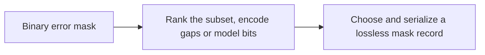
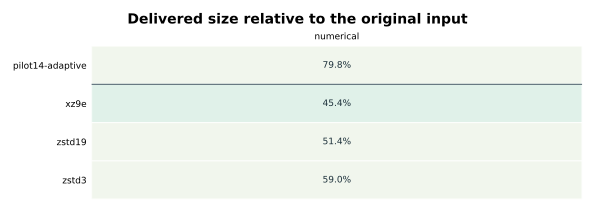

# Experiment 14 · Sparse residual coding

> **Verdict: loses on real data.** Best real input: Silesia numerical files (mr + x-ray + sao), +75.8% vs xz -9e.
>
> Part of [chapter 4](../../report/4-specialised.md) of the [report](../../report/README.md). Terms: [glossary](../../report/glossary.md).

## Question

When most of a correction is zero, what is the cheapest way to store the few wrong positions: an exact combinatorial rank, gaps between them, or a context model?

## How it works



The same sparse error masks are coded four ways, and a per-block selector picks the best.

<details><summary>Technical details</summary>

When does spatial error structure favor a combinatorial rank, gap code or adaptive context model?

The earlier internal-stream study measured 7,053 bytes for plane enumeration and 6,635 for its contextual KT2 model on 8,192 input bytes.

**Mechanism and test.** Weight, gap lengths and local bit context describe different structures. Sparse regular gaps favor different codes from dense correlated masks. Per-block switching must recover its selector and padding.

Use 32-byte blocks. Enumerative stores the weight and colexicographic subset rank. Rice optimizes the parameter k and encodes increasing error-position gaps. Context uses a 32-bit arithmetic coder with KT counts keyed by bit position and the preceding two bits. Adaptive chooses the shortest serialized option per block, including its selector, parameters, payload size and padding. All modes restore the mask exactly.

The [codec](codec.py) defines the profiles in wire order. Pass a profile name with `encode --profile NAME`. The [benchmark protocol](../../PROTOCOL.md) specifies the common archive header, byte accounting and decoder delivery convention.

</details>

## Results on 20 MiB inputs

Every archive below decoded byte-exact. *Our archive* is this project's own format. *Our transform → standard tool* reshapes the bytes reversibly and hands the result to gzip, zstd or xz; it is listed only where it beats that same tool on the raw bytes. *Best standard tool* is the smallest of gzip, bzip2, xz, Zstandard, Brotli and PPMd (plus domain codecs for images, scans and video) on the raw bytes. *Difference* compares the better of our two columns with it; negative = ours is smaller.

| Input | Kind | Raw bytes | Our archive | Our transform → standard tool | Best standard tool | Difference |
|---|---|---:|---:|---:|---:|---:|
| Silesia numerical files (mr + x-ray + sao) | real | 25,696,748 | 20,503,460 (`pilot14-adaptive`) | — | 11,662,476 (xz -9e) | +75.8% |

<details><summary>All profiles, timings and entropy measurements</summary>

<!-- BEGIN generated project measurements -->

Each archive passed a byte-for-byte round trip. *Bytes saved* is raw size minus archive (and any reference the decoder needs). Timings are one run on a shared desktop.

These tables list every measured profile. The comparison with the best standard tool on each input (gzip, bzip2, xz, Zstandard, Brotli, PPMd and the domain codecs) is the Results table above.

### Archive comparison across inputs



Read down a column to compare methods on identical input. Lower is better. 100% is the raw file size. Where available, standard codecs appear below the dividing line. Near 100%, cells give the exact byte difference from raw (+ means larger). Below 0.1%, they give the exact delivered total. A dash means the combination was unmeasured.

This project's published large-file trials measure complete archives. The effect on gzip, Zstandard or XZ after an isolated preprocessing step is unmeasured here.

### numerical · 25,696,748 raw bytes

**Standalone archives**

| Profile | Archive bytes | Bytes saved vs raw | Encode (s) | Decode (s) |
|---|---:|---:|---:|---:|
| `pilot14-adaptive` | 20,503,460 | +5,193,288 | 1340.134 | 876.104 |

Same-input baseline archives (bytes) · XZ 9 extreme 11,662,476 · Zstandard 19 13,213,336 · Zstandard 3 15,163,683

[Input hash and all measured codecs](../../research/large-scale/results/by-dataset.md#numerical)

### Reproduce the large-file comparison

From the repository root, with the pinned inputs and project dependencies installed, replay all published standalone profiles for this folder into a fresh directory.

```sh
python3 research/large-scale/primary.py runs/replay-14-sparse-residuals --project 14-sparse-residuals --all-profiles
```

[Dataset preparation](../../research/large-scale/README.md#inputs) · [Archive hashes and settings](../../research/large-scale/results/archives.jsonl)

<!-- END generated project measurements -->

</details>

## Small-scale results

Three 4,096-bit masks each contain exactly 128 errors distributed independently, in bursts or periodically by row. Real masks come from experiment 08 GF(2) errors, experiment 09 spectral residuals and experiment 12 aligned literal gaps. The driver calls their implementations on the frozen source fixtures.

The context implementation uses reconstructed prefix bits. It needs no free list-boundary side information. Each block starts with fresh counts. The trial details show which codes the adaptive profile selected.

The [benchmark driver](benchmark.py) freezes the corpus construction. The same seeded uniform control has the first planted input's length. Every profile runs once per file in a fresh worker. [Fixture provenance](../../fixtures/README.md).

At equal density, the isolated mask favored enumeration at 147 bytes and the clustered mask favored context coding at 119 bytes.

| Input | Raw bytes | Smallest profile (first on ties) | Archive bytes | Zstd bytes |
|---|---:|---|---:|---:|
| isolated | 512 | enumerative | 147 | 210 |
| uniform | 512 | enumerative | 567 | 525 |
| clustered | 512 | context | 119 | 76 |
| row-pattern | 512 | enumerative | 156 | 24 |
| fax.bin-GF2 | 512 | enumerative | 44 | 22 |
| fax.bin-Walsh | 512 | enumerative | 44 | 22 |
| fax-mid.bin-GF2 | 512 | enumerative | 44 | 22 |
| fax-mid.bin-Walsh | 512 | enumerative | 147 | 129 |
| medical.bin-GF2 | 512 | enumerative | 96 | 138 |
| medical.bin-Walsh | 512 | rice | 154 | 114 |
| aligned-logo-exceptions | 210 | adaptive | 50 | 29 |

All 44 profile archives decoded byte for byte. The [trial measurements](results/reference/trials.csv) give timings, peak RSS, metadata, bundle bytes and method details. The [full comparison](results/reference/comparison.csv) includes every profile and both baselines. [Environment and source hashes](results/reference/environment.json).

### Cost by error distribution at the same density

| Distribution | Enumerative | Rice | Context | Adaptive including selector |
|---|---:|---:|---:|---:|
| isolated | 147 | 165 | 194 | 163 |
| clustered | 141 | 143 | 119 | 120 |
| row-pattern | 156 | 156 | 156 | 172 |

## Run it

Run from this folder on Linux with Python 3.10 or newer and the Zstd CLI. The codec writes new output files. Choose a fresh directory for each benchmark run.

```sh
python3 ../../lab.py 14 test
python3 ../../lab.py 14 encode ../../fixtures/medical.bin sample.lcx
python3 ../../lab.py 14 decode sample.lcx sample.restored
cmp ../../fixtures/medical.bin sample.restored
python3 ../../lab.py 14 benchmark ../../runs/recheck-14
```

## Provenance

<details><summary>Where this code came from</summary>

The adaptive arithmetic update and KT count increments follow the predictor source. The new context uses local reconstructed bits and position. Paths below are relative to the original workspace.

- `lab/hutter/divisors/neif-2-condiviso/ricorsivi/esperimenti-per-struttura/margolus/misure.json`
- `lab/hutter/divisors/neif-2-condiviso/ricorsivi/esperimenti-per-struttura/predittori.py`
- `lab/hutter/divisors/neif-2-condiviso/ricorsivi/esperimenti-per-struttura/margolus/prova.py`

</details>
