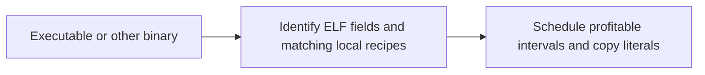
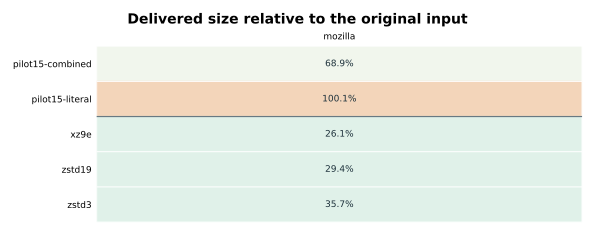

# Experiment 15 · Regenerating binary regions

> **Verdict: loses on real data.** Best real input: Silesia mozilla (Firefox binaries), 2.6× larger vs xz -9e.
>
> Part of [chapter 4](../../report/4-specialised.md) of the [report](../../report/README.md). Terms: [glossary](../../report/glossary.md).

## Question

Executables contain predictable parts (headers, tables, padding). Can a catalogue of generators recreate those parts of a real binary cheaply enough to pay for listing where they are?

## How it works



The encoder rebuilds ELF headers from the file's own structure and scans for local formula matches; everything else is stored literally.

<details><summary>Technical details</summary>

How much of a binary can a versioned generator catalog recreate after every interval and recipe is counted?

The earlier archive9 study regenerated 187 bytes in 18 intervals and saved 107 archive bytes with an external decoder. Part of its constants catalog had been selected after inspecting archive9.

**Mechanism and test.** A reproducible header saves bytes only at matching locations. Runs and backward copies can help other regions independently. The single-component profiles test whether ELF semantics add anything beyond local repetition.

Cross ELF header generation with local formula scanning. A little-endian ELF64 header is reconstructed from a fixed identification prefix and varint fields. Use the original integer square-root/FNV constant catalog, repeated-byte runs and backward copies for the remaining regions. Weighted interval scheduling maximizes saved bytes with absolute positions, widths, tags, recipe lengths and parameters included. Uncovered bytes stay literal. The decoder regenerates each interval in output order.

The [codec](codec.py) defines the profiles in wire order. Pass a profile name with `encode --profile NAME`. The [benchmark protocol](../../PROTOCOL.md) specifies the common archive header, byte accounting and decoder delivery convention.

</details>

## Results on 20 MiB inputs

Every archive below decoded byte-exact. *Our archive* is this project's own format. *Our transform → standard tool* reshapes the bytes reversibly and hands the result to gzip, zstd or xz; it is listed only where it beats that same tool on the raw bytes. *Best standard tool* is the smallest of gzip, bzip2, xz, Zstandard, Brotli and PPMd (plus domain codecs for images, scans and video) on the raw bytes. *Difference* compares the better of our two columns with it; negative = ours is smaller.

| Input | Kind | Raw bytes | Our archive | Our transform → standard tool | Best standard tool | Difference |
|---|---|---:|---:|---:|---:|---:|
| Silesia mozilla (Firefox binaries) | real | 51,220,480 | 35,313,184 (`pilot15-combined`) | — | 13,376,240 (xz -9e) | 2.6× larger |

<details><summary>All profiles, timings and entropy measurements</summary>

<!-- BEGIN generated project measurements -->

Each archive passed a byte-for-byte round trip. *Bytes saved* is raw size minus archive (and any reference the decoder needs). Timings are one run on a shared desktop.

These tables list every measured profile. The comparison with the best standard tool on each input (gzip, bzip2, xz, Zstandard, Brotli, PPMd and the domain codecs) is the Results table above.

### Archive comparison across inputs



Read down a column to compare methods on identical input. Lower is better. 100% is the raw file size. Where available, standard codecs appear below the dividing line. Near 100%, cells give the exact byte difference from raw (+ means larger). Below 0.1%, they give the exact delivered total. A dash means the combination was unmeasured.

This project's published large-file trials measure complete archives. The effect on gzip, Zstandard or XZ after an isolated preprocessing step is unmeasured here.

### mozilla · 51,220,480 raw bytes

**Standalone archives**

| Profile | Archive bytes | Bytes saved vs raw | Encode (s) | Decode (s) | Peak KiB (encode / decode) |
|---|---:|---:|---:|---:|---:|
| `pilot15-combined` | 35,313,184 | +15,907,296 | 319.594 | 22.196 | — / — |
| `pilot15-literal` | 51,247,081 | -26,601 | 65.219 | 2.238 | 25,100 / 23,496 |

Same-input baseline archives (bytes) · XZ 9 extreme 13,376,240 · Zstandard 19 15,071,672 · Zstandard 3 18,281,292

[Input hash and all measured codecs](../../research/large-scale/results/by-dataset.md#mozilla)

### Reproduce the large-file comparison

From the repository root, with the pinned inputs and project dependencies installed, replay all published standalone profiles for this folder into a fresh directory.

```sh
python3 research/large-scale/primary.py runs/replay-15-binary-regions --project 15-binary-regions --all-profiles
```

[Dataset preparation](../../research/large-scale/README.md#inputs) · [Archive hashes and settings](../../research/large-scale/results/archives.jsonl)

<!-- END generated project measurements -->

</details>

## Small-scale results

The planted file contains a generated ELF header, indexed constants, runs and random gaps. Two complete held-out lab executables are the rusage wrapper with a GCC build comment and the repdigit scanner containing a Clang build comment. Treat both as byte strings. Family statistics give regenerated and record bytes. Subtract the latter for net savings.

The ELF rule applies only to the frozen identification prefix. The comparison targets two program builds. The collection CSV measures an executable Python package containing both archives and a single decoder and verifies both extracted files.

The [benchmark driver](benchmark.py) freezes the corpus construction. The same seeded uniform control has the first planted input's length. Every profile runs once per file in a fresh worker. [Fixture provenance](../../fixtures/README.md).

Across the two real executables, the combined profile used 18,900 archive bytes. The runnable package with one shared decoder used 26,330 bytes and decoded both files.

| Input | Raw bytes | Smallest profile (first on ties) | Archive bytes | Zstd bytes |
|---|---:|---|---:|---:|
| generated-header-and-regions | 640 | combined | 461 | 488 |
| uniform | 640 | literal | 652 | 653 |
| rusage.elf | 16,584 | combined | 5,984 | 3,294 |
| scanner.elf | 23,128 | combined | 12,916 | 7,647 |

All 16 profile archives decoded byte for byte. The [trial measurements](results/reference/trials.csv) give timings, peak RSS, metadata, bundle bytes and method details. The [full comparison](results/reference/comparison.csv) includes every profile and both baselines. [Environment and source hashes](results/reference/environment.json). [Collection delivery costs](results/reference/collection.csv).

## Run it

Run from this folder on Linux with Python 3.10 or newer and the Zstd CLI. The codec writes new output files. Choose a fresh directory for each benchmark run.

```sh
python3 ../../lab.py 15 test
python3 ../../lab.py 15 encode ../../fixtures/scanner.elf sample.lcx
python3 ../../lab.py 15 decode sample.lcx sample.restored
cmp ../../fixtures/scanner.elf sample.restored
python3 ../../lab.py 15 benchmark ../../runs/recheck-15
```

## Provenance

<details><summary>Where this code came from</summary>

The catalog ports the square-root and FNV constants. The ELF prototype motivates reconstruction by parameters. The new header profile also handles regular multi-segment executable headers without modeling program headers. Paths below are relative to the original workspace.

- `lab/hutter/catalogo-formule/RISULTATI.md`
- `lab/hutter/divisors/neif-2-condiviso/ricorsivi/esperimenti-per-struttura/elf64.py`
- `lab/hutter/catalogo-formule/formule.py`

</details>
