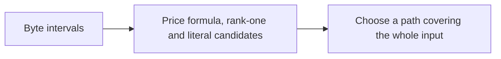
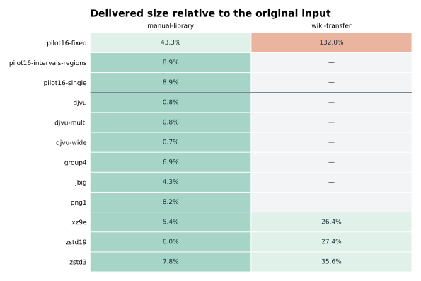

# Experiment 16 · Joint selection of compression methods

> **Verdict: loses on real data.** Best real input: Wikipedia text, another 24 MiB, 5.0× larger vs xz -9e.
>
> Part of [chapter 4](../../report/4-specialised.md) of the [report](../../report/README.md). Terms: [glossary](../../report/glossary.md).

## Question

Is it worth switching between methods inside one file (for example a formula here, a copy there), once every switch is paid for?

## How it works



The encoder compares one method for the whole file, a choice per fixed block, and a choice per variable interval found by dynamic programming.

<details><summary>Technical details</summary>

Does selecting a method at different offsets beat a single method once headers and model resets are fully priced?

The prior mixed archive combines generated blocks with compressed literals. The original formula scanner uses dynamic programming over competing intervals.

**Mechanism and test.** A method can help on one region while interrupting a productive compressed literal stream. Comparing fixed boundaries with variable intervals tests whether moving the cuts pays for restarts and tags.

Each candidate emits a method tag, regenerated width, body length and body. Compare a complete-file choice, choices on fixed 32-byte blocks and variable intervals starting at every byte. At each permitted width try DEFLATE, a direct repdigit from a frozen catalog, or an exact rank-one GF(2) row model with a basis byte and row mask. Variable search uses widths 1, 4, 8, 12, 16, 24, 32, 48 and 64, clipped at EOF, plus a complete-file edge. The regions extension additionally tests ELF headers and frozen constants. Dynamic programming charges a fresh DEFLATE stream at every literal interruption and checks the serialized record bytes against its predicted cost.

The [codec](codec.py) defines the profiles in wire order. Pass a profile name with `encode --profile NAME`. The [benchmark protocol](../../PROTOCOL.md) specifies the common archive header, byte accounting and decoder delivery convention.

</details>

## Results on 20 MiB inputs

Every archive below decoded byte-exact. *Our archive* is this project's own format. *Our transform → standard tool* reshapes the bytes reversibly and hands the result to gzip, zstd or xz; it is listed only where it beats that same tool on the raw bytes. *Best standard tool* is the smallest of gzip, bzip2, xz, Zstandard, Brotli and PPMd (plus domain codecs for images, scans and video) on the raw bytes. *Difference* compares the better of our two columns with it; negative = ours is smaller.

| Input | Kind | Raw bytes | Our archive | Our transform → standard tool | Best standard tool | Difference |
|---|---|---:|---:|---:|---:|---:|
| Scanned manual: Graphviz library | real | 24,283,584 | 2,157,752 (`pilot16-intervals-regions`) | — | 175,164 (DjVu) | 12.3× larger |
| Wikipedia text, another 24 MiB | real | 25,165,824 | 33,206,752 (`pilot16-fixed`) | — | 6,637,336 (xz -9e) | 5.0× larger |

<details><summary>All profiles, timings and entropy measurements</summary>

<!-- BEGIN generated project measurements -->

Each archive passed a byte-for-byte round trip. *Bytes saved* is raw size minus archive (and any reference the decoder needs). Timings are one run on a shared desktop.

These tables list every measured profile. The comparison with the best standard tool on each input (gzip, bzip2, xz, Zstandard, Brotli, PPMd and the domain codecs) is the Results table above.

### Archive comparison across inputs



Read down a column to compare methods on identical input. Lower is better. 100% is the raw file size. Where available, standard codecs appear below the dividing line. Near 100%, cells give the exact byte difference from raw (+ means larger). Below 0.1%, they give the exact delivered total. A dash means the combination was unmeasured.

This project's published large-file trials measure complete archives. The effect on gzip, Zstandard or XZ after an isolated preprocessing step is unmeasured here.

### manual-library · 24,283,584 raw bytes

**Standalone archives**

| Profile | Archive bytes | Bytes saved vs raw | Encode (s) | Decode (s) | Peak KiB (encode / decode) |
|---|---:|---:|---:|---:|---:|
| `pilot16-fixed` | 10,520,316 | +13,763,268 | 56.062 | 19.452 | 24,704 / 23,520 |
| `pilot16-intervals-regions` | 2,157,752 | +22,125,832 | 913.789 | 1.369 | 39,716 / 23,580 |
| `pilot16-single` | 2,157,752 | +22,125,832 | 4.051 | 0.881 | 25,204 / 23,652 |

Same-input baseline archives (bytes) · DjVu 202,780 · DjVu (separated foreground) 202,666 · DjVu (wide strips) 175,164 · CCITT Group 4 1,678,602 · JBIG 1,049,864 · 1-bit PNG 1,996,848 · XZ 9 extreme 1,304,420 · Zstandard 19 1,457,017 · Zstandard 3 1,903,366

[Input hash and all measured codecs](../../research/large-scale/results/by-dataset.md#manual-library)

### wiki-transfer · 25,165,824 raw bytes

**Standalone archives**

| Profile | Archive bytes | Bytes saved vs raw | Encode (s) | Decode (s) |
|---|---:|---:|---:|---:|
| `pilot16-fixed` | 33,206,752 | -8,040,928 | 29.777 | 4.621 |

Same-input baseline archives (bytes) · XZ 9 extreme 6,637,336 · Zstandard 19 6,891,038 · Zstandard 3 8,968,456

[Input hash and all measured codecs](../../research/large-scale/results/by-dataset.md#wiki-transfer)

### Reproduce the large-file comparison

From the repository root, with the pinned inputs and project dependencies installed, replay all published standalone profiles for this folder into a fresh directory.

```sh
python3 research/large-scale/primary.py runs/replay-16-joint-selection --project 16-joint-selection --all-profiles
```

[Dataset preparation](../../research/large-scale/README.md#inputs) · [Archive hashes and settings](../../research/large-scale/results/archives.jsonl)

<!-- END generated project measurements -->

</details>

## Small-scale results

The mixed control alternates 11 random bytes, a 24-byte arithmetic region, 16 bytes of rank-one rows and an eight-byte constant. Only the generator knows these boundaries. A second positive control changes the repdigit exponent, basis and constant across regions. Test uniform noise and prefixes of two real executables and a medical-image file.

The shortest path is optimal within the stated interval and method catalog. The arithmetic search and rank-one model are bounded subsets of the families in experiments 01 and 07. Full-file DEFLATE can benefit from a larger history than local literal streams.

The [benchmark driver](benchmark.py) freezes the corpus construction. The same seeded uniform control has the first planted input's length. Every profile runs once per file in a fresh worker. [Fixture provenance](../../fixtures/README.md).

On the repeated-motif input the complete-file candidate used 191 bytes and variable selection tied it. On the separate 1,824-byte varying-recipe control, single used 1,369 bytes, variable intervals used 1,158, and adding local regions reduced the archive to 1,020. Zstd used 1,384 bytes on that control.

| Input | Raw bytes | Smallest profile (first on ties) | Archive bytes | Zstd bytes |
|---|---:|---|---:|---:|
| mixed-11-24-16-8 | 354 | single | 191 | 185 |
| uniform | 354 | single | 382 | 367 |
| mixed-varying-recipes | 1,824 | intervals-regions | 1,020 | 1,384 |
| rusage.elf | 512 | single | 175 | 173 |
| scanner.elf | 512 | single | 179 | 179 |
| medical.bin | 512 | single | 141 | 137 |

All 24 profile archives decoded byte for byte. The [trial measurements](results/reference/trials.csv) give timings, peak RSS, metadata, bundle bytes and method details. The [full comparison](results/reference/comparison.csv) includes every profile and both baselines. [Environment and source hashes](results/reference/environment.json).

## Run it

Run from this folder on Linux with Python 3.10 or newer and the Zstd CLI. The codec writes new output files. Choose a fresh directory for each benchmark run.

```sh
python3 ../../lab.py 16 test
python3 ../../lab.py 16 encode ../../fixtures/medical.bin sample.lcx
python3 ../../lab.py 16 decode sample.lcx sample.restored
cmp ../../fixtures/medical.bin sample.restored
python3 ../../lab.py 16 benchmark ../../runs/recheck-16
```

## Provenance

<details><summary>Where this code came from</summary>

The mixed-archive source supplies the generated-record and literal-stream comparison. This implementation prices local DEFLATE streams and the three proposed candidate families. Paths below are relative to the original workspace.

- `lab/arena/pattern_archive.py`
- `lab/hutter/catalogo-formule/RISULTATI.md`

</details>
