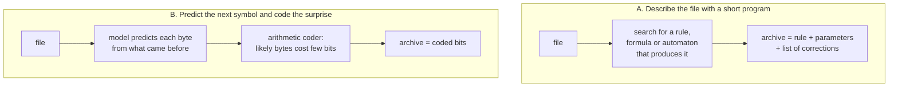

# 0 · Lossless compression in five minutes

This page explains the few ideas you need to read the rest of the report. Terms in **bold** are also in the
[glossary](glossary.md).

## What a compressor does

A lossless compressor turns a file into a shorter **archive** from which the exact original can be rebuilt.
There are two ways to make the archive shorter, and this project tried both.

- **A. Describe** is the project's starting idea: a photo of a whiteboard formula that divides one repeated-digit
  number by another, and the hope that some short rule regenerates a whole file. Chapters
  [1](1-formulas.md) and [2](2-dynamics.md) test it.
- **B. Predict** is how every record-holding compressor works (PPMd, paq, cmix). Chapters
  [3](3-reshaping.md), [4](4-specialised.md) and [5](5-text.md) test variants of it.

## How to compare two compressors

Run both on the **same bytes**, count the **whole archive**, decode it and check every byte. That is the only
comparison this report makes. A method counts as a win only if it beats the best of the standard tools
(gzip, bzip2, xz, Zstandard, Brotli, PPMd, plus the domain codecs for images, scans and video) on that input.
Details: [methods](methods.md).

## Why most clever ideas fail: the counting argument

There are 2ⁿ different files of *n* bits. There are fewer than 2ⁿ files shorter than *n* bits. So no method can
shrink every file; it can only shrink the files it **expects**. A compressor is a bet about which files are
likely.

The same argument applies to searching. Suppose you try *G* different rules (digits of π, seeds of a random
generator, cellular automata, formulas) and keep whichever matches the file best. By pure luck the best one will
agree with about log₂ *G* bits of the file. But to tell the decoder *which* rule you picked, you must also send
about log₂ *G* bits. The two cancel. [Chapter 1](1-formulas.md) measures this directly: across about ten billion
candidate rules (plus eleven billion pairs of automata), the bits each family "found" in real data were never more
than a few bits above or below the cost of naming it.

A search only pays when the data really was made by something in the search space. That is why every chapter
also runs **planted** inputs (made by a rule in the family, where the method should win) and **shuffled** or
**random** inputs (where it must not win).

## How to read a result

| You see | It means |
|---|---|
| A blue bar shorter than the orange bar | Our method beat the best standard tool on that real input. |
| A big win on a *planted* input | The detector works. It is not evidence about real files. |
| "re-verified" | Measured again for this report, round trip passed. |
| "carried over" | Measured earlier with a round trip; the original log is in the repository. |
| "published" | Someone else's number, from a public table with a link. |
| "cost" | An exact coding cost; real archives from the same model are within about 0.02%. |

## The data

| Input | What it is | Size |
|---|---|---|
| enwik8 | First 100 MB of an English Wikipedia XML dump; the standard text benchmark | 100,000,000 B |
| Silesia | 12 standard files: text, XML, executables, databases, medical images | 212 MB |
| NOAA / Covertype | Real weather records and a real forest-cover table, 24 MiB each | 25,165,824 B |
| Scanned manuals | Four software manuals rendered to 1-bit pages | 24–32 MB |
| Photos, video | Three photos (canonical RGB) and three grayscale clips | 29–100 MB |
| Q and Neif | The Hutter-record archive and a later entry, each read as one big integer | 97 MB, 89 MB |
| Planted controls | Generated from fixed seeds by the scripts in each project | 21–29 MB |

Where each file comes from and its SHA-256: [inputs](../research/large-scale/README.md#inputs).
