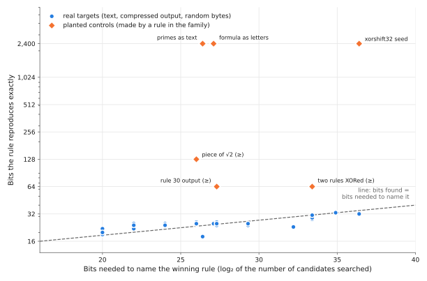
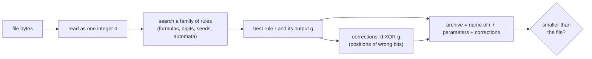
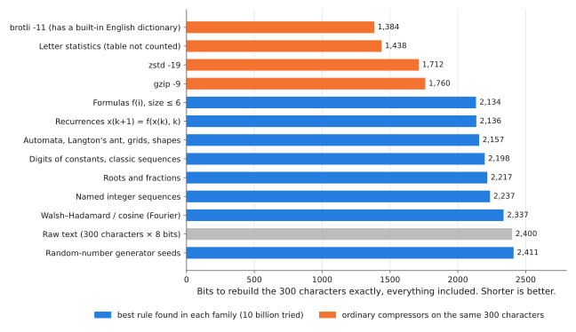

# 1 · Can a file be regenerated from a short formula?

**Question.** The project started from a whiteboard: read a file as one huge number *d*, then look for a short
formula that produces it, such as one repeated-digit number divided by another. More generally: is there a
rule (digits of π, a formula, a random-number seed, a cellular automaton, a shape) that regenerates real
data, with a short list of corrected bits?

**Short answer.** **No, not on real data.** Every search found its planted control, often thousands of times
smaller than the raw bytes. On real text, binaries, numbers and the Hutter-record archive, the best formula
found by any search **saved between 0 and 0.004%**, and usually cost more than storing the bytes. The reason
is the counting argument: a search over *G* candidates recreates about log₂ *G* bits by luck, and naming the
winner costs the same log₂ *G* bits.

<picture><source media="(prefers-color-scheme: dark)" srcset="figures/counting-dark.svg"></picture>

*Every search in this chapter, on one chart. Blue: real targets. They sit on the dashed line: what a rule
reproduces by luck is what it costs to name the rule. Orange: planted controls, found completely (≥ means the
search stopped at that length). Re-verified November 28, 2026.*

## The idea in one picture

The archive is smaller only if the rule's output agrees with the file on more bits than it costs to say
which rule it is and where it is wrong.

## 1.1 The whiteboard formula

The whiteboard proposes *d* = G(b₁,c₁,r₁) / G(b₂,c₂,r₂), where G(b,c,r) is the digit *c* repeated *r* times in
base *b* (for example G(10,7,4) = 7777). Six small numbers would describe a large one.

**How many numbers can it actually shorten?** We enumerated every 6-tuple and every number below 2ᴺ, with a
price that a decoder can actually read (Elias-gamma codes for the six parameters). Carried over, code and data:
[`research/whiteboard-census/counts`](../research/whiteboard-census/counts).

| Numbers tested (all *d* < 2ᴺ) | Shortened by ≥ 1 bit | by ≥ 8 bits | by ≥ 16 bits |
|---|---:|---:|---:|
| N = 16: 65,535 | 0 | 0 | 0 |
| N = 20: 1,048,575 | 20 | 0 | 0 |
| N = 24: 16,777,215 | 171 (0.001%) | 0 | 0 |
| N = 28: 268,435,455 | 974 (0.0004%) | 21 | 0 |

With the looser "sum of bit lengths" price (which a decoder cannot actually parse), 142,040 numbers below 2²⁴
looked shorter; the honest price removes 99.9% of them. The formula is a fine *alphabet* for numbers that are
themselves repdigit quotients and almost useless for anything else.

**Self-generated data is not evidence.** The census tables and "witness" records that this enumeration printed
can be rebuilt from a 15–48-byte descriptor plus the enumerator program (re-verified). That only shows that
the output of a program can be re-run. When the witness records are shuffled, the advantage disappears
([whiteboard census](../research/whiteboard-census/README.md)).

## 1.2 Whole files as one integer

| Target | Method | Result | Status |
|---|---|---|---|
| enwik7 (first 10 MB of Wikipedia) | ⌊(84^(3538²) + 350^(3077²)) / 248030456864173^(18²)⌋, then subtract a correction *R* | *R* is 79,999,935 bits long: the formula explains 65 of 80,000,000 bits | carried over |
| Q = record archive ÷ 3,072 (96,994,187 B) | Floor/nearest/mixed power formulas | 96,994,272–96,994,288 B (**larger**) | re-verified |
| Q | Sparse prefix + modular-square suffix | **−136 B** | re-verified |
| Q | Factor 12 found in the data, plus sparse regions | **−3,772 B** (0.004%) | re-verified |
| Q | Repdigit intervals (moving boundaries, all families) | −79 to −86 B | re-verified |
| Q | Factor trees (split into children, recurse) | **+27 to +31 B** | re-verified |
| Q | Prime-index trees | +11,100 B or more | re-verified |
| Q | Recursive fourth-power quotients | 247,891,575 B (**2.6× larger**) | re-verified |
| Q | Sums of three generators | +18 B | re-verified |
| Q, windows | Learned finite-field recurrences, modular differences, periodic edits | no rule fits; the same searches recover all planted rules | carried over |

The only meaningful savings on Q (up to 73 kB) came from recognising what Q *contains*, an executable and
neural-network weights, and coding those parts with format-aware models. That is ordinary modelling, not a
formula. It is described in [chapter 6](6-record-archive.md).

## 1.3 The sixteen thesis experiments

The original plan listed sixteen questions. Each has a small runnable codec in [`experiments/`](../experiments)
and was then run on 24 MiB inputs. Every one finds its planted structure. On real inputs they all lose to xz
except one format-specific case.

| # | Idea | Planted input: ours / zstd | Real input, 24 MiB: ours | Real vs xz -9e |
|---|---|---|---|---|
| 01 | Repdigit ratios with adaptive segments | 4,096 → 1,900 / 1,160 B | Wikipedia: 25,178,126 B | 3.8× larger |
| 02 | Near-factorization + digit concatenation | 512 → 236 / 203 B | Wikipedia: 26,751,758 B | 4.0× larger |
| 03 | Powers and generator sums with residuals | 384 → 60 / 169 B | Wikipedia: 26,751,758 B | 4.0× larger |
| 04 | Sums of irrational numbers with checkpoints | 192 → 44 / 107 B | Wikipedia: 27,248,340 B | 4.1× larger |
| 05 | Local number bases | 512 → 236 / 288 B | Wikipedia: 26,747,076 B | 4.0× larger |
| 10 | Affine instruction chains | — | archived formula instructions: **6,304,526 B** | **8% smaller** |
| 11 | Grammars / shared subexpressions | — | formula listing: 9,357,678 B | 5.3× larger |
| 15 | Regenerate binary regions (ELF headers, local formulas) | — | Firefox binaries: 35,313,184 B | 2.6× larger |
| 16 | Choose the best method per interval | — | scanned manual: 2,157,752 B | 1.7× larger |

Even on their own planted inputs, experiments 01 and 02 lost to plain zstd: the plant was not strong enough to
pay for the recipe headers.

Experiments 06–09 and 13–14 (automata, matrix factors, Walsh–Hadamard, BWT prediction, sparse residuals) are
in [chapter 2](2-dynamics.md) and [chapter 3](3-reshaping.md). The one win (10) is a codec written for the
exact instruction format it compresses. All sizes: [by experiment](../research/large-scale/results/by-experiment.md).

## 1.4 The coincidence hunt: any rule, any match, one small piece

If no formula fits a whole file, maybe *some* rule fits *some* small piece by luck. The hunt
([code](../research/coincidence-hunt/README.md)) takes 300 characters of the enwik8 "Anarchism" article
(2,400 bits) and tries about ten billion candidates in eight families, charging each its name plus its
corrections.

<picture><source media="(prefers-color-scheme: dark)" srcset="figures/hunt-dark.svg"></picture>

| Family | Candidates tried | Bits to name one | Longest exact match from the start | Best total (name + corrections) |
|---|---:|---:|---:|---:|
| Digits of π, e, √2, √3, √5, φ and their sums; classic sequences | 3.9 × 10⁹ | 34.9 | 33 bits | 2,198 |
| Binary digits of √n, ∛n, 1/q | 8.1 × 10⁷ | 29.3 | 24 bits | 2,217 |
| Random-number generators (every xorshift32 seed, splitmix64, 8 LCGs) | 5.5 × 10⁹ | 36.4 | 32 bits | 2,411 |
| Formulas f(i) up to 6 operations | 1.8 × 10⁷ | 27.1 | 25 bits | 2,134 |
| Recurrences x(k+1) = f(x(k), k) | 8.5 × 10⁷ | 29.3 | 25 bits | 2,136 |
| Named integer sequences (primes, Fibonacci, Collatz, …) | 1.1 × 10⁷ | 26.4 | 18 bits | 2,237 |
| Walsh–Hadamard and cosine transforms | 4.4 × 10³ | 3.0 | 0 bits | 2,337 |
| Cellular automata, Langton's ant, grids, pyramids | 3.2 × 10⁸ | 32.2 | 23 bits | 2,157 |

*Re-verified November 28, 2026 ([logs](../research/coincidence-hunt/results)); identical to the original run of November 24
except that ties between equally long matches were broken differently.*

Read the last two numeric columns together. In every family the longest stretch a rule reproduces **exactly**
is shorter than, or equal to, the bits needed just to say which rule it is. The "best total" rows beat the
2,400 raw bits only because a rule like "every 8th bit is 0" matches how ASCII text is laid out, a fact that
plain letter statistics (1,438 bits) capture far better. The best rule of all, f(i) = 100 XOR gcd(i, 5)
(mostly the letter "d"), needs **21% more bits than gzip and 54% more than brotli** on the same characters.

| Planted control (300 bytes, made by one family member) | Found | Total bits |
|---|---|---:|
| xorshift32 output, seed 123,456,789 | exactly, all 2,400 bits | 48 |
| A formula written as letters | exactly | 35 |
| The primes written out with ", " | exactly | 35 |
| Binary digits of √1234 with 72 bits flipped | the root and every flip | 503 |

Four planted controls, each made by one member of a family, are found exactly (for example the xorshift
generator with seed 123,456,789 regenerates all 2,400 bits from a 48-bit description).

## 1.5 Rules against noise, and digits of irrational numbers

Two more direct tests of the counting argument ([code](../research/rules-vs-noise/README.md)):

| Search | Candidates | Bits to name one | Bits reproduced exactly: xz output / PPMd output / random | Planted control |
|---|---:|---:|---|---|
| Elementary cellular automata (256 rules × widths × columns × start steps) | 2²⁷·³ | 27.3 | 24 / 26 / 25 | rule-30 output: ≥ 64 (search limit) |
| Pairs of those programs, XORed | 2³³·⁴ | 33.4 | 28 / 29 / 31 | ≥ 64 |
| Every linear (XOR) rule, exactly (Berlekamp–Massey) | all | — | needs 8,192 bits to reproduce 8,192 bits | none possible: rule 30 is not linear (318 bits for 320) |
| Digits of √2, √3, √5, e, π and 11 digit-wise sums, any start | 2²⁶ | 26.0 | text 26 · xz 25 · random 25 | a piece of √2: all 128 bits |

The targets are 1 MiB of enwik8 compressed by xz and by PPMd (already almost random), seeded random bytes, and
the first bytes of enwik8. Each row is the counting argument measured directly: the best lucky match grows by
one bit each time the search space doubles, and naming the match costs exactly that bit.

## 1.6 Programs block by block, and transforms on random data

**Block programs** ([code](../research/block-programs/README.md)) give every 64-byte block its own generator plus
corrections, and re-run every generated line to check it. The first kilobyte of enwik8 costs **946 bytes** with
mathematical generators only and **526 bytes** when generators may also copy earlier data or predict from context,
against **300** (brotli), **350** (gzip) and **420** (xz). The better program wins only through copies and
context prediction, which is what an ordinary compressor does. On 4 KiB blocks of the first 10 MB, no real block
was described better than by its own letter counts (0 of 7), while four of five planted blocks were found.

**Transforms on data that is already random** ([code](../research/transform-controls/README.md)): a search over
reversible transforms on 8 MiB of random bytes and on xz output of *dickens* is the control for every transform
in this report. On the xz output of *dickens*, the best of 176 measured transforms (deltas, regroupings, bit-symbol sizes) was 2 bytes *larger* than compressing it directly (carried over; rerun in progress).

## Why it fails: the counting argument

A family of *G* rules can produce at most *G* different outputs. For a random-looking target, the chance that
some rule agrees with the first *k* bits is about *G* / 2ᵏ, so the longest lucky agreement is about log₂ *G*
bits, exactly what it costs to name the rule. More search, more threads and cleverer families move both sides
of the balance together. Real text is not random, but its structure is *statistical* (some letters and words are
more likely after others). A predictor captures that; a formula does not.

The idea does work when the data really was produced by a rule in the family. The planted controls show the
detectors are correct. They also show that in this project's real data, no such rule was there to be found.

[← 0 · How to read](0-how-to-read.md) · [Contents](README.md) · [2 · Automata and matrix factors →](2-dynamics.md)
