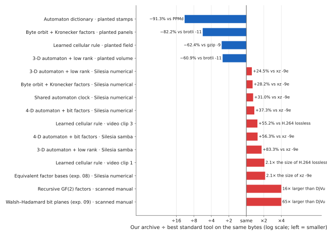
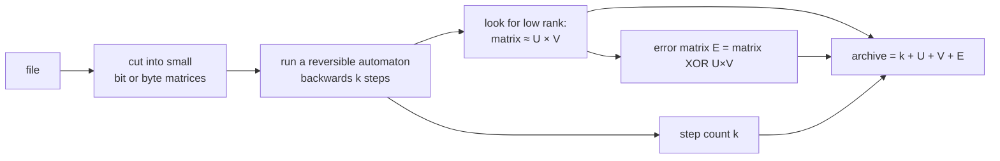

# 2 · Do reversible automata and matrix factors expose hidden structure?

**Question.** Cut a file into small bit or byte matrices. Run a reversible cellular automaton *backwards* to an
earlier, simpler state, then write that state as a product of two small matrices plus an error matrix. If real
data had been "evolved" from something simple, this would undo it.

**Short answer.** **The machinery works and the premise is false.** On planted fields built exactly this way,
the combined methods are **2.6 to 15 times smaller** than the best standard tool. On every real input
(Silesia numerical data, source code, video frames, scanned pages, the Neif archive) the same methods are
**25% to 65× larger** than the best standard tool. Running the automaton backwards often *does* lower the
bit entropy of each matrix, but storing which step was chosen costs more than it saves.

<picture><source media="(prefers-color-scheme: dark)" srcset="figures/dynamics-dark.svg"></picture>

*Each bar compares our complete archive with the best standard tool on the same bytes (xz, zstd, bzip2, Brotli,
PPMd, or the domain codec: H.264 lossless for video, DjVu for scans). Blue = smaller, red = larger. All archives
decoded byte-exact; re-verified November 2026.*

## The method in one picture

To decode: multiply U × V, XOR with E, run the automaton forwards k steps. Every part must be paid for.

## What was tried

| Project | What it adds | Planted result | Real result |
|---|---|---|---|
| [Reversible automata, step counts](../experiments/06-reversible-automata/README.md) (exp. 06) | checkerboard and Margolus rules, fixed or searched step | finds the step on planted orbits | — |
| [Recursive GF(2) factorization](../research/hierarchical-gf2/README.md) (exp. 07) | automaton before or after a recursive bit-matrix factorization | 8,205 → 4,492 B on 256 evolved rank-4 matrices | scanned manual: 16× larger than DjVu |
| [Equivalent factor bases](../experiments/08-equivalent-factors/README.md) (exp. 08) | change basis so U and V cost fewer bits | small gains on plants | Silesia numerical: 2.1× xz |
| [Walsh–Hadamard bit planes](../experiments/09-walsh-bitplanes/README.md) (exp. 09) | spectral prediction of each bit plane | — | scanned manual: 65× DjVu |
| [3-D automata + matrix panels](../research/tensor-orbits/README.md) | volumes instead of planes | 25.2 → 9.6 MB | numerical +24.5%, samba +83% |
| [4-D automata + factors](../research/four-dimensional-factors/README.md) | noisy space-time, equivalent bases | 25.2 → 9.4 MB | numerical +37%, samba +56% |
| [Byte orbits + Kronecker factors](../research/modular-kronecker/README.md) | full byte cells, arithmetic mod 256 | 25.2 → 4.5 MB | numerical +28% |
| [Learned cellular rules](../research/learned-cellular-rules/README.md) | learn the rule and the residual basis together | 29.5 → 11.1 MB (sequential fitting: 25.1 MB) | video: +55% to 2.1× H.264 lossless |
| [Shared automaton clock](../research/checkerboard-orbits/README.md) | one step count per page instead of per matrix | 13.6 → 12.4 MB | numerical +31% |
| Checkerboard automaton on the Neif archive (carried over) | 11.2 million 8-byte matrices, best of 128–256 steps each | — | bit entropy 0.989 → 0.894 per cell, yet the archive **grew** from 89.3 MB to 93.2 MB because each step index costs ~8 bits |

Planted inputs are rebuilt from fixed seeds by each project's `control.py`. Exact sizes for every profile:
[results by experiment](../research/large-scale/results/by-experiment.md).

## Controls that make the result trustworthy

- **The factor stage only fires when there is something to factor.** On the planted 4-D field the encoder chose
  matrix factors for 384 of 384 blocks; on numerical, samba and uniform data it chose them for **0** blocks,
  so adding factors saved exactly 0 bytes there.
- **The rule must be the right one.** On automaton-evolved stamps, the matching inverse rule gives 622,700 bytes
  and the rotated rule 5,366,106; swap the generator and the order swaps. The detector is specific.
- **Joint learning matters only when the rule is hidden.** Learning the cellular rule together with the
  residual basis cut the planted field from 25,054,265 to 11,051,733 bytes; a second random seed reproduced
  it; shifting the error planes independently removed the gain (one byte); on the three real clips joint and
  sequential fitting tied.

## Why it fails on real data (interpretation)

Real files are not evolved from simple states. Images and video are smooth, so a *predictor* (the pixel to
the left, the same pixel in the previous frame) explains them far better than any automaton, which is what
PNG, JPEG XL and H.264 use. Binary and numerical files are made of records and fields, which a context
model or a column transform captures ([chapter 3](3-reshaping.md)). An automaton step mixes neighbouring
bits in a fixed way that does not match how any of these files were made, so the backward search mostly
finds noise and then pays to describe it.

The idea is sound as a **detector**: if some data really were produced by a known reversible rule, these
codecs would find it and compress it by large factors, as the planted rows show.

[← 1 · Formulas](1-formulas.md) · [Contents](README.md) · [3 · Reshaping →](3-reshaping.md)
