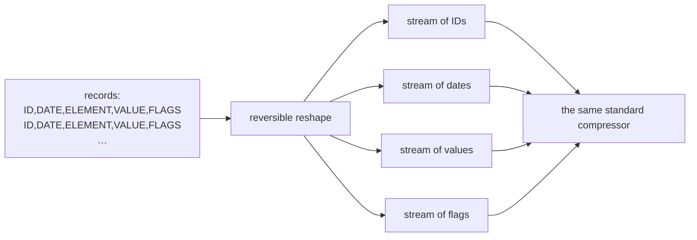

# 3 · Does reshaping the bytes help a standard compressor?

**Question.** Keep an ordinary compressor (gzip, Zstandard, xz) and change only the *order* or *form* of the
bytes it sees, reversibly, with every byte needed to undo the change stored in the stream. When does that help?

**Short answer.** **It helps a lot when the file has fields or rows, and it does not help prose.**
Splitting each weather record into one stream per field makes xz **42–47% smaller** on two real NOAA samples.
Predicting each number in the Silesia numerical files from its neighbours saves **10%** with xz.
A scanline XOR plus a tree of empty regions saves **33–39%** on scanned pages, but DjVu is still 3× smaller
([chapter 4](4-specialised.md)). On Wikipedia, every reshape we tried helps gzip a little and makes xz worse.
The controls behave as they should: shuffling the scanlines of a manual turns the 33–39% gain into a 27–34%
loss; shuffling characters *within* each row of a chemical database keeps part of the gain, because every row keeps
its length and its set of characters, which column grouping still exploits.

<picture><source media="(prefers-color-scheme: dark)" srcset="figures/reshape-dark.svg"></picture>

*Same compressor and settings on the original bytes and on the reshaped stream (which includes everything needed
to undo the reshape). Every pair decoded byte-exact. Carried over; the underlying archives were re-verified in the
rerun.*

## The idea in one picture

A general compressor looks for repeats in a one-dimensional byte stream. Records interleave unrelated fields,
so each field's regularity is broken up. Putting each field next to its own kind (or predicting a number from the
one above it) hands the compressor a stream whose repeats are near each other.

## Results against the best standard tool

The chart above compares a compressor with itself. The real question is whether reshape + compressor beats the
**best** standard tool on the raw file (gzip, bzip2, xz -9e, zstd -19, Brotli, PPMd):

<!-- BEGIN CH3-TABLE -->
| Input | Kind | Best standard tool on the raw bytes | Our best (archive or transform → tool) | Difference |
|---|---|---:|---:|---:|
| Silesia numerical files (mr + x-ray + sao) | real | 11,662,476 (xz -9e) | 10,421,725 (`lattice-joint-xz`) | **−10.6%** |
| Silesia nci (chemical database) | real | 1,449,272 (xz -9e) | 1,686,759 (`statico`) | +16.4% |
| Silesia mozilla (Firefox binaries) | real | 13,376,240 (xz -9e) | 14,328,741 (`lattice-joint-xz`) | +7.1% |
| Silesia samba (source tarball) | real | 3,739,524 (xz -9e) | 4,239,761 (`lattice-direct-xz`) | +13.4% |
| Silesia webster (dictionary) | real | 8,368,672 (xz -9e) | 12,097,762 (`lattice-rows-select`) | +44.6% |
| NOAA weather records 1990 | real | 3,541,940 (zstd -3) | 957,348 (`lattice-rows-fields + xz-6`) | **−73.0%** |
| NOAA weather records 2020 | real | 3,552,109 (zstd -3) | 1,065,376 (`lattice-rows-fields + xz-6`) | **−70.0%** |
| UCI forest-cover table | real | 2,420,012 (xz -9e) | 1,686,701 (`lattice-rows-field-positions → brotli -11`) | **−30.3%** |
| Stamps evolved by an automaton | planted | 7,183,888 (PPMd) | 560,916 (`checker-bitmap-orbit-book + xz-6`) | **−92.2%** |
| nci with characters shuffled inside rows | control | 11,879,367 (bzip2 -9) | 9,958,468 (`lattice-rows-columns + xz-6`) | **−16.2%** |
| Graphviz pages with scanlines shuffled | control | 1,202,180 (PPMd) | 1,846,387 (`checker-bitmap-direct-flat`) | +53.6% |

*Generated by [`build_scoreboard.py`](build_scoreboard.py) from the receipts and the baseline panel. A transform is credited only when it beats the same tool on the raw bytes.*
<!-- END CH3-TABLE -->

## What else was tried

| Experiment | Data | Result | Status |
|---|---|---|---|
| [Reshape tournament](../research/reshape-tournament/README.md): 381 reversible chains (BWT, MTF, delta, bit planes, base 2/3/4 expansion, transposes, capital flags, word codes) × zstd, bzip2, xz | first 10 MB of enwik8 | best chain: words + BWT, xz −5.7%, zstd −2.9%; bzip2 best with word codes (−5.5%); expanding to base 2/3/4 costs +265–275%; compressing twice never helps | carried over (rerun in progress) |
| [Text front end](../research/text-views/README.md): capital flags, word codes, XML headers as columns | full enwik8 | xz −5.9%, bzip2 −8.6%, PPMd −1.6%, Statico −2.1%, our CM: none | carried over |
| [Shape search](../research/stride-scan/README.md): fold the file into grids, triangles, spirals, Hilbert and Morton orders; search local rules | first MiB of 12 files | only raster and column orders win: fax page −25%, spreadsheet −23% vs xz (code-length estimates); triangles, spirals, Hilbert/Morton never win; text +17% to +35% | carried over (rerun in progress) |
| [Article order](../research/article-order/README.md): Wikipedia pages sorted by title, size or ID | enwik8 | pages grouped by category: xz −0.65%, zstd −0.67%, PPMd −0.25%; random order +0.45% (the decoder sorts pages back by ID, so the order costs nothing) | carried over (rerun in progress) |
| [Transform controls](../research/transform-controls/README.md): search reshapes on random bytes and on xz output | 8 MiB random, dickens.xz | xz output of dickens: best of 176 measured transforms is 2 bytes larger than no transform | carried over (rerun in progress) |
| Reading the bits as k-bit symbols, hidden alphabets, base changes | Silesia, Canterbury | no gain beyond noise (one PPMd setting changed by 2.7% because its own raw result was unstable) | carried over |

## Why it works when it works (interpretation)

Every gain in this chapter comes from **making neighbours similar**: fields next to their own kind, a number next
to its prediction, a scanline next to the one above. That is exactly what a column store, PNG's row filters or a
spreadsheet format do, and it is the opposite of the formula idea in chapter 1: nothing is being *generated*,
existing structure is just made visible to a compressor that only looks backwards a short way.

Text has no fixed columns, so reordering mostly destroys the left-to-right context that strong text compressors
rely on: BWT lowers the "next-byte" entropy (H1) of Wikipedia from 3.88 to 2.80 bits per byte, yet xz output
grows by 9%. A lower entropy estimate does not guarantee a smaller file
([all 178 paired measurements](../research/large-scale/findings.md#all-paired-trials)).

[← 2 · Automata](2-dynamics.md) · [Contents](README.md) · [4 · Specialised models →](4-specialised.md)
