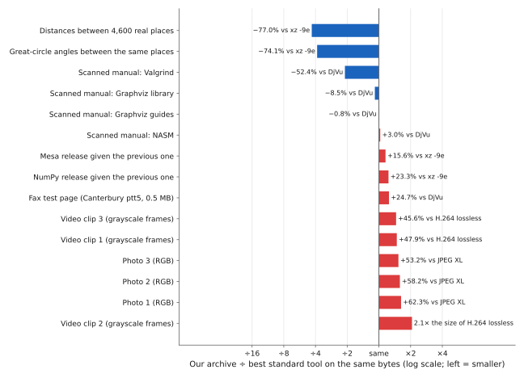

# 4 · Do models written for one kind of data beat the usual tools?

**Question.** General compressors know nothing about pictures, scanned pages, video or distance tables. If we
write a model for exactly one kind of data, can it beat both the general tools and the specialised standards
(JPEG XL, H.264, DjVu, JBIG)?

**Short answer.** **Yes for scanned manuals and distance tables; no for photos, video, fax and software updates.** Coding scanned manuals as a dictionary of glyph shapes
plus an exact correction beats lossless DjVu on three of four manuals (by 0.8%, 8.5% and 52%) and loses on the
fourth (+3%). Rebuilding a table of distances between 4,600 real places from four landmark columns is **4.3×
smaller than xz**, because the table is a deterministic function of the coordinates. Our photo, video and
software-update models lose to JPEG XL, lossless H.264 and xz by 16% to 2×, and our fax model loses to JBIG and DjVu.

<picture><source media="(prefers-color-scheme: dark)" srcset="figures/specialised-dark.svg"></picture>

*Our best archive for each input, relative to the best tool on the same bytes, including the domain standards.
Every archive decoded byte-exact; re-verified November 2026 except the per-file tools marked in the tables.*

## Four models in one picture

```mermaid
flowchart TB
    subgraph G["Scanned pages"]
        G1["page bitmap"] --> G2["connected components<br/>= glyph shapes"] --> G3["dictionary of shapes<br/>+ positions + exact pixel residual"]
    end
    subgraph D["Distance table"]
        D1["n×n distances"] --> D2["pick 4 landmarks,<br/>recover coordinates"] --> D3["landmark columns<br/>+ exact residual"]
    end
    subgraph P["Photos"]
        P1["RGB pixels"] --> P2["reversible colour transform<br/>+ integer wavelet"] --> P3["context-coded coefficients"]
    end
    subgraph V["Video"]
        V1["frames"] --> V2["motion vectors<br/>+ spatial predictor"] --> V3["coded residual"]
    end
```

## Results

| Input | Kind | Ours | Best other tool | Difference |
|---|---|---:|---:|---:|
| Valgrind manual, 64 pages | real | 394,104 | DjVu 828,622 | **−52.4%** |
| Graphviz library manual | real | 160,297 | DjVu 175,164 | **−8.5%** |
| Graphviz guides | real | 189,603 | DjVu 191,132 | **−0.8%** |
| NASM manual, 64 pages | real | 195,223 | DjVu 189,610 | +3.0% |
| Fax test page (ptt5) | real | 28,037 | DjVu 22,490 · JBIG 25,917 · Group 4 32,344 · xz 39,868 | +24.7% |
| Distances between 4,600 real places | derived | 3,850,014 | xz -9e 16,711,344 | **−77.0%** |
| Great-circle angles between the same places | derived | 4,242,861 | xz -9e 16,371,240 | **−74.1%** |
| Random triangle of distances | control | 21,155,413 | zstd -19 21,155,900 | 0% (literal fallback) |
| Three photos | real | 0.64–32.4 MB | JPEG XL 0.41–21.1 MB | +53% to +62% |
| Three video clips | real | 1.10–3.88 MB | H.264 lossless 0.54–2.67 MB | +46% to +106% |
| NumPy release given the previous one | real | 10,201,056 | xz -9e 8,272,288 | +23.3% |
| Mesa release given the previous one | real | 18,718,222 | xz -9e 16,198,184 | +15.6% |

Per-input details: [glyph residuals](../research/glyph-residuals/README.md) ·
[distance geometry](../research/distance-geometry/README.md) · [shape context (fax)](../research/shape-context/README.md) ·
[reversible wavelets](../research/reversible-wavelets/README.md) · [motion residuals](../research/motion-residuals/README.md) ·
[reference patches](../research/arithmetic-references/README.md). Fax tools measured for this report:
[data/fax.json](data/fax.json).

## Why (interpretation)

- **Glyphs** work because a manual is printed from a few hundred letter shapes, so storing each shape once and
  then only positions is a genuinely better model of the page. DjVu's JB2 coder uses the same idea with one
  dictionary per band of about 14 pages (the largest DjVu allows); ours keeps one dictionary for the whole
  manual, which is our guess for why it wins. A JBIG2 encoder with a whole-document dictionary was not available
  to test ([check](data/djvu-check.json)). The NASM manual has more varied shapes and DjVu wins.
- **Distance tables** win by a large margin because 21 MB of distances are really 4,600 points on a sphere.
  That is a property of how the table was *made* (computed from coordinates), not a general method: on a random
  triangle of the same size the codec stores the bytes literally.
- **Photos and video** lose because JPEG XL and H.264 are the product of decades of tuning on exactly this data,
  and our models are a few hundred lines each.
- **Software updates** lose because xz with a large window already finds the long copies between versions, and
  our patch format pays for its own headers.

[← 3 · Reshaping](3-reshaping.md) · [Contents](README.md) · [5 · Text →](5-text.md)
