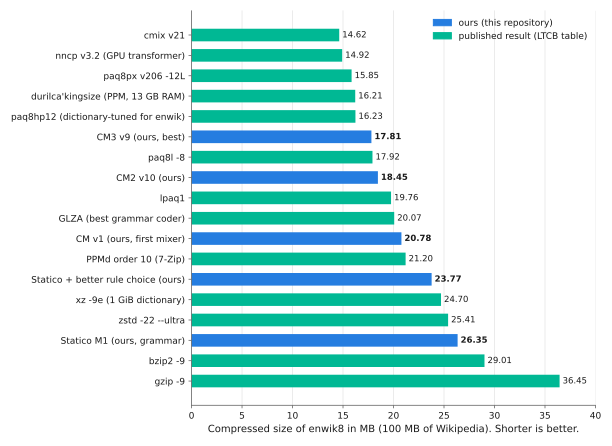
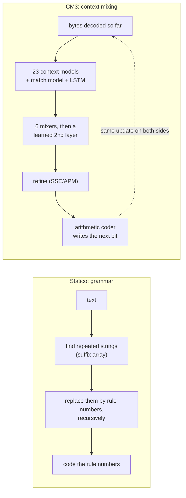

# 5 · Compressing text: our own compressors on enwik8

**Question.** How small can a compressor written from scratch in this project make enwik8 (the first 100 MB of
English Wikipedia), compared with the published state of the art?

**Short answer.** Our context-mixing compressor **CM3** makes a real, byte-exact archive of **17,811,463 bytes**
(1.425 bits per byte). That beats xz (24.70 MB), PPMd (21.20 MB), every BWT compressor, GLZA (20.07 MB),
lpaq1 (19.76 MB), zpaq (17.86 MB) and paq8l at its strongest setting (17.92 MB). It is behind the specialised
PPM durilca'kingsize (16.21 MB with 13 GB of memory), the enwik-tuned paq8hp12 (16.23 MB), **paq8px (15.85 MB,
12% smaller)** and **cmix (14.62 MB, 22% smaller)**. Our grammar compressor Statico, the project's first design, did
not beat xz.

<picture><source media="(prefers-color-scheme: dark)" srcset="figures/enwik8-dark.svg"></picture>

*Blue: our compressors (real archives except "CM v1", an exact coding cost). Green: published results from the
[Large Text Compression Benchmark](https://mattmahoney.net/dc/text.html). Numbers in MB = 1,000,000 bytes.*

## Two designs

**Statico** ([code](../research/statico/README.md)) finds repeated strings and replaces them with rule numbers,
the way GLZA does. It is fast to decode (40 MB/s) but leaves the statistics of *which* rule comes next almost
unmodelled.

**CM3** ([code](../research/context-mixer/README.md)) predicts every bit of the file from what came before.
Each of 23 context models (the previous 1–8 bytes, the current word, the previous words, markup state, numbers,
"what followed this context last time") gives a probability. A match model follows the earlier occurrence
whose history agrees longest. A small LSTM network adds a learned prediction. Six mixers, chosen by different
contexts, combine the predictions; a learned second layer combines the mixers; refinement stages correct
remaining biases; an arithmetic coder writes the bit. The decoder runs the same model and makes the same
predictions.

## How we got from 26.3 MB to 17.8 MB

| Step | enwik8 bytes | bpc | Kind | Status |
|---|---:|---:|---|---|
| Statico M1, grammar | 26,346,968 | 2.108 | archive | re-verified |
| Statico with GLZA-style rule choice | 23,774,125 | 1.902 | archive | carried over |
| First context mixer (orders 1–6, word, match, 2 mixers) | 20,783,455 | 1.663 | cost | carried over |
| CM2 v3: bit-history states, mixer chosen by context count | 19,158,128 | 1.533 | cost | carried over |
| CM2 v8: indirect contexts, faster learning-rate decay | 18,632,203 | 1.491 | cost | carried over |
| CM2 v10: tuned knobs, word-skip and 12-byte contexts | 18,454,423 | 1.476 | archive | carried over |
| CM3 v5: cache-line tables, LSTM with 192 cells | 18,301,523 | 1.464 | archive | carried over |
| CM3 v7: LSTM learning rate decays with input length | 18,060,601 | 1.445 | archive | carried over |
| CM3 v8: match model picks the best of 32 earlier candidates | 17,896,981 | 1.432 | archive | carried over |
| CM3 v9: second mixing layer, second match model, word stems | **17,811,463** | **1.425** | archive | carried over; full rerun queued |

"Archive" rows decoded byte-exact on full enwik8 (SHA-256 `2b49720e…`). Original logs:
[`research/context-mixer/history/logs`](../research/context-mixer/history/logs).

### Which ideas paid (same 10 MB, same table budget)

<!-- CM-HISTORY-10MB -->
*Being re-measured: every version above on the first 10,000,000 bytes of enwik8 with the same table size, so
the versions differ only in their models. Results will appear here when the rerun finishes.*

## Side roads that did not pay

| Idea | Result | Why |
|---|---|---|
| **Better symbol coding inside Statico** (recency, order-1 on rules) | about −8% (to 24.3 MB); a shuffled-context control kept −3.5%, so the real context gain is ~1% | The grammar already absorbs most pair statistics; most of the gap to GLZA is in which rules are built. |
| **BWT, then mixing** ([BWT lab](../research/bwt-lab/README.md)) | 2,390,774 bytes on 10 MB vs about 2.0 MB for raw-text CM | Sorting by context helps weak models (−31%) but throws away the order that word and match models use. |
| **Text rewrites before compressing** (capital-letter flags, word codes, header columns) | xz −5.9%, bzip2 −8.6%, Statico −2.1%, CM: none (+0.5% to +1.9%) | They do the modelling a weak compressor lacks; a strong model already does it. |
| **Article reordering** (pages sorted by title or topic) | measured in [article order](../research/article-order/README.md) | Leaders on enwik9 reorder articles; on enwik8 the gain is small. |
| **Generators as an extra mixer input** (digits of π, fixed patterns) | +150 and +15 bytes on 3 MB (worse) | A rule that does not predict the text is noise to the mixer. See [chapter 1](1-formulas.md). |
| **"Find the longest block" by trying many earlier positions** | the one generator idea that paid: −0.91% at 100 MB | Long *copies* of earlier text are real structure in Wikipedia (12.5% of enwik8 lies in repeats of ≥ 32 bytes). |
| **Bigger LSTM (256 cells)** | −0.48% on 30 MB, at +74% time | Too slow for the prize's time limit on one core without more engineering. |

## What this means for the Hutter Prize

The prize is judged on enwik9 (10× larger) and counts the decompressor too. Scaling our enwik8 ratio gives an
estimated 130–135 MB, against a record of **100,424,672 bytes** (fx2-cmix-transformer, which also uses a
transformer pre-trained offline on GPUs). The distance from CM3 to the record is about the same as the
distance from CM3 to cmix on enwik8. Closing it would need what the leaders have: a much larger model with
pre-trained weights, a dictionary transform and article reordering, and a few times more compute.

## Limits

- CM3 uses floating point with `-ffast-math`. Encoder and decoder must be the same binary on the same CPU
  model. A portable version would need fixed-point arithmetic.
- The best configuration takes about 6,200 s to encode and 6,300 s to decode enwik8 with 2.8 GB of tables.
- Model choices were tuned on the first 3–10 MB of enwik8, which is part of the test file.
- Published numbers are other people's measurements on other machines; they were not re-run here.

[← 4 · Specialised models](4-specialised.md) · [Contents](README.md) · [6 · The record archive →](6-record-archive.md)
