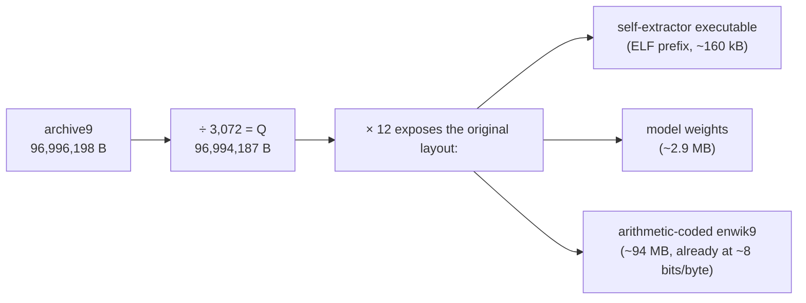

# 6 · Working on the record archive itself

**Question.** The Hutter Prize record (fx2-cmix-transformer, 2026) is a 96,996,198-byte archive of enwik9 plus a
3,428,474-byte compressor: **100,424,672 bytes** in total. Can that archive be made smaller, either by treating
it as a number and finding structure in it, or by improving the models of the leading entries piece by piece?

**Short answer.** Treated as a number, the archive is essentially random: Zstandard -19 makes Q 462 bytes
*larger*, and the similar Neif archive measures 7.9999981 bits per byte. Every formula from [chapter 1](1-formulas.md) saved between 0 and 3,772 bytes of its 97 MB.
Recognising the pieces hidden inside it (an executable and neural-network weights) and coding those with
format-aware models saved **73,220 bytes (0.075%)**, including the decoders. Improvements to individual
model components of the leading entries saved **hundreds to ~110,000 bytes** on the parts they touch. A new award needs at least **1% (about 1,004,000 bytes)** off the record total;
the 20% goal discussed in the project would need about 13 MB less from the coded text. **Nothing here is close.**

All results on this page are **carried over**: they depend on the leaders' published archives and GPL source
code, which are not redistributed in this repository. Where an experiment is replayable from the repository
(Q formulas, Q packages, reference patches), it was **re-verified**.

## What the record archive contains

Q is the archive read as one big integer and divided by 3,072 = 3 × 2¹⁰ (it divides exactly). Multiplying by 12
lines the bytes up again with the executable, the transformer weights and the coded text.

## Getting the inputs

The archives are third-party files and are not stored in this repository.

- **Q**: download the fx2-cmix-transformer `archive9` (96,996,198 bytes) from the record's public release, read it
  as one big-endian integer, divide by 3,072 (exact) and write the quotient as big-endian bytes: 96,994,187 bytes,
  SHA-256 `5f7921346a0b045f6196be84b1c794344455a47eaf84bf9ef81b8707559ca547`.
- **Neif**: the cmix-neif 2.0 self-extracting archive (89,346,392 bytes) from its author's release.

[`research/large-scale/project_data.py`](../research/large-scale/project_data.py) and the
[input table](../research/large-scale/README.md#inputs) list every hash.

## 6.1 Q as a number

| Method | Q (96,994,187 B) | Status |
|---|---:|---|
| Decimal text with Zstandard | 109,065,983 | carried over |
| Best of 256 number bases, then ZIP | 97,022,473 | carried over |
| Zstandard -19 on the bytes | 96,994,649 (+462) | re-verified |
| Factor trees, prime-index trees, quartic recursion | +27 B to 2.6× larger | re-verified |
| Repdigit intervals, sparse prefix + modular square | −79 to −136 B | re-verified |
| Factor 12 + sparse arithmetic regions | −3,772 B | re-verified |
| Python package incl. decoder, informed arithmetic selection | −1,684 B | re-verified |

## 6.2 Q as a container: format-aware packages

Each package is a self-contained Python program that rebuilds Q byte for byte. Sizes **include the decoders**.

<!-- FIG-Q -->

| Package | Bytes | Saving vs Q | What it adds |
|---|---:|---:|---|
| V8 | 96,930,189 | 63,998 | rebuild ELF tables and weights inside 12Q |
| V9 | 96,928,804 | 65,383 | better weight decoding |
| V10 | 96,923,859 | 70,328 | ELF reconstruction PNR3, correlations between weight tensors, streaming division |
| V11 | 96,922,143 | 72,044 | — |
| V12 | 96,921,555 | 72,632 | 478 unwind records grouped, native NRV regeneration |
| V14 | 96,921,200 | 72,987 | three weight-metadata streams (QWX7) |
| **V15** | **96,920,967** | **73,220** | compact weight directory (QWX8) |

[Replay of V15](../research/portable-arithmetic/README.md) · [package history](../research/evidence/portable-q-v15.json).
With the exact record archive available to the decoder as a reference, a 46-byte descriptor suffices, but
delivering the reference makes the total 96,994,234 bytes ([reference patches](../research/arithmetic-references/README.md)).

## 6.3 The leaders' models, one component at a time

The later entry cmix-neif 2.0 (93,388,956 bytes) was rebuilt from source and its coded stream was replayed on
windows, so that single model components could be changed and priced with the real coder. Selected results:

| Component changed | Measured on | Saved |
|---|---|---:|
| Link-target titles predicted from decoded page-title affixes (PPMd link archive) | 14.6 MB link tail | 111,826 B of 2.47 MB |
| Trie of earlier link targets | 10 windows, 295 kB | 559 B of 57,614 |
| Word-rank prediction with global odds | 6 windows, 164 kB | 467 B |
| URL authority and path predictor, 16 MiB history | 6 windows | 150 of 37,417 B (0.4%) |
| Articles reordered by topic (within groups of 512) | whole Neif text band, Zstd-6 | **+525,442 B** (larger) |
| Model weights: five lossless re-encodings | 3,744,629 B of weights | all **larger** (+48,888 to +629,205 B) |

The local audit's arithmetic: keeping every other part of Neif fixed, its 85,417,870-byte coded stream would have
to shrink by **13,049,219 bytes (15.3%)** to reach a 20% improvement over the record. The component gains above
are 3 to 5 orders of magnitude smaller. [Audit](../research/evidence/report-index.tsv) (reports 081–147).

## Why (interpretation)

An archive produced by a strong compressor is, by design, close to random: if a simple pattern were left in it,
the compressor would have used it. The only exploitable structure left is in the *non-coded* parts (executable,
weights, metadata), which are a few percent of the file and already compact. Improving the coded part means
building a better predictor of Wikipedia text, which is the work of [chapter 5](5-text.md), and the leaders
are far ahead there.

[← 5 · Text](5-text.md) · [Contents](README.md) · [All ideas →](ideas.md)
