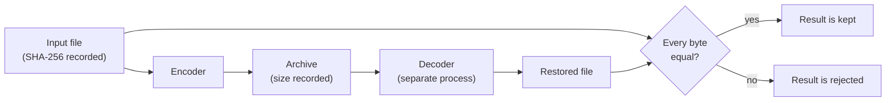

# How everything was measured

The rules are simple and the same for every result in this repository.

## One measurement

1. **Everything counts.** The archive size includes headers, lengths, parameters, rule tables, dictionaries,
   corrections, seeds and padding. If the decoder also needs a reference file, its size is added
   ("delivered size").
2. **Every archive is decoded** by a separate process and compared byte for byte with the input (`cmp`).
   Results that fail are not reported.
3. **Same bytes for every method.** A method is compared only with tools that compressed the identical input
   (same SHA-256).
4. **Decoder size.** Archive sizes assume the receiver already has the decoder program, as for gzip or xz.
   Where the decoder is unusual or large (whole-file formulas, the Q packages), the program is added and
   the page says so.

## The baseline panel

A method is only interesting if it beats the tools people already use. Every input is therefore compressed by
the same panel, each with a round trip:

| Tool | Command |
|---|---|
| gzip | `gzip -9` |
| bzip2 | `bzip2 -9` |
| xz | `xz -9e -T1` |
| Zstandard | `zstd -19 --long=27` |
| Brotli | `brotli -q 11 -w 24` |
| PPMd | `7z -m0=PPMd:mem=768m:o=10` |

For pictures, documents and video, the matching domain codecs are added: JPEG XL, PNG and WebP for images;
DjVu, JBIG and CCITT Group 4 for scanned pages; FFV1 and lossless H.264 for video.
"Best standard" in the charts means the smallest of all of these on that input.
Code: [`research/large-scale/baseline_panel.py`](../research/large-scale/baseline_panel.py).

## Real data and planted data

Every input belongs to one of four kinds, and the charts never mix them:

| Kind | Example | What a good result means |
|---|---|---|
| **Real** | enwik8 text, Silesia files, weather records, scanned manuals, photos, video frames | The method helps on data nobody prepared for it. |
| **Derived from real** | distances between real map coordinates; the record archive read as an integer | It helps on a real thing seen in a particular way. |
| **Self-generated** | tables printed by our own enumeration program | Only that the program can be re-run. Not compression. |
| **Planted (detector test)** | a field built with a hidden automaton rule; random bytes | The method can find the structure it was designed for. Says nothing about real files. |

A method that wins on planted data and loses on real data has passed its detector test and failed as a
compressor. Most of the formula and automaton ideas end there, and the report says so.

## Size floors and samples

- **Main benchmark:** at least 20 MiB (20,971,520 bytes) of raw input per trial, so that fixed costs such as
  headers and tables cannot hide.
- **Text:** full enwik8 (100,000,000 bytes) for complete compressors; the first 10,000,000 bytes for fast
  comparisons between versions of the same model.
- **Small searches:** the coincidence hunt uses one 300-character piece on purpose, because it asks whether
  *any* rule matches *anything*; its controls are the same size.
- **Diagnostic suites** (`experiments/`): small frozen fixtures that test that each codec works, including
  empty and tiny inputs. They are tests, not results.

## Labels on every number

| Label | Meaning |
|---|---|
| **re-verified** | Run again for this report on November 28–29, 2026, round trip passed. |
| **carried over** | Measured earlier in the project with a round trip (or an exact coding cost, marked *cost*); the original log is kept next to the code. |
| **cost** | Exact adaptive-coding cost (sum of −log₂ *p* over every coded bit). Real archives from the same models land within about 0.02% of it. |
| **published** | Copied from a public table (LTCB, Silesia), with a link. Not measured here. |

## Facts and interpretation

Sections titled *Why (interpretation)* explain results in words. The numbers in them are measured; the
explanations are our reading of those numbers and were not separately tested unless a control is cited.

## Timing and memory

Times are single wall-clock runs on one desktop (Intel Core Ultra 7 165U, Linux), usually one thread, while
other work was running. They show orders of magnitude, not precise speeds. Peak memory is the process
high-water mark.

## Reproducibility

- Each archive receipt records the input SHA-256, the archive SHA-256, the codec profile and its settings:
  [`research/large-scale/results/archives.jsonl`](../research/large-scale/results/archives.jsonl).
- The rerun for this report replayed every receipt except enwik9 and compared the new archive with the old
  one byte for byte: [rerun summary](data/rerun-summary.md).
- Planted inputs are rebuilt from fixed seeds by the scripts in each project folder.
