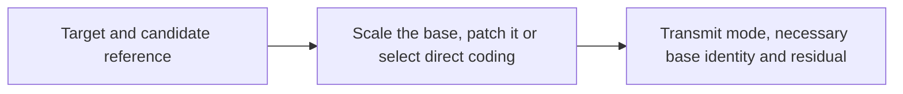
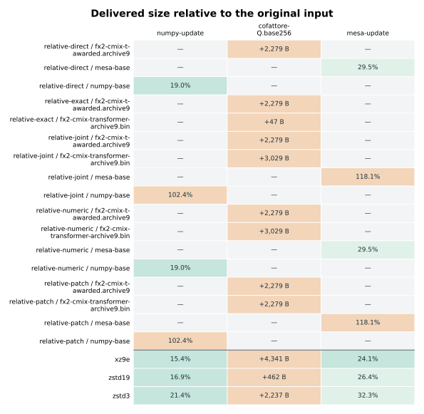

# Conditional patches after arithmetic alignment

> **Verdict: no meaningful gain on real data.** Best real input: Q: the record archive as an integer, −0.0004% vs zstd -19.
>
> Part of [chapter 6](../../report/6-record-archive.md) of the [report](../../report/README.md). Terms: [glossary](../../report/glossary.md).

## Question

If the receiver already owns a related file (a previous release, or the record archive), how small can a patch be, and what does it cost if the reference has to be sent too?

## How it works



The new file is coded relative to the reference with copies and arithmetic transforms; sizes are reported with and without delivering the reference.

<details><summary>Technical details</summary>

Can a cheap arithmetic transformation turn a reference into a useful predictor, and what does the result cost when the receiver must also obtain the reference?

**Mechanism and test.** An exact arithmetic relationship can shrink a patch to a descriptor. A receiver missing the base must also obtain its bytes. Compare matching and unrelated releases under both delivery assumptions.

The encoder compares direct Zstandard 9, Zstandard patch-from, and an XOR delta after multiplying or dividing the entire reference integer. Dispersed exact-byte probes shortlist scales. The exact profile can omit the residual when the prediction is identical. The header carries the target width, mode, scale and required reference SHA-256. Direct mode can decode without a base.

</details>

## Results on 20 MiB inputs

Every archive below decoded byte-exact. *Our archive* is this project's own format. *Our transform → standard tool* reshapes the bytes reversibly and hands the result to gzip, zstd or xz; it is listed only where it beats that same tool on the raw bytes. *Best standard tool* is the smallest of gzip, bzip2, xz, Zstandard, Brotli and PPMd (plus domain codecs for images, scans and video) on the raw bytes. *Difference* compares the better of our two columns with it; negative = ours is smaller.

| Input | Kind | Raw bytes | Our archive | Our transform → standard tool | Best standard tool | Difference |
|---|---|---:|---:|---:|---:|---:|
| Mesa release given the previous one | real | 67,133,440 | 19,832,536 (`relative-direct`) | — | 16,198,184 (xz -9e) | +22.4% |
| NumPy release given the previous one | real | 53,800,960 | 10,201,056 (`relative-direct`) | — | 8,272,288 (xz -9e) | +23.3% |
| Q: the record archive as an integer | derived from real | 96,994,187 | 96,994,234 (`relative-exact`) | — | 96,994,649 (zstd -19) | −0.0004% |

<details><summary>All profiles, timings and entropy measurements</summary>

<!-- BEGIN generated project measurements -->

Each archive passed a byte-for-byte round trip. *Bytes saved* is raw size minus archive (and any reference the decoder needs). Timings are one run on a shared desktop.

These tables list every measured profile. The comparison with the best standard tool on each input (gzip, bzip2, xz, Zstandard, Brotli, PPMd and the domain codecs) is the Results table above.

### Archive comparison across inputs



Read down a column to compare methods on identical input. Lower is better. 100% is the raw file size. Where available, standard codecs appear below the dividing line. Near 100%, cells give the exact byte difference from raw (+ means larger). Below 0.1%, they give the exact delivered total. A dash means the combination was unmeasured.

This project's published large-file trials measure complete archives. The effect on gzip, Zstandard or XZ after an isolated preprocessing step is unmeasured here.

### numpy-update · 53,800,960 raw bytes

**Standalone archives**

| Profile | Archive bytes | Archive + required reference (bytes) | Bytes saved vs raw | Encode (s) | Decode (s) |
|---|---:|---:|---:|---:|---:|
| `relative-direct` (base `numpy-base`) | 10,201,056 | 10,201,056 | +43,599,904 | 8.960 | 2.061 |
| `relative-joint` (base `numpy-base`) | 1,347,467 | 55,066,507 | -1,265,547 | 60.708 | 2.311 |
| `relative-numeric` (base `numpy-base`) | 10,201,056 | 10,201,056 | +43,599,904 | 43.941 | 1.944 |
| `relative-patch` (base `numpy-base`) | 1,347,467 | 55,066,507 | -1,265,547 | 9.894 | 2.551 |

Same-input baseline archives (bytes) · XZ 9 extreme 8,272,288 · Zstandard 19 9,104,011 · Zstandard 3 11,502,762

[Input hash and all measured codecs](../large-scale/results/by-dataset.md#numpy-update)

### cofattore-Q.base256 · 96,994,187 raw bytes

**Standalone archives**

| Profile | Archive bytes | Archive + required reference (bytes) | Bytes saved vs raw | Encode (s) | Decode (s) |
|---|---:|---:|---:|---:|---:|
| `relative-direct` (base `fx2-cmix-t-awarded.archive9`) | 96,996,466 | 96,996,466 | -2,279 | 1.987 | 2.407 |
| `relative-exact` (base `fx2-cmix-t-awarded.archive9`) | 96,996,466 | 96,996,466 | -2,279 | 45.158 | 2.573 |
| `relative-exact` (base `fx2-cmix-transformer-archive9.bin`) | 46 | 96,994,234 | -47 | 29.909 | 3.724 |
| `relative-joint` (base `fx2-cmix-t-awarded.archive9`) | 96,996,466 | 96,996,466 | -2,279 | 63.236 | 2.786 |
| `relative-joint` (base `fx2-cmix-transformer-archive9.bin`) | 3,028 | 96,997,216 | -3,029 | 59.035 | 5.324 |
| `relative-numeric` (base `fx2-cmix-t-awarded.archive9`) | 96,996,466 | 96,996,466 | -2,279 | 39.524 | 2.994 |
| `relative-numeric` (base `fx2-cmix-transformer-archive9.bin`) | 3,028 | 96,997,216 | -3,029 | 35.276 | 7.237 |
| `relative-patch` (base `fx2-cmix-t-awarded.archive9`) | 96,996,466 | 96,996,466 | -2,279 | 6.263 | 3.166 |
| `relative-patch` (base `fx2-cmix-transformer-archive9.bin`) | 96,996,466 | 96,996,466 | -2,279 | 8.375 | 2.642 |

Same-input baseline archives (bytes) · XZ 9 extreme 96,998,528 · Zstandard 19 96,994,649 · Zstandard 3 96,996,424

[Input hash and all measured codecs](../large-scale/results/by-dataset.md#cofattore-qbase256)

### mesa-update · 67,133,440 raw bytes

**Standalone archives**

| Profile | Archive bytes | Archive + required reference (bytes) | Bytes saved vs raw | Encode (s) | Decode (s) |
|---|---:|---:|---:|---:|---:|
| `relative-direct` (base `mesa-base`) | 19,832,536 | 19,832,536 | +47,300,904 | 12.167 | 2.646 |
| `relative-joint` (base `mesa-base`) | 13,146,431 | 79,307,071 | -12,173,631 | 53.086 | 2.310 |
| `relative-numeric` (base `mesa-base`) | 19,832,536 | 19,832,536 | +47,300,904 | 34.607 | 2.094 |
| `relative-patch` (base `mesa-base`) | 13,146,431 | 79,307,071 | -12,173,631 | 19.326 | 3.453 |

Same-input baseline archives (bytes) · XZ 9 extreme 16,198,184 · Zstandard 19 17,697,935 · Zstandard 3 21,668,962

[Input hash and all measured codecs](../large-scale/results/by-dataset.md#mesa-update)

### Reproduce the large-file comparison

From the repository root, with the pinned inputs and project dependencies installed, replay all published standalone profiles for this folder into a fresh directory.

```sh
python3 research/large-scale/primary.py runs/replay-arithmetic-references --project arithmetic-references --all-profiles
```

[Dataset preparation](../large-scale/README.md#inputs) · [Archive hashes and settings](../large-scale/results/archives.jsonl)

<!-- END generated project measurements -->

</details>

## Small-scale results

The complete award release and the exact original FX2 numerator are separate references for Q. Two independent transfers use the decompressed package tar streams of adjacent NumPy and Mesa releases. The measurements identify both hashes and show base delivery separately.

The matching 96,994,188-byte numerator and a 46-byte formula recover all of Q; delivering both costs 96,994,234 bytes. With the other FX2 award release the exact profile selected direct coding at 96,996,466. The NumPy update used 1,347,467 bytes relative to its older package, versus 10,201,056 direct. Mesa also benefited from a conventional patch. [Full archive sizes, times and hashes](../large-scale/results/by-dataset.md)

## Run it

Run these commands from the repository root. The [large-suite instructions](../large-scale/README.md) give input preparation, dependencies and the complete benchmark command.

```sh
mkdir -p runs
BASE=../lab/hutter/divisors/fx2-cmix-transformer-archive9.bin
python3 research/arithmetic-references/codec.py encode "$Q" runs/q.arf --reference "$BASE" --profile exact
python3 research/arithmetic-references/codec.py decode runs/q.arf runs/q-relative.restored --reference "$BASE"
cmp "$Q" runs/q-relative.restored
```

## Provenance

<details><summary>Where this code came from</summary>

Reports 021, 057 and 058 distinguish a shared model, a reference patch and computational reproduction. ARF1 is a new, general archive with a content-addressed reference. It also tests the older lab observation that the matching FX2 numerator is exactly 3,072 times Q.

</details>
