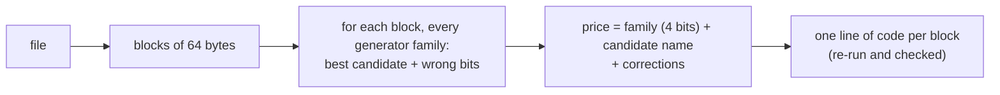

# Block programs: describe each block with the cheapest generator

> **Verdict: loses to every ordinary compressor.** The first kilobyte of enwik8 costs 946 bytes with mathematical
> generators only and 526 bytes once "copy earlier data" and "predict from context" generators are allowed,
> against 300 bytes for brotli, 350 for gzip and 420 for xz. On 10 MB, no real block was described better by any
> generator than by its own letter counts (0 of 7); 4 of 5 planted blocks were found.
>
> Part of [chapter 1](../../report/1-formulas.md) of the [report](../../report/README.md).

## Question

Instead of one rule for the whole file, give every small block its own generator (a formula, a digit sequence, a
seeded random stream, an automaton, a copy of earlier data) plus bit corrections. Is the sum of those
descriptions shorter than the data?

## How it works



- [`blockgen.cpp`](blockgen.cpp) writes one line of code per block that regenerates it, then re-runs every line
  and compares the output (round trip). Mode `math` allows only rule generators; mode `all` adds generators that
  reuse earlier data (copy, "the byte that followed last time", "the most frequent follower").
- [`gen.cpp`](gen.cpp) scans 12 blocks of 4 KiB from the first 10 MB of enwik8, 5 of which are replaced by
  planted generator output, and reports whether any generator "layer" beats the block's own letter counts.

## Results

Re-verified November 28, 2026 ([logs](results)); identical to the original runs.

| First 1,024 bytes of enwik8 | Bytes |
|---|---:|
| Mathematical generators only (formulas, digits, automata, repeats) | 946 |
| + copies of earlier data and context predictors | 526 |
| xz -9e / gzip -9 / brotli -11 | 420 / 350 / 300 |

The math-only program needs 136–174 corrected bits for every 512-bit block: each "rule" is really a vague fit to
the ASCII layout. The second program is better only because its winning generators are *copies and context
predictors*, i.e. an ordinary compressor written as a program.

| 10 MB scan, 4 KiB blocks | Result |
|---|---|
| 7 real blocks | none beaten by any generator; the best generator layer loses 7,800–9,900 bits per block; longest exact run 260–264 bits against 267 bits to name it |
| Planted: Thue–Morse every 3rd from 9,999 | found exactly (47 bits for 32,768) |
| Planted: rule 30 from a random first row | found exactly |
| Planted: Langton's ant after 11,000 steps | found exactly (42 bits) |
| Planted: digits of √2 + √3 with 2% noise | found |
| Planted: 3-D pyramid of ones with 1% noise | not found as a shape; a dragon-curve sequence approximated it (2,731 bits vs 6,396) |

## Run it

```sh
make -C research lab
python3 research/coincidence-hunt/digits.py runs/digits
head -c 1024 "$CORPUS/enwik8/enwik8" > runs/e1k
research/build/blockgen runs/e1k 1024 64 runs/digits math runs/e1k_math.prog
research/build/blockgen runs/e1k 1024 64 runs/digits all runs/e1k_all.prog
head -c 10000000 "$CORPUS/enwik8/enwik8" > runs/e10m
research/build/gen runs/e10m runs/digits 4096 12 --plant
```
