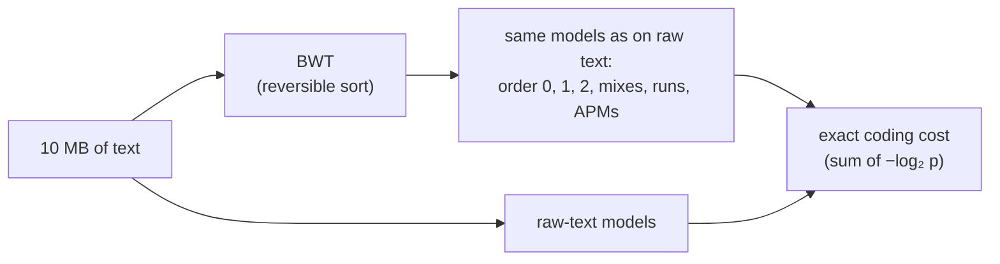

# BWT lab: sort first, then model

> **Verdict: helps weak models, loses to context mixing.** On the first 10 MB of enwik8 the best BWT pipeline costs
> 2,390,774 bytes, against 2,222,042 for our first context mixer on the raw text and about 2.0 MB for CM3.
> Telling the decoder which letters follow (via count headers) never pays.
>
> Part of [chapter 5](../../report/5-text.md) of the [report](../../report/README.md).

## Question

The Burrows–Wheeler transform (the step inside bzip2) reorders text so that characters with similar following
contexts end up next to each other. How much does that help a model, and is "sort first, then model" a better
route than modelling the raw text directly?

## How it works



Every model is run twice, on the raw text and on its BWT, and priced as an adaptive arithmetic coder would pay.
The last test stores letter, pair or triple counts in a header so that the decoder knows which letters *follow*
each sorted position.

## Results

First 10,000,000 bytes of enwik8. Re-verified November 28, 2026 ([log](results/bwtlab-10m.log)); identical to the
run of November 24 ([log](bwtlab-10m-2026-11-24.log)).

| Model | Raw text | After BWT |
|---|---:|---:|
| Letter counts (order 0) | 6,269,384 | 3,854,239 |
| Next byte given 1 previous (order 1) | 4,789,847 | 2,754,618 |
| Next byte given 2 previous (order 2) | 3,862,096 | 2,763,431 |
| Mix of orders 0–2 + run model + 2 APMs | 3,522,562 | 2,432,301 |
| BWT → move-to-front → run-length + ranks | — | 2,538,087 |
| Larger mix (hashed orders 0–3, two mixers, 3 APMs) | — | **2,390,774** |
| … + header with following-letter counts | — | 2,395,542 |
| … + header with following-pair counts | — | 2,399,659 |
| … + header with following-triple counts | — | 2,507,176 |
| *For comparison: our first context mixer on raw text* | *2,222,042* | |
| *xz -9e on the same 10 MB* | *2,720,256* | |

BWT makes weak models 30–40% better and turns 60.7% of bytes into zeros after move-to-front. But the best BWT
pipeline is still 7.6% worse than a modest context mixer on the raw text, because sorting destroys the
left-to-right order that word models and long-match models need. The published best BWT compressor
(bsc-m03, 20.29 MB on enwik8) is likewise behind context mixers such as paq8l (17.92 MB).

## Run it

```sh
make -C research lab
head -c 10000000 "$CORPUS/enwik8/enwik8" > runs/e10m
research/build/bwtlab runs/e10m            # about 4 minutes
```
