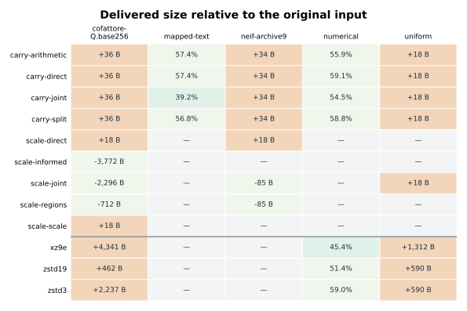

# Integer carries across tree boundaries

> **Verdict: no meaningful gain on real data.** Best real input: Q: the record archive as an integer, −0.0044% vs zstd -19.
>
> Part of [chapter 1](../../report/1-formulas.md) of the [report](../../report/README.md). Terms: [glossary](../../report/glossary.md).

## Question

Does multiplying or dividing the whole file by a small number before splitting it expose regions that the same trick on each piece would miss?

## How it works


The file is scaled (for example by 12), split into regions, and sparse arithmetic regions are coded while the rest stays literal; the order of scaling and splitting is compared.

<details><summary>Technical details</summary>

Does multiplying or dividing a file before splitting expose regions that the same transformation on individual leaves misses?

**Mechanism and test.** Carries cross a boundary when scaling precedes a cut. This can expose a locally encodable span even when the rest is incompressible. The blind and informed searches test how much the answer depends on prior knowledge of the candidate.

CRT1 uses literal, Zstandard, split and map nodes on roots up to 4 MiB. An odd multiplier is bijective modulo 2ⁿ. The power of two in a factor rotates bits, preserving those that would otherwise overflow. The inverse solves the exact carry and reverses the rotation. A map above a split carries information across its boundary. Encoder shortlist decisions cost no decoder bits. SCL1 applies a single map across the entire file and uses weighted interval scheduling over verified compressed replacements. The probe-selected `joint` profile and the `informed` profile, which adds the original lab candidate 12, are reported separately.

</details>

## Results on 20 MiB inputs

Every archive below decoded byte-exact. *Our archive* is this project's own format. *Our transform → standard tool* reshapes the bytes reversibly and hands the result to gzip, zstd or xz; it is listed only where it beats that same tool on the raw bytes. *Best standard tool* is the smallest of gzip, bzip2, xz, Zstandard, Brotli and PPMd (plus domain codecs for images, scans and video) on the raw bytes. *Difference* compares the better of our two columns with it; negative = ours is smaller.

| Input | Kind | Raw bytes | Our archive | Our transform → standard tool | Best standard tool | Difference |
|---|---|---:|---:|---:|---:|---:|
| Silesia numerical files (mr + x-ray + sao) | real | 25,696,748 | 13,992,442 (`carry-joint`) | — | 11,662,476 (xz -9e) | +20.0% |
| Q: the record archive as an integer | derived from real | 96,994,187 | 96,990,415 (`scale-informed`) | — | 96,994,649 (zstd -19) | −0.0044% |
| Neif: a later enwik9 archive | derived from real | 89,346,392 | 89,346,307 (`scale-joint`) | — | — | — |
| Uniform random bytes | control | 25,165,824 | 25,165,842 (`carry-arithmetic`) | — | 25,166,414 (zstd -19) | −0.0023% |
| mapped-text | other | 25,165,824 | 9,869,511 (`carry-joint`) | — | 10,023,454 (PPMd) | **−1.5%** |

<details><summary>All profiles, timings and entropy measurements</summary>

<!-- BEGIN generated project measurements -->

Each archive passed a byte-for-byte round trip. *Bytes saved* is raw size minus archive (and any reference the decoder needs). Timings are one run on a shared desktop.

These tables list every measured profile. The comparison with the best standard tool on each input (gzip, bzip2, xz, Zstandard, Brotli, PPMd and the domain codecs) is the Results table above.

### Archive comparison across inputs



Read down a column to compare methods on identical input. Lower is better. 100% is the raw file size. Where available, standard codecs appear below the dividing line. Near 100%, cells give the exact byte difference from raw (+ means larger). Below 0.1%, they give the exact delivered total. A dash means the combination was unmeasured.

This project's published large-file trials measure complete archives. The effect on gzip, Zstandard or XZ after an isolated preprocessing step is unmeasured here.

### cofattore-Q.base256 · 96,994,187 raw bytes

**Standalone archives**

| Profile | Archive bytes | Bytes saved vs raw | Encode (s) | Decode (s) | Peak KiB (encode / decode) |
|---|---:|---:|---:|---:|---:|
| `carry-arithmetic` | 96,994,223 | -36 | 6.200 | 1.479 | — / — |
| `carry-direct` | 96,994,223 | -36 | 1.547 | 0.933 | — / — |
| `carry-joint` | 96,994,223 | -36 | 43.804 | 0.543 | — / — |
| `carry-split` | 96,994,223 | -36 | 2.387 | 1.003 | — / — |
| `scale-direct` | 96,994,205 | -18 | 0.968 | 0.643 | 332,216 / 319,036 |
| `scale-informed` | 96,990,415 | +3,772 | 22.654 | 4.414 | 829,848 / 629,032 |
| `scale-joint` | 96,991,891 | +2,296 | 17.724 | 3.091 | 756,360 / 629,192 |
| `scale-regions` | 96,993,475 | +712 | 5.059 | 0.716 | 330,192 / 319,536 |
| `scale-scale` | 96,994,205 | -18 | 7.204 | 1.081 | 736,900 / 318,932 |

Same-input baseline archives (bytes) · XZ 9 extreme 96,998,528 · Zstandard 19 96,994,649 · Zstandard 3 96,996,424

[Input hash and all measured codecs](../large-scale/results/by-dataset.md#cofattore-qbase256)

### mapped-text · 25,165,824 raw bytes

**Standalone archives**

| Profile | Archive bytes | Bytes saved vs raw | Encode (s) | Decode (s) |
|---|---:|---:|---:|---:|
| `carry-arithmetic` | 14,436,133 | +10,729,691 | 3.499 | 0.301 |
| `carry-direct` | 14,436,133 | +10,729,691 | 1.006 | 0.417 |
| `carry-joint` | 9,869,511 | +15,296,313 | 30.406 | 0.943 |
| `carry-split` | 14,295,184 | +10,870,640 | 5.485 | 0.552 |

[Input hash and all measured codecs](../large-scale/results/by-dataset.md#mapped-text)

### neif-archive9 · 89,346,392 raw bytes

**Standalone archives**

| Profile | Archive bytes | Bytes saved vs raw | Encode (s) | Decode (s) | Peak KiB (encode / decode) |
|---|---:|---:|---:|---:|---:|
| `carry-arithmetic` | 89,346,426 | -34 | 4.039 | 0.923 | — / — |
| `carry-direct` | 89,346,426 | -34 | 0.700 | 0.754 | — / — |
| `carry-joint` | 89,346,426 | -34 | 33.529 | 1.000 | — / — |
| `carry-split` | 89,346,426 | -34 | 2.205 | 0.734 | — / — |
| `scale-direct` | 89,346,410 | -18 | 1.709 | 1.372 | 309,936 / 296,692 |
| `scale-joint` | 89,346,307 | +85 | 17.144 | 0.714 | 685,272 / 296,568 |
| `scale-regions` | 89,346,307 | +85 | 5.242 | 1.037 | 306,308 / 296,752 |

[Input hash and all measured codecs](../large-scale/results/by-dataset.md#neif-archive9)

### numerical · 25,696,748 raw bytes

**Standalone archives**

| Profile | Archive bytes | Bytes saved vs raw | Encode (s) | Decode (s) |
|---|---:|---:|---:|---:|
| `carry-arithmetic` | 14,355,119 | +11,341,629 | 2.797 | 0.464 |
| `carry-direct` | 15,175,129 | +10,521,619 | 0.955 | 0.465 |
| `carry-joint` | 13,992,442 | +11,704,306 | 42.440 | 0.788 |
| `carry-split` | 15,117,918 | +10,578,830 | 5.278 | 0.415 |

Same-input baseline archives (bytes) · XZ 9 extreme 11,662,476 · Zstandard 19 13,213,336 · Zstandard 3 15,163,683

[Input hash and all measured codecs](../large-scale/results/by-dataset.md#numerical)

### uniform · 25,165,824 raw bytes

**Standalone archives**

| Profile | Archive bytes | Bytes saved vs raw | Encode (s) | Decode (s) | Peak KiB (encode / decode) |
|---|---:|---:|---:|---:|---:|
| `carry-arithmetic` | 25,165,842 | -18 | 1.716 | 0.542 | — / — |
| `carry-direct` | 25,165,842 | -18 | 0.405 | 0.503 | — / — |
| `carry-joint` | 25,165,842 | -18 | 9.305 | 0.213 | — / — |
| `carry-split` | 25,165,842 | -18 | 0.565 | 0.207 | — / — |
| `scale-joint` | 25,165,842 | -18 | 8.231 | 0.928 | 214,524 / 108,528 |

Same-input baseline archives (bytes) · XZ 9 extreme 25,167,136 · Zstandard 19 25,166,414 · Zstandard 3 25,166,414

[Input hash and all measured codecs](../large-scale/results/by-dataset.md#uniform)

### Reproduce the large-file comparison

From the repository root, with the pinned inputs and project dependencies installed, replay all published standalone profiles for this folder into a fresh directory.

```sh
python3 research/large-scale/primary.py runs/replay-carry-trees --project carry-trees --all-profiles
```

[Dataset preparation](../large-scale/README.md#inputs) · [Archive hashes and settings](../large-scale/results/archives.jsonl)

<!-- END generated project measurements -->

</details>

## Small-scale results

Inputs include full Q, full Neif, real numerical bytes, noise, and 24 MiB of distinct Wikipedia fragments deliberately scrambled by independent page-local arithmetic maps.

On the scrambled text the combined tree gave 9,869,511 bytes, versus 14,295,184 for splitting alone. The independent numerical input gave 13,992,442 versus 14,355,119 for arithmetic alone. The 4 MiB tree stored all of Q literally. On full Q the sparse region-only archive was 96,993,475 bytes, the whole-file joint search gave 96,991,891, and explicitly including factor 12 gave 96,990,415. The original V15 package still has the larger saving. [Full archive sizes, times and hashes](../large-scale/results/by-dataset.md)

## Run it

Run these commands from the repository root. The [large-suite instructions](../large-scale/README.md) give input preparation, dependencies and the complete benchmark command.

```sh
mkdir -p runs
python3 research/carry-trees/codec.py encode runs/large/raw/mapped-text runs/mapped.crt --profile joint
python3 research/carry-trees/codec.py decode runs/mapped.crt runs/mapped.restored
cmp runs/large/raw/mapped-text runs/mapped.restored
python3 research/carry-trees/sparse_scale.py encode "$Q" runs/q.scl --profile informed
python3 research/carry-trees/sparse_scale.py decode runs/q.scl runs/q-scale.restored
cmp "$Q" runs/q-scale.restored
```

## Provenance

<details><summary>Where this code came from</summary>

The original mixed-arity trees divide an integer and split its quotient. The hybrid Q archive in `lab/hutter/divisors/q-ibrido/ibrido.py` selects disjoint spans in 12Q. CRT1 and SCL1 are new experiments based on those two constructions.

</details>
