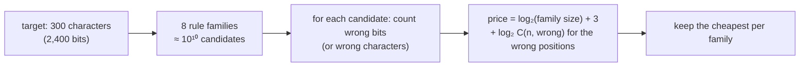

# Coincidence hunt

> **Verdict: no coincidence exists to be found.** About ten billion candidate rules were tried on 300 characters
> of Wikipedia. The best (2,134 bits) needs 21% more bits than gzip and 54% more than brotli; in every family
> the longest exact match is no longer than the bits needed to name the rule. All four planted controls are
> found exactly.
>
> Part of [chapter 1](../../report/1-formulas.md) of the [report](../../report/README.md).

## Question

Forget general compression. Is there **any** simple rule (a formula, digits of a constant, a random-number seed,
a cellular automaton, a shape) whose output happens to match **one** small piece of real text, with a list of
corrected bits, so that rule + corrections is shorter than the piece?

## How it works



- **Target:** bytes 4,123–4,422 of enwik8, the start of the "Anarchism" article.
- **Families:** digits of π, e, √2, √3, √5, φ and their digit-wise sums, read through 8 bit rules, plus classic
  sequences (Thue–Morse, Fibonacci word, dragon curve…); binary digits of √n, ∛n and 1/q; every xorshift32
  seed, 2³⁰ splitmix64 seeds, 8 LCGs; every formula and recurrence up to 6 operations; 40 named integer
  sequences, as bits or as text; Walsh–Hadamard, XOR-polynomial and cosine fits; all 256 elementary automata,
  Langton's ant, constant rows/columns/diagonals and pyramids at every width.
- **Price:** naming a candidate costs log₂ of how many the family tried; corrections cost the number of wrong
  bits plus which ones (log₂ of the binomial coefficient). "Longest exact run" is how many bits from the start
  match with no correction at all.

## Results

Re-verified November 28, 2026 ([logs](results)); the original run of November 24 is in
[`results-2026-11-24`](results-2026-11-24).

| Family | Candidates | Bits to name one | Longest exact run | Best total |
|---|---:|---:|---:|---:|
| Digits of constants, classic sequences | 3.9 × 10⁹ | 34.9 | 33 | 2,198 |
| Roots and fractions | 8.1 × 10⁷ | 29.3 | 24 | 2,217 |
| Random-number generator seeds | 5.5 × 10⁹ | 36.4 | 32 | 2,411 |
| Formulas f(i) | 1.8 × 10⁷ | 27.1 | 25 | **2,134** |
| Recurrences | 8.5 × 10⁷ | 29.3 | 25 | 2,136 |
| Named integer sequences | 1.1 × 10⁷ | 26.4 | 18 | 2,237 |
| Walsh–Hadamard / cosine | 4.4 × 10³ | 3.0 | 0 | 2,337 |
| Automata, Langton's ant, grids, shapes | 3.2 × 10⁸ | 32.2 | 23 | 2,157 |
| *Raw text* | | | | *2,400* |
| *gzip -9 / zstd -19 / brotli -11* | | | | *1,760 / 1,712 / 1,384* |
| *Letter statistics (table not counted)* | | | | *1,438* |

| Planted control (300 bytes) | Families searched | Result |
|---|---|---|
| [xorshift32, seed 123,456,789](controls/ctl_xorshift.bin) | generators | found exactly: 48 bits |
| [a formula written as letters](controls/ctl_formula.txt) | formulas | found exactly: 35 bits |
| [the primes as text](controls/ctl_primes.txt) | integer sequences | found exactly: 35 bits |
| [√1234 in binary with 72 flipped bits](controls/ctl_sqrt.bin) | roots | root and all 72 flips: 503 bits |

The best "wins" over raw bits come from rules like *f(i) = 100 XOR gcd(i, 5)*, which is mostly the byte for
"d": they match the fact that ASCII text has a 0 in the top bit of every byte. That is ordinary letter
statistics, done badly.

## Run it

```sh
make -C research lab                                         # builds research/build/hunt (needs GMP)
python3 research/coincidence-hunt/digits.py runs/digits      # 1M digits of 7 constants (about 1 minute)
head -c 4423 "$CORPUS/enwik8/enwik8" | tail -c 300 > runs/target300.txt
research/build/hunt runs/target300.txt runs/digits           # all families, about 7 minutes on 12 threads
research/build/hunt research/coincidence-hunt/controls/ctl_xorshift.bin runs/digits prng
```

The whole step is also part of [`research/lab-reruns.sh`](../lab-reruns.sh).
