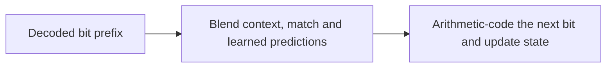
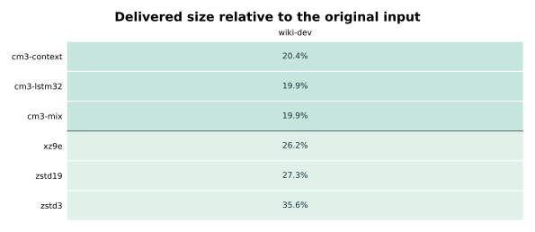

# CM3 context mixing

> **Verdict: wins on real data.** Best: Wikipedia text, 24 MiB, −24.3% vs xz -9e.
>
> On the full enwik8 (100 MB): **17,811,463 B**, better than paq8l -8 (17,916,450, published) and xz (24,703,772); see [chapter 5](../../report/5-text.md).
>
> Part of [chapter 5](../../report/5-text.md) of the [report](../../report/README.md). Terms: [glossary](../../report/glossary.md).

## Question

How well can a context-mixing compressor written from scratch in this project compress English Wikipedia?

## How it works



Dozens of small models (previous bytes, words, markup, long matches, a small LSTM network) each predict the next bit; learned mixers combine them and an arithmetic coder writes the result.

<details><summary>Technical details</summary>

How much does the lab's text compressor gain when it combines byte and word contexts, longer matches, a second mixer and a recurrent predictor? The CPU implementation and predictor headers are from `lab/arena`. The historic full-file run used the v9 configuration and the binary called cm3_v11. The workspace source has later optional predictors. The retained log records the original result.

**Mechanism and test.** Better probabilities shorten the arithmetic-coded stream. Models share decoder-synchronized state, while large tables and neural updates cost time and memory. Compare model additions on the same prefix before transferring the conclusion to a full run.

Each predictor supplies a probability for the next bit. The mixer combines them before arithmetic coding. Both processors update from the same decoded prefix. The profile and floating-point implementation are part of the shared decoder configuration. Use the same binary and CPU for encoding and decoding. The file carries its length and range-coded data. The benchmark directly compares restored contents and hashes the source.

</details>

## Results on 20 MiB inputs

Every archive below decoded byte-exact. *Our archive* is this project's own format. *Our transform → standard tool* reshapes the bytes reversibly and hands the result to gzip, zstd or xz; it is listed only where it beats that same tool on the raw bytes. *Best standard tool* is the smallest of gzip, bzip2, xz, Zstandard, Brotli and PPMd (plus domain codecs for images, scans and video) on the raw bytes. *Difference* compares the better of our two columns with it; negative = ours is smaller.

| Input | Kind | Raw bytes | Our archive | Our transform → standard tool | Best standard tool | Difference |
|---|---|---:|---:|---:|---:|---:|
| Wikipedia text, 24 MiB | real | 25,165,824 | 4,997,716 (`cm3-lstm32`) | — | 6,602,488 (xz -9e) | **−24.3%** |

<details><summary>All profiles, timings and entropy measurements</summary>

<!-- BEGIN generated project measurements -->

Each archive passed a byte-for-byte round trip. *Bytes saved* is raw size minus archive (and any reference the decoder needs). Timings are one run on a shared desktop.

These tables list every measured profile. The comparison with the best standard tool on each input (gzip, bzip2, xz, Zstandard, Brotli, PPMd and the domain codecs) is the Results table above.

### Archive comparison across inputs



Read down a column to compare methods on identical input. Lower is better. 100% is the raw file size. Where available, standard codecs appear below the dividing line. Near 100%, cells give the exact byte difference from raw (+ means larger). Below 0.1%, they give the exact delivered total. A dash means the combination was unmeasured.

This project's published large-file trials measure complete archives. The effect on gzip, Zstandard or XZ after an isolated preprocessing step is unmeasured here.

### wiki-dev · 25,165,824 raw bytes

**Standalone archives**

| Profile | Archive bytes | Bytes saved vs raw | Encode (s) | Decode (s) |
|---|---:|---:|---:|---:|
| `cm3-context` | 5,128,905 | +20,036,919 | 176.900 | 261.540 |
| `cm3-lstm32` | 4,997,716 | +20,168,108 | 1761.612 | 1960.914 |
| `cm3-mix` | 5,017,931 | +20,147,893 | 739.683 | 1013.867 |

Same-input baseline archives (bytes) · XZ 9 extreme 6,602,488 · Zstandard 19 6,873,848 · Zstandard 3 8,951,574

[Input hash and all measured codecs](../large-scale/results/by-dataset.md#wiki-dev)

### Reproduce the large-file comparison

From the repository root, with the pinned inputs and project dependencies installed, replay all published standalone profiles for this folder into a fresh directory.

```sh
python3 research/large-scale/primary.py runs/replay-context-mixer --project context-mixer --all-profiles
```

[Dataset preparation](../large-scale/README.md#inputs) · [Archive hashes and settings](../large-scale/results/archives.jsonl)

<!-- END generated project measurements -->

</details>

## Small-scale results

The primary trial measures `cm3-mix` on the complete `wiki-dev` input (25,165,824 raw bytes). The runner invokes a separate decoder and compares the reconstructed file byte for byte. The earlier measurements below retain their original input sizes.

On the first 131,072 bytes of enwik8, small context tables produced a 34,010-byte archive. The match and second-layer profile produced 33,759. Adding a 32-cell LSTM reduced that to 33,727. The original full 100,000,000-byte run used larger context tables and a 192-cell LSTM. Its verified archive measured 17,811,463 bytes. The prefix run was repeated here. The full result comes from the retained encode/decode log. [Fresh benchmark](results/enwik8-prefix.csv) · [Historical full-file log](results/original-enwik8.log)

## Run it

```sh
mkdir -p runs
python3 research/context-mixer/benchmark.py "$CORPUS/enwik8/enwik8" runs/cm3-prefix.csv
CM3_BITS=13 research/build/cm3 c research/statico/tests/data/sample.txt runs/sample.cm
CM3_BITS=13 research/build/cm3 d runs/sample.cm runs/sample.decoded
cmp research/statico/tests/data/sample.txt runs/sample.decoded
```

The benchmark clears inherited CM3 settings and supplies the same explicit profile for encoding and decoding. For the historical configuration, run the following in a clean shell from the repository root. This substantial run originally took about 6,200 seconds to encode and 6,300 seconds to decode, with 2.8 GB of context tables.

```sh
(
  set -a
  . ./research/context-mixer/cm3_v9.config
  set +a
  research/build/cm3 c "$CORPUS/enwik8/enwik8" runs/enwik8.cm
  research/build/cm3 d runs/enwik8.cm runs/enwik8.restored
  cmp "$CORPUS/enwik8/enwik8" runs/enwik8.restored
)
```
