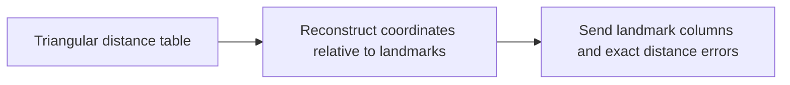
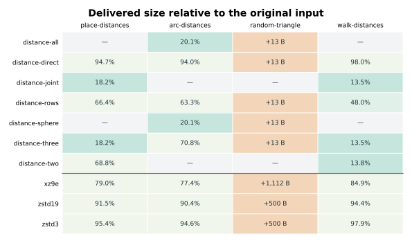

# Distance matrices reconstructed from landmarks

> **Verdict: wins on data derived from real data.** Best: Distances between 4,600 real places, −77.0% vs xz -9e. Planted control: Distances along a random planar walk, −84.1% vs xz -9e.
>
> Part of [chapter 4](../../report/4-specialised.md) of the [report](../../report/README.md). Terms: [glossary](../../report/glossary.md).

## Question

A table of distances between points is fully determined by the points' positions. Can a decoder rebuild the whole table from a few landmark columns?

## How it works



The encoder picks three or four well-spread landmarks, stores their full distance columns, recovers each point's coordinates relative to them, predicts every other distance and stores the exact errors.

<details><summary>Technical details</summary>

The old triangle experiment predicted an entry from the row above. Can a decoder recover the geometry itself when it receives only pairwise distances?

**Mechanism and test.** Low-dimensional geometry lets a few columns predict many pairwise distances. Quantization and a mismatch between chord and angular distance increase residual cost. An equal-size random triangle controls for triangular storage alone.

For n vertices the file has n(n−1)/2 little-endian unsigned 16-bit entries. The encoder chooses a triangle or tetrahedron of well-spread anchors, then stores their indices and full distance columns. Differences of squared distances give dot products against the anchor simplex. An integer adjugate and a fixed-point inverse predict the remaining pairs. The decoder recovers all errors from signed residual lanes. A separate spherical profile maps angular bins to chord bins using a deterministic Q62 recurrence before predicting, and maps back before applying the residual. The archived integer table is restored exactly; the coordinates stay with the data generator.

</details>

## Results on 20 MiB inputs

Every archive below decoded byte-exact. *Our archive* is this project's own format. *Our transform → standard tool* reshapes the bytes reversibly and hands the result to gzip, zstd or xz; it is listed only where it beats that same tool on the raw bytes. *Best standard tool* is the smallest of gzip, bzip2, xz, Zstandard, Brotli and PPMd (plus domain codecs for images, scans and video) on the raw bytes. *Difference* compares the better of our two columns with it; negative = ours is smaller.

| Input | Kind | Raw bytes | Our archive | Our transform → standard tool | Best standard tool | Difference |
|---|---|---:|---:|---:|---:|---:|
| Great-circle angles between the same places | derived from real | 21,155,400 | 4,242,861 (`distance-all`) | — | 16,371,240 (xz -9e) | **−74.1%** |
| Distances between 4,600 real places | derived from real | 21,155,400 | 3,850,014 (`distance-joint`) | — | 16,711,344 (xz -9e) | **−77.0%** |
| Distances along a random planar walk | planted | 21,155,400 | 2,860,313 (`distance-joint`) | — | 17,954,172 (xz -9e) | **−84.1%** |
| Random triangle of distances | control | 21,155,400 | 21,155,413 (`distance-all`) | — | 21,155,900 (zstd -19) | −0.0023% |

<details><summary>All profiles, timings and entropy measurements</summary>

<!-- BEGIN generated project measurements -->

Each archive passed a byte-for-byte round trip. *Bytes saved* is raw size minus archive (and any reference the decoder needs). Timings are one run on a shared desktop.

These tables list every measured profile. The comparison with the best standard tool on each input (gzip, bzip2, xz, Zstandard, Brotli, PPMd and the domain codecs) is the Results table above.

### Archive comparison across inputs



Read down a column to compare methods on identical input. Lower is better. 100% is the raw file size. Where available, standard codecs appear below the dividing line. Near 100%, cells give the exact byte difference from raw (+ means larger). Below 0.1%, they give the exact delivered total. A dash means the combination was unmeasured.

This project's published large-file trials measure complete archives. The effect on gzip, Zstandard or XZ after an isolated preprocessing step is unmeasured here.

### place-distances · 21,155,400 raw bytes

**Standalone archives**

| Profile | Archive bytes | Bytes saved vs raw | Encode (s) | Decode (s) | Peak KiB (encode / decode) |
|---|---:|---:|---:|---:|---:|
| `distance-direct` | 20,027,877 | +1,127,523 | 2.281 | 1.660 | 93,592 / 94,744 |
| `distance-joint` | 3,850,014 | +17,305,386 | 5.433 | 5.220 | 180,288 / 129,720 |
| `distance-rows` | 14,052,449 | +7,102,951 | 2.484 | 2.845 | 137,868 / 125,716 |
| `distance-three` | 3,850,014 | +17,305,386 | 3.909 | 4.255 | 143,992 / 129,784 |
| `distance-two` | 14,554,691 | +6,600,709 | 4.737 | 4.281 | 152,092 / 149,876 |

Same-input baseline archives (bytes) · XZ 9 extreme 16,711,344 · Zstandard 19 19,356,133 · Zstandard 3 20,188,613

[Input hash and all measured codecs](../large-scale/results/by-dataset.md#place-distances)

### arc-distances · 21,155,400 raw bytes

**Standalone archives**

| Profile | Archive bytes | Bytes saved vs raw | Encode (s) | Decode (s) | Peak KiB (encode / decode) |
|---|---:|---:|---:|---:|---:|
| `distance-all` | 4,242,861 | +16,912,539 | 5.818 | 2.145 | 220,072 / 132,180 |
| `distance-direct` | 19,891,770 | +1,263,630 | 1.149 | 0.941 | 97,036 / 94,688 |
| `distance-rows` | 13,383,793 | +7,771,607 | 1.292 | 1.581 | 140,884 / 124,496 |
| `distance-sphere` | 4,242,861 | +16,912,539 | 3.315 | 2.242 | 164,956 / 131,912 |
| `distance-three` | 14,975,990 | +6,179,410 | 1.762 | 3.083 | 153,468 / 151,524 |

Same-input baseline archives (bytes) · XZ 9 extreme 16,371,240 · Zstandard 19 19,114,392 · Zstandard 3 20,007,568

[Input hash and all measured codecs](../large-scale/results/by-dataset.md#arc-distances)

### random-triangle · 21,155,400 raw bytes

**Standalone archives**

| Profile | Archive bytes | Bytes saved vs raw | Encode (s) | Decode (s) | Peak KiB (encode / decode) |
|---|---:|---:|---:|---:|---:|
| `distance-all` | 21,155,413 | -13 | 4.823 | 0.769 | 206,032 / 76,064 |
| `distance-direct` | 21,155,413 | -13 | 0.808 | 0.581 | 77,180 / 76,244 |
| `distance-rows` | 21,155,413 | -13 | 0.809 | 0.641 | 140,972 / 76,240 |
| `distance-sphere` | 21,155,413 | -13 | 3.226 | 0.909 | 165,688 / 75,900 |
| `distance-three` | 21,155,413 | -13 | 1.468 | 0.519 | 166,220 / 76,240 |

Same-input baseline archives (bytes) · XZ 9 extreme 21,156,512 · Zstandard 19 21,155,900 · Zstandard 3 21,155,900

[Input hash and all measured codecs](../large-scale/results/by-dataset.md#random-triangle)

### walk-distances · 21,155,400 raw bytes

**Standalone archives**

| Profile | Archive bytes | Bytes saved vs raw | Encode (s) | Decode (s) | Peak KiB (encode / decode) |
|---|---:|---:|---:|---:|---:|
| `distance-direct` | 20,725,737 | +429,663 | 1.189 | 0.662 | 97,520 / 96,060 |
| `distance-joint` | 2,860,313 | +18,295,087 | 4.178 | 2.658 | 184,104 / 125,408 |
| `distance-rows` | 10,164,974 | +10,990,426 | 1.299 | 0.967 | 141,704 / 118,100 |
| `distance-three` | 2,860,313 | +18,295,087 | 2.572 | 3.109 | 143,732 / 125,760 |
| `distance-two` | 2,925,332 | +18,230,068 | 2.121 | 2.414 | 142,972 / 126,984 |

Same-input baseline archives (bytes) · XZ 9 extreme 17,954,172 · Zstandard 19 19,976,964 · Zstandard 3 20,717,883

[Input hash and all measured codecs](../large-scale/results/by-dataset.md#walk-distances)

### Reproduce the large-file comparison

From the repository root, with the pinned inputs and project dependencies installed, replay all published standalone profiles for this folder into a fresh directory.

```sh
python3 research/large-scale/primary.py runs/replay-distance-geometry --project distance-geometry --all-profiles
```

[Dataset preparation](../large-scale/README.md#inputs) · [Archive hashes and settings](../large-scale/results/archives.jsonl)

<!-- END generated project measurements -->

</details>

## Small-scale results

The 4,600 distinct coordinate pairs come from Wikipedia coordinate templates and explicitly signed named infobox fields. One table contains rounded 3D unit-sphere chord distances and another rounded great-circle angles. A seeded planar walk extends the original control. The random control has exactly the same triangular length and row count. Each raw file contains 21,155,400 bytes.

On the real-place chord table, row prediction gave 14,052,449 bytes, three landmarks gave 14,554,691, four landmarks gave 3,850,014 and XZ extreme gave 16,711,344. On the angular table, blindly applying the Euclidean model gave 14,975,990 bytes. The spherical model gave 4,242,861. On matched random words the selector retained the original data with a 13-byte header. [Full archive sizes, times and hashes](../large-scale/results/by-dataset.md)

## Run it

Run these commands from the repository root. The [large-suite instructions](../large-scale/README.md) give input preparation, dependencies and the complete benchmark command.

```sh
mkdir -p runs
python3 research/distance-geometry/codec.py encode runs/large/raw/arc-distances runs/places.dgm --profile all
python3 research/distance-geometry/codec.py decode runs/places.dgm runs/places.restored
cmp runs/large/raw/arc-distances runs/places.restored
```

## Provenance

<details><summary>Where this code came from</summary>

The lower-triangle layout and random-walk control come from `lab/shape/triangle.py`. DGM1 adds a self-contained landmark predictor. The geographic inputs are constructed from actual coordinates in enwik9. They are separate, derived files with independently pinned hashes.

</details>
