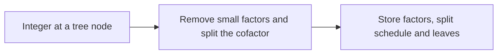
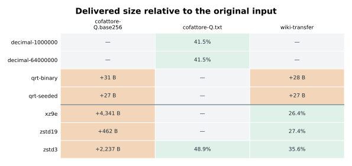

# Mixed-arity factor trees

> **Verdict: no meaningful gain on real data.** Best real input: Q: the record archive as an integer, −0.0004% vs zstd -19.
>
> Part of [chapter 1](../../report/1-formulas.md) of the [report](../../report/README.md). Terms: [glossary](../../report/glossary.md).

## Question

Read a big file as one integer. Can splitting it into factors and children, again and again, describe it in fewer bytes than the file?

## How it works



Each node removes its small prime factors, then splits the remaining number into 2 to 128 children at chosen bit positions, keeping every width so the bytes can be rebuilt.

<details><summary>Technical details</summary>

Can extracting the small prime factors of every node pay for the tree when its children split at different bit positions? The native GMP implementation comes from `lab/hutter/divisors/q-fattori-ricorsivi/albero.cpp`. It uses Statico's range coder for factor descriptors. The [original sweep](original-arity-sweep.tsv) prices 129 schedules. Its final column identifies configurations originally written and checked with `cmp`.

**Mechanism and test.** A boundary shift helps only when it exposes factors cheap enough to repay the description of the cut. Widths preserve leading zeros. Full-Q and text receipts test whether that saving survives an entire tree.

At each node, divide out small prime powers. Split the remaining cofactor in binary, retaining each child's width so leading zeros can be restored. The decoder concatenates the child bit strings and multiplies the extracted factors back in. QRT4 carries the per-level arity schedule and a common cut offset. QRT5 carries a seed from which both sides derive individual boundary shifts. The seed, arities, arithmetic-coded factor descriptions, leaves and terminal padding all count.

</details>

## Results on 20 MiB inputs

Every archive below decoded byte-exact. *Our archive* is this project's own format. *Our transform → standard tool* reshapes the bytes reversibly and hands the result to gzip, zstd or xz; it is listed only where it beats that same tool on the raw bytes. *Best standard tool* is the smallest of gzip, bzip2, xz, Zstandard, Brotli and PPMd (plus domain codecs for images, scans and video) on the raw bytes. *Difference* compares the better of our two columns with it; negative = ours is smaller.

| Input | Kind | Raw bytes | Our archive | Our transform → standard tool | Best standard tool | Difference |
|---|---|---:|---:|---:|---:|---:|
| Wikipedia text, another 24 MiB | real | 25,165,824 | 25,165,851 (`qrt-seeded`) | — | 6,637,336 (xz -9e) | 3.8× larger |
| Q: the record archive as an integer | derived from real | 96,994,187 | 96,994,214 (`qrt-seeded`) | — | 96,994,649 (zstd -19) | −0.0004% |
| cofattore-Q.txt | other | 233,585,278 | 96,994,346 (`decimal-64000000`) | — | 114,336,073 (zstd -3) | **−15.2%** |

<details><summary>All profiles, timings and entropy measurements</summary>

<!-- BEGIN generated project measurements -->

Each archive passed a byte-for-byte round trip. *Bytes saved* is raw size minus archive (and any reference the decoder needs). Timings are one run on a shared desktop.

These tables list every measured profile. The comparison with the best standard tool on each input (gzip, bzip2, xz, Zstandard, Brotli, PPMd and the domain codecs) is the Results table above.

### Archive comparison across inputs



Read down a column to compare methods on identical input. Lower is better. 100% is the raw file size. Where available, standard codecs appear below the dividing line. Near 100%, cells give the exact byte difference from raw (+ means larger). Below 0.1%, they give the exact delivered total. A dash means the combination was unmeasured.

This project's published large-file trials measure complete archives. The effect on gzip, Zstandard or XZ after an isolated preprocessing step is unmeasured here.

### cofattore-Q.base256 · 96,994,187 raw bytes

**Standalone archives**

| Profile | Archive bytes | Bytes saved vs raw | Encode (s) | Decode (s) |
|---|---:|---:|---:|---:|
| `qrt-binary` | 96,994,218 | -31 | 14.118 | 6.514 |
| `qrt-seeded` | 96,994,214 | -27 | 8.719 | 7.790 |

Same-input baseline archives (bytes) · XZ 9 extreme 96,998,528 · Zstandard 19 96,994,649 · Zstandard 3 96,996,424

[Input hash and all measured codecs](../large-scale/results/by-dataset.md#cofattore-qbase256)

### cofattore-Q.txt · 233,585,278 raw bytes

**Standalone archives**

| Profile | Archive bytes | Bytes saved vs raw | Encode (s) | Decode (s) |
|---|---:|---:|---:|---:|
| `decimal-1000000` | 97,001,941 | +136,583,337 | 105.699 | 116.955 |
| `decimal-64000000` | 96,994,346 | +136,590,932 | 159.959 | 368.037 |

Same-input baseline archives (bytes) · Zstandard 3 114,336,073

[Input hash and all measured codecs](../large-scale/results/by-dataset.md#cofattore-qtxt)

### wiki-transfer · 25,165,824 raw bytes

**Standalone archives**

| Profile | Archive bytes | Bytes saved vs raw | Encode (s) | Decode (s) |
|---|---:|---:|---:|---:|
| `qrt-binary` | 25,165,852 | -28 | 3.968 | 1.396 |
| `qrt-seeded` | 25,165,851 | -27 | 2.664 | 1.723 |

Same-input baseline archives (bytes) · XZ 9 extreme 6,637,336 · Zstandard 19 6,891,038 · Zstandard 3 8,968,456

[Input hash and all measured codecs](../large-scale/results/by-dataset.md#wiki-transfer)

### Reproduce the large-file comparison

From the repository root, with the pinned inputs and project dependencies installed, replay all published standalone profiles for this folder into a fresh directory.

```sh
python3 research/large-scale/primary.py runs/replay-factor-trees --project factor-trees --all-profiles
```

[Dataset preparation](../large-scale/README.md#inputs) · [Archive hashes and settings](../large-scale/results/archives.jsonl)

<!-- END generated project measurements -->

</details>

## Small-scale results

The primary trial measures `qrt-seeded` on the complete `cofattore-Q.base256` input (96,994,187 raw bytes). The runner invokes a separate decoder and compares the reconstructed file byte for byte. The earlier measurements below retain their original input sizes.

| Configuration, 1 MiB leaf limit | Archive bytes | Excess over Q |
|---|---:|---:|
| Centered binary | 96,994,218 | 31 |
| Arity 9 then 11, offset −9 bits | 96,994,215 | 28 |
| Arity cap 128, seed 2 | 96,994,214 | 27 |

The last configuration made 93 actual children at the root. Its 96,994,126 leaf bytes saved 61 bytes. The header and factor descriptors occupied 22 and 66 bytes, respectively. All three full reconstructions passed a byte comparison. Allowing more children improved the balance by four bytes over the binary tree. The [replay](../evidence/native-replay/trials.csv) includes timings and the input hash. For a child whose cofactor contains a formula, see the [nested experiment](../whiteboard-trees/README.md).

## Run it

Build the [research engines](../README.md#build) and set `Q` as described there. QRT accepts nonempty files. These commands use the entire cofactor.

```sh
mkdir -p runs
research/build/factor-tree split-seeded "$Q" runs/q.qrt runs/levels.tsv 1048576 128 2
research/build/factor-tree join runs/q.qrt runs/q.restored
cmp "$Q" runs/q.restored
python3 research/benchmark_native.py "$Q" runs/native-trees
```
