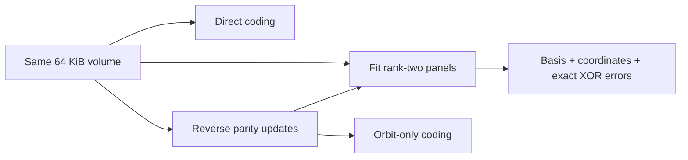
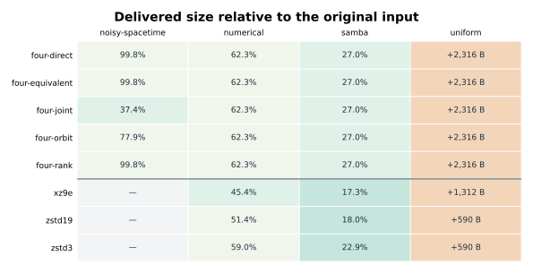
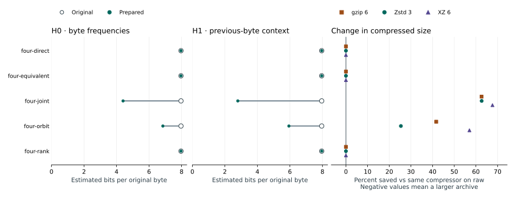
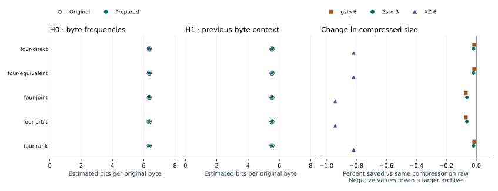
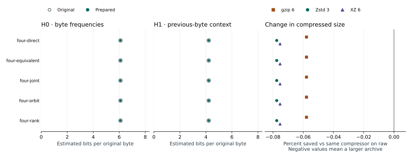
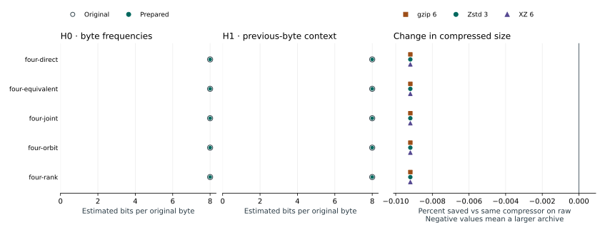

# Four-dimensional automata with noisy binary matrix factors

[Method diagram](#method-diagram) · [Charts and benchmark tables](#large-file-benchmark)

## Question and prior work

Can inverse evolution recover approximate low rank after motion in four axes? Can equally valid bases yield different coded lengths?

### Source files and compatibility

This extends the U/V/E constructions from local reports 028–031, the predecessor search in report 013, and numbered experiments 06–08. F4D1 is a new format with a small native panel factorizer and a separate forward inverse.

## Run the experiment

Run these commands from the repository root. The [large-suite instructions](../large-scale/README.md) give input preparation, dependencies and the complete benchmark command.

```sh
mkdir -p runs
python3 research/four-dimensional-factors/control.py runs/spacetime.bin
python3 research/four-dimensional-factors/codec.py encode runs/spacetime.bin runs/spacetime.f4d --profile joint
python3 research/four-dimensional-factors/codec.py decode runs/spacetime.f4d runs/spacetime.restored
cmp runs/spacetime.bin runs/spacetime.restored
```

## Variants and format

Each 64 KiB volume has open time, z, y and packed x axes. Each axis has two parity updates. Linear neighbor-XOR and nonlinear two-neighbor rules have an exact inverse obtained by reversing the schedule. Independently, each 16×8 panel stores two basis rows, two coordinate bit masks and its exact XOR residual. Six binary changes of basis preserve the product. The joint mode ranks predecessor samples and fully prices two candidate factorizations plus the step-zero factorization. Stored bases and coordinates are sufficient to decode.

### Method diagram



**Mechanism and test.** The planted generator mixes nearly low-rank panels along four axes. Undoing its schedule exposes the factors. The joint and orbit-only archives tie on numerical, Samba and uniform inputs, which bounds the observed incremental benefit of factoring.

## Inputs and measurement

The 24 MiB plant has slowly changing bases, independently sampled coordinates and a deliberate one-bit error in every other panel. Each volume then evolves a chosen number of steps. The real numerical and Samba inputs and uniform bytes use exactly the same search.

## Results

On the plant, direct and equivalent-factor profiles gave 25,120,549 bytes. The orbit alone gave 19,601,212. Combining inverse evolution with factor/residual coding gave 9,414,787. On real numerical data the joint profile tied the orbit-only result of 16,013,206. Samba and uniform data also showed no incremental factor gain. [Full archive sizes, times and hashes](../large-scale/results/by-dataset.md)


### What does factoring add after the automaton?

All five profiles used the same four pinned inputs. The direct profile retains the native record headers. The raw baseline skips those headers. Comparing orbit with joint holds the framing and backend fixed and tests the additional option to fit factors on a predecessor. Comparing direct with rank and equivalent tests those factor choices before reversing any steps.

| Input | Factored blocks selected by joint / total | gzip 6 bytes saved by adding factors | Zstandard 3 bytes saved | XZ 6 bytes saved |
|---|---:|---:|---:|---:|
| `noisy-spacetime` | 384 / 384 | 5,243,072 | 9,383,067 | 2,666,448 |
| `numerical` | 0 / 393 | 0 | 0 | 0 |
| `samba` | 0 / 330 | 0 | 0 | 0 |
| `uniform` | 0 / 384 | 0 | 0 | 0 |

On every input, direct, rank-only and equivalent-basis coding emitted byte-identical prepared streams. On the plant, undoing the evolution first changed that outcome on all 384 blocks. The orbit-only stream had normalized H0 of **6.8492 bits per original byte**. Adding factors lowered it to **4.4010**, even though the prepared stream grew from **25,168,140 to 34,605,324 bytes**. All three backends benefited, by different amounts.

On numerical, Samba and uniform input the orbit and joint prepared hashes match exactly. The zeroes above mean the encoder selected no factor records. On numerical it selected an orbit on just two blocks. That choice saved **975 bytes** in the native block archive, yet cost **6,700 bytes** with whole-stream Zstandard compared with the framed direct profile, and **9,430 bytes** compared with raw Zstandard. The block-wise selection objective and the whole-stream objective can favor different choices.

The paired runs used native archives checked against the previously published SHA-256 for each input and profile. Where profiles already had identical verified archives, one matching native file supplied those profiles. Each pair ran inverse preprocessing and all three compress/decompress comparisons. This is one planted source with specific dynamics, two real files and one uniform control. It establishes a mechanism on this plant and leaves its prevalence on other volumes open. [Native selections and hashes](../large-scale/results/archives.jsonl) · [Prepared stream hashes and backend sizes](../large-scale/results/preprocessing.jsonl)

<details>
<summary>Reproduce the complete five-by-four paired experiment</summary>

From the repository root after building the panel factorizer and preparing the pinned inputs, use a fresh output directory.

```sh
mkdir -p runs/four-paired
for input in noisy-spacetime numerical samba uniform; do
  for profile in direct orbit rank equivalent joint; do
    python3 research/large-scale/entropy_bench.py "four-$profile" \
      "runs/large/raw/$input" "runs/four-paired/$input-$profile.json" || exit 1
  done
done
```

</details>

## Large-file benchmark

On `noisy-spacetime` (25,165,824 raw bytes), `four-joint` produced 9,414,787 archive bytes. [Input and timing](../large-scale/results/by-dataset.md#noisy-spacetime) · [All project measurements](../large-scale/results/by-experiment.md#four-dimensional-factors)

<!-- BEGIN generated project measurements -->

Each archive passed a byte-for-byte round trip. Bytes saved subtracts the archive and any required reference from the raw input size. Timings are seconds from one run.

Holding `four-joint` fixed across the 3 measured input/reference settings with a standalone Zstandard 3 control gives **0 smaller, 0 equal and 3 larger** delivered archives. Each setting counts once.

### Archive comparison across inputs



Read down a column to compare methods on identical input. Lower is better. 100% is the raw file size. Where available, standard codecs appear below the dividing line. Near 100%, cells give the exact byte difference from raw (+ means larger). Below 0.1%, they give the exact delivered total. A dash means the combination was unmeasured.

The paired figures below measure preprocessing separately. H0 measures byte frequencies. H1 conditions on the previous byte. The tables give both in bits per byte of their own stream. The figures express model costs per original byte. H0 counts every byte. H1 counts each adjacent pair, omitting the first byte’s marginal cost. Positive compressor savings mean a smaller compressed file.

### noisy-spacetime · 25,165,824 raw bytes



Of 5 measured profiles on this input, 2 reduced gzip size, 2 reduced Zstandard size and 2 reduced XZ size. Exact ties count separately from improvements.

**Entropy before and after preprocessing**

| Profile | Prepared bytes | H0 before → after | H1 before → after | Post H0 per raw byte |
|---|---:|---:|---:|---:|
| `four-direct` | 25,168,140 | 7.9645 → 7.9643 | 7.9554 → 7.9552 | 7.9651 |
| `four-equivalent` | 25,168,140 | 7.9645 → 7.9643 | 7.9554 → 7.9552 | 7.9651 |
| `four-joint` | 34,605,324 | 7.9645 → 3.2005 | 7.9554 → 2.0327 | 4.4010 |
| `four-orbit` | 25,168,140 | 7.9645 → 6.8486 | 7.9554 → 5.9360 | 6.8492 |
| `four-rank` | 25,168,140 | 7.9645 → 7.9643 | 7.9554 → 7.9552 | 7.9651 |

**Same compressor on original → prepared bytes**

| Profile | gzip 6 | Zstandard 3 | XZ 6 |
|---|---:|---:|---:|
| `four-direct` | 25,042,968 → 25,045,207 (-0.01%) | 25,166,413 → 25,168,729 (-0.01%) | 25,063,412 → 25,065,264 (-0.01%) |
| `four-equivalent` | 25,042,968 → 25,045,207 (-0.01%) | 25,166,413 → 25,168,729 (-0.01%) | 25,063,412 → 25,065,264 (-0.01%) |
| `four-joint` | 25,042,968 → 9,362,367 (+62.61%) | 25,166,413 → 9,397,974 (+62.66%) | 25,063,412 → 8,109,204 (+67.65%) |
| `four-orbit` | 25,042,968 → 14,605,439 (+41.68%) | 25,166,413 → 18,781,041 (+25.37%) | 25,063,412 → 10,775,652 (+57.01%) |
| `four-rank` | 25,042,968 → 25,045,207 (-0.01%) | 25,166,413 → 25,168,729 (-0.01%) | 25,063,412 → 25,065,264 (-0.01%) |

**Standalone archives**

| Profile | Archive bytes | Bytes saved vs raw | Encode (s) | Decode (s) |
|---|---:|---:|---:|---:|
| `four-direct` | 25,120,549 | +45,275 | 1.351 | 0.902 |
| `four-equivalent` | 25,120,549 | +45,275 | 7.538 | 1.313 |
| `four-joint` | 9,414,787 | +15,751,037 | 71.639 | 12.335 |
| `four-orbit` | 19,601,212 | +5,564,612 | 46.702 | 7.518 |
| `four-rank` | 25,120,549 | +45,275 | 5.129 | 0.756 |

[Input hash and all measured codecs](../large-scale/results/by-dataset.md#noisy-spacetime)

### numerical · 25,696,748 raw bytes



Of 5 measured profiles on this input, 0 reduced gzip size, 0 reduced Zstandard size and 0 reduced XZ size. Exact ties count separately from improvements.

**Entropy before and after preprocessing**

| Profile | Prepared bytes | H0 before → after | H1 before → after | Post H0 per raw byte |
|---|---:|---:|---:|---:|
| `four-direct` | 25,699,118 | 6.3494 → 6.3490 | 5.5271 → 5.5269 | 6.3496 |
| `four-equivalent` | 25,699,118 | 6.3494 → 6.3490 | 5.5271 → 5.5269 | 6.3496 |
| `four-joint` | 25,699,118 | 6.3494 → 6.3468 | 5.5271 → 5.5270 | 6.3474 |
| `four-orbit` | 25,699,118 | 6.3494 → 6.3468 | 5.5271 → 5.5270 | 6.3474 |
| `four-rank` | 25,699,118 | 6.3494 → 6.3490 | 5.5271 → 5.5269 | 6.3496 |

**Same compressor on original → prepared bytes**

| Profile | gzip 6 | Zstandard 3 | XZ 6 |
|---|---:|---:|---:|
| `four-direct` | 15,063,439 → 15,065,547 (-0.01%) | 15,163,679 → 15,166,409 (-0.02%) | 11,665,916 → 11,761,332 (-0.82%) |
| `four-equivalent` | 15,063,439 → 15,065,547 (-0.01%) | 15,163,679 → 15,166,409 (-0.02%) | 11,665,916 → 11,761,332 (-0.82%) |
| `four-joint` | 15,063,439 → 15,073,917 (-0.07%) | 15,163,679 → 15,173,109 (-0.06%) | 11,665,916 → 11,775,660 (-0.94%) |
| `four-orbit` | 15,063,439 → 15,073,917 (-0.07%) | 15,163,679 → 15,173,109 (-0.06%) | 11,665,916 → 11,775,660 (-0.94%) |
| `four-rank` | 15,063,439 → 15,065,547 (-0.01%) | 15,163,679 → 15,166,409 (-0.02%) | 11,665,916 → 11,761,332 (-0.82%) |

**Standalone archives**

| Profile | Archive bytes | Bytes saved vs raw | Encode (s) | Decode (s) |
|---|---:|---:|---:|---:|
| `four-direct` | 16,014,181 | +9,682,567 | 1.946 | 1.080 |
| `four-equivalent` | 16,014,181 | +9,682,567 | 10.374 | 1.016 |
| `four-joint` | 16,013,206 | +9,683,542 | 98.398 | 1.591 |
| `four-orbit` | 16,013,206 | +9,683,542 | 49.426 | 1.247 |
| `four-rank` | 16,014,181 | +9,682,567 | 5.019 | 1.167 |

Same-input baseline archives (bytes) · XZ 9 extreme 11,662,476 · Zstandard 19 13,213,336 · Zstandard 3 15,163,683

[Input hash and all measured codecs](../large-scale/results/by-dataset.md#numerical)

### samba · 21,606,400 raw bytes



Of 5 measured profiles on this input, 0 reduced gzip size, 0 reduced Zstandard size and 0 reduced XZ size. Exact ties count separately from improvements.

**Entropy before and after preprocessing**

| Profile | Prepared bytes | H0 before → after | H1 before → after | Post H0 per raw byte |
|---|---:|---:|---:|---:|
| `four-direct` | 21,608,392 | 6.0945 → 6.0944 | 4.2167 → 4.2168 | 6.0950 |
| `four-equivalent` | 21,608,392 | 6.0945 → 6.0944 | 4.2167 → 4.2168 | 6.0950 |
| `four-joint` | 21,608,392 | 6.0945 → 6.0944 | 4.2167 → 4.2168 | 6.0950 |
| `four-orbit` | 21,608,392 | 6.0945 → 6.0944 | 4.2167 → 4.2168 | 6.0950 |
| `four-rank` | 21,608,392 | 6.0945 → 6.0944 | 4.2167 → 4.2168 | 6.0950 |

**Same compressor on original → prepared bytes**

| Profile | gzip 6 | Zstandard 3 | XZ 6 |
|---|---:|---:|---:|
| `four-direct` | 5,460,531 → 5,463,688 (-0.06%) | 4,957,764 → 4,961,606 (-0.08%) | 3,787,400 → 3,790,252 (-0.08%) |
| `four-equivalent` | 5,460,531 → 5,463,688 (-0.06%) | 4,957,764 → 4,961,606 (-0.08%) | 3,787,400 → 3,790,252 (-0.08%) |
| `four-joint` | 5,460,531 → 5,463,688 (-0.06%) | 4,957,764 → 4,961,606 (-0.08%) | 3,787,400 → 3,790,252 (-0.08%) |
| `four-orbit` | 5,460,531 → 5,463,688 (-0.06%) | 4,957,764 → 4,961,606 (-0.08%) | 3,787,400 → 3,790,252 (-0.08%) |
| `four-rank` | 5,460,531 → 5,463,688 (-0.06%) | 4,957,764 → 4,961,606 (-0.08%) | 3,787,400 → 3,790,252 (-0.08%) |

**Standalone archives**

| Profile | Archive bytes | Bytes saved vs raw | Encode (s) | Decode (s) |
|---|---:|---:|---:|---:|
| `four-direct` | 5,843,228 | +15,763,172 | 1.975 | 1.221 |
| `four-equivalent` | 5,843,228 | +15,763,172 | 12.148 | 0.739 |
| `four-joint` | 5,843,228 | +15,763,172 | 52.373 | 0.861 |
| `four-orbit` | 5,843,228 | +15,763,172 | 39.657 | 1.470 |
| `four-rank` | 5,843,228 | +15,763,172 | 5.621 | 1.424 |

Same-input baseline archives (bytes) · XZ 9 extreme 3,739,524 · Zstandard 19 3,894,675 · Zstandard 3 4,957,768

[Input hash and all measured codecs](../large-scale/results/by-dataset.md#samba)

### uniform · 25,165,824 raw bytes



Of 5 measured profiles on this input, 0 reduced gzip size, 0 reduced Zstandard size and 0 reduced XZ size. Exact ties count separately from improvements.

**Entropy before and after preprocessing**

| Profile | Prepared bytes | H0 before → after | H1 before → after | Post H0 per raw byte |
|---|---:|---:|---:|---:|
| `four-direct` | 25,168,140 | 8.0000 → 8.0000 | 7.9981 → 7.9981 | 8.0007 |
| `four-equivalent` | 25,168,140 | 8.0000 → 8.0000 | 7.9981 → 7.9981 | 8.0007 |
| `four-joint` | 25,168,140 | 8.0000 → 8.0000 | 7.9981 → 7.9981 | 8.0007 |
| `four-orbit` | 25,168,140 | 8.0000 → 8.0000 | 7.9981 → 7.9981 | 8.0007 |
| `four-rank` | 25,168,140 | 8.0000 → 8.0000 | 7.9981 → 7.9981 | 8.0007 |

**Same compressor on original → prepared bytes**

| Profile | gzip 6 | Zstandard 3 | XZ 6 |
|---|---:|---:|---:|
| `four-direct` | 25,169,682 → 25,171,998 (-0.01%) | 25,166,413 → 25,168,729 (-0.01%) | 25,167,136 → 25,169,452 (-0.01%) |
| `four-equivalent` | 25,169,682 → 25,171,998 (-0.01%) | 25,166,413 → 25,168,729 (-0.01%) | 25,167,136 → 25,169,452 (-0.01%) |
| `four-joint` | 25,169,682 → 25,171,998 (-0.01%) | 25,166,413 → 25,168,729 (-0.01%) | 25,167,136 → 25,169,452 (-0.01%) |
| `four-orbit` | 25,169,682 → 25,171,998 (-0.01%) | 25,166,413 → 25,168,729 (-0.01%) | 25,167,136 → 25,169,452 (-0.01%) |
| `four-rank` | 25,169,682 → 25,171,998 (-0.01%) | 25,166,413 → 25,168,729 (-0.01%) | 25,167,136 → 25,169,452 (-0.01%) |

**Standalone archives**

| Profile | Archive bytes | Bytes saved vs raw | Encode (s) | Decode (s) |
|---|---:|---:|---:|---:|
| `four-direct` | 25,168,140 | -2,316 | 0.882 | 0.824 |
| `four-equivalent` | 25,168,140 | -2,316 | 7.082 | 1.470 |
| `four-joint` | 25,168,140 | -2,316 | 59.974 | 0.834 |
| `four-orbit` | 25,168,140 | -2,316 | 48.124 | 0.760 |
| `four-rank` | 25,168,140 | -2,316 | 4.588 | 1.319 |

Same-input baseline archives (bytes) · XZ 9 extreme 25,167,136 · Zstandard 19 25,166,414 · Zstandard 3 25,166,414

[Input hash and all measured codecs](../large-scale/results/by-dataset.md#uniform)

### Reproduce the large-file comparison

From the repository root, with the pinned inputs and project dependencies installed, replay all published standalone profiles for this folder into a fresh directory.

```sh
python3 research/large-scale/primary.py runs/replay-four-dimensional-factors --project four-dimensional-factors --all-profiles
```

[Dataset preparation](../large-scale/README.md#inputs) · [Archive hashes and settings](../large-scale/results/archives.jsonl)

A separate paired run also records entropy, stream hashes and the three backend sizes.

```sh
mkdir -p runs/paired
python3 research/large-scale/entropy_bench.py four-direct runs/large/raw/noisy-spacetime runs/paired/four-dimensional-factors.json
```

[All paired stream hashes and compressor versions](../large-scale/results/preprocessing.jsonl)

<!-- END generated project measurements -->

## Connections

The [three-dimensional exact rank study](../tensor-orbits/README.md) uses different panels. The [motion residual study](../motion-residuals/README.md) works on natural sequences of luminance frames.
