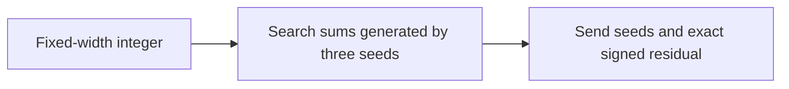

# Three seeded generators plus a signed residual

[Method diagram](#method-diagram) · [Charts and benchmark tables](#large-file-benchmark)

## Question and prior work

If the encoder searches 16,777,216 seed triples, how much of the target can those three transmitted seed bytes actually explain?

### Source files and compatibility

This is the original QGS1 encoder and decoder from `lab/hutter/divisors/q-somma-generatori`, with English diagnostics. It uses the precise SHAKE domains and signed residual representation of the original experiment.

## Run the experiment

Run these commands from the repository root. The [large-suite instructions](../large-scale/README.md) give input preparation, dependencies and the complete benchmark command.

```sh
mkdir -p runs
python3 research/generator-sums/control.py runs/sums.bin
python3 research/generator-sums/encode.py runs/sums.bin runs/sums.qgs --block 4096
python3 research/generator-sums/decoder.py runs/sums.qgs runs/sums.restored
cmp runs/sums.bin runs/sums.restored
```

## Variants and format

The first term carries a seed byte as its high byte. Each of the other terms has a leading zero byte. Ordered sums of two terms support a nearest-neighbor search. A prefix bound safely eliminates candidates before the remaining full-width differences are evaluated. Each unit transmits three seeds, a signed-length descriptor and the exact absolute residual. Block size zero describes one whole-file integer.

### Method diagram



**Mechanism and test.** The generator is cheap when a small seed tuple predicts many bytes. A planted seed sum directly tests recoverability. The numerical and uniform inputs test the cost when the nearest generated value still has a large residual.

## Inputs and measurement

The plant has 6,144 distinct seed triples across 24 MiB. Half the blocks also receive a small signed correction. Real Q, ordinary numerical bytes and equally long uniform bytes use the same search budget.

## Results

The planted block archive was 36,872 bytes. Zstd-19 and XZ extreme both grew the 25,165,824-byte source. On complete Q, one search gave 96,994,205 bytes and 4 KiB searches gave 97,021,897. On uniform data the 4 KiB mode also expanded. [Full archive sizes, times and hashes](../large-scale/results/by-dataset.md)


## Large-file benchmark

On `three-seeds` (25,165,824 raw bytes), `sum-4096` produced 36,872 archive bytes. Zstandard level 3 used 25,166,414 bytes on the same input. [Input and timing](../large-scale/results/by-dataset.md#three-seeds) · [All project measurements](../large-scale/results/by-experiment.md#generator-sums)

<!-- BEGIN generated project measurements -->

Each archive passed a byte-for-byte round trip. Bytes saved subtracts the archive and any required reference from the raw input size. Timings are seconds from one run.

On the primary input `three-seeds`, `sum-4096` delivers 36,872 bytes, 25,129,542 bytes smaller than standalone Zstandard 3 (25,166,414 bytes).

Holding `sum-4096` fixed across the 4 measured input/reference settings with a standalone Zstandard 3 control gives **1 smaller, 0 equal and 3 larger** delivered archives. Each setting counts once.

### Archive comparison across inputs


Read down a column to compare methods on identical input. Lower is better. 100% is the raw file size. Where available, standard codecs appear below the dividing line. Near 100%, cells give the exact byte difference from raw (+ means larger). Below 0.1%, they give the exact delivered total. A dash means the combination was unmeasured.

This project's published large-file trials measure complete archives. The effect on gzip, Zstandard or XZ after an isolated preprocessing step is unmeasured here.

### three-seeds · 25,165,824 raw bytes

**Standalone archives**

| Profile | Archive bytes | Bytes saved vs raw | Encode (s) | Decode (s) |
|---|---:|---:|---:|---:|
| `sum-0` | 25,161,749 | +4,075 | 2.643 | 3.655 |
| `sum-4096` | 36,872 | +25,128,952 | 2.524 | 1.066 |

Same-input baseline archives (bytes) · XZ 9 extreme 25,167,136 · Zstandard 19 25,166,414 · Zstandard 3 25,166,414

[Input hash and all measured codecs](../large-scale/results/by-dataset.md#three-seeds)

### cofattore-Q.base256 · 96,994,187 raw bytes

**Standalone archives**

| Profile | Archive bytes | Bytes saved vs raw | Encode (s) | Decode (s) |
|---|---:|---:|---:|---:|
| `sum-0` | 96,994,205 | -18 | 13.265 | 12.031 |
| `sum-4096` | 97,021,897 | -27,710 | 5.507 | 2.178 |

Same-input baseline archives (bytes) · XZ 9 extreme 96,998,528 · Zstandard 19 96,994,649 · Zstandard 3 96,996,424

[Input hash and all measured codecs](../large-scale/results/by-dataset.md#cofattore-qbase256)

### numerical · 25,696,748 raw bytes

**Standalone archives**

| Profile | Archive bytes | Bytes saved vs raw | Encode (s) | Decode (s) |
|---|---:|---:|---:|---:|
| `sum-0` | 25,696,765 | -17 | 4.439 | 3.289 |
| `sum-4096` | 25,708,646 | -11,898 | 2.466 | 0.444 |

Same-input baseline archives (bytes) · XZ 9 extreme 11,662,476 · Zstandard 19 13,213,336 · Zstandard 3 15,163,683

[Input hash and all measured codecs](../large-scale/results/by-dataset.md#numerical)

### uniform · 25,165,824 raw bytes

**Standalone archives**

| Profile | Archive bytes | Bytes saved vs raw | Encode (s) | Decode (s) |
|---|---:|---:|---:|---:|
| `sum-0` | 25,165,841 | -17 | 2.637 | 3.328 |
| `sum-4096` | 25,173,018 | -7,194 | 2.590 | 0.938 |

Same-input baseline archives (bytes) · XZ 9 extreme 25,167,136 · Zstandard 19 25,166,414 · Zstandard 3 25,166,414

[Input hash and all measured codecs](../large-scale/results/by-dataset.md#uniform)

### Reproduce the large-file comparison

From the repository root, with the pinned inputs and project dependencies installed, replay all published standalone profiles for this folder into a fresh directory.

```sh
python3 research/large-scale/primary.py runs/replay-generator-sums --project generator-sums --all-profiles
```

[Dataset preparation](../large-scale/README.md#inputs) · [Archive hashes and settings](../large-scale/results/archives.jsonl)

<!-- END generated project measurements -->

## Connections

Experiment 03 uses a small generator budget; experiment 04 prices checkpointed irrational sums. The [integer formulas](../integer-formulas/README.md) try wholly different generators on the same Q.
