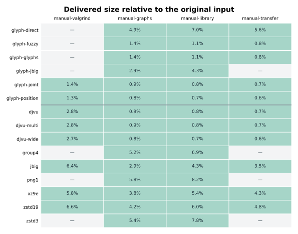

# Repeated glyphs and an exact bitmap residual

[Method diagram](#method-diagram) · [Charts and benchmark tables](#large-file-benchmark)

## Question and prior work

Can the lab's idea of storing a reusable shape plus a correction work on an entire technical manual? The raster-context prototype in `lab/shape` predicted each pixel. This extension finds connected components, reuses their bitmaps at different positions and tests whether the remaining pixels still benefit from a fax coder. Lossless DjVu provides a mature symbol-coding comparison.

## Run the experiment

```sh
python3 research/glyph-residuals/codec.py encode runs/large/raw/manual-library runs/manual.glr --profile position
python3 research/glyph-residuals/codec.py decode runs/manual.glr runs/manual.raw
cmp runs/large/raw/manual-library runs/manual.raw
```

## Variants and format

GLR1 counts 8-connected components in 512-row strips. It takes at most 4,096 repeated bitmaps. A position can use an exact shape or a nearby shape with the same dimensions. The encoder XORs every placement out of the source and codes the residual using Zstandard or JBIG. Applying the same placements to the residual restores every pixel, including boundaries, drawings and any correction to an approximate match.

The original position stream sorts placements by their top or bottom, then codes glyph IDs, row steps and signed horizontal gaps. The `position` profile also estimates a baseline offset for each shape, groups events by inferred text line, and tests causal predictors for the next symbol and character spacing. It charges the dictionary, baseline offsets, choices, positions, and residual. Dimensions and all stream lengths are in the archive. The bitmap uses MSB-first, black-one rows and accepts widths divisible by eight.

### Method diagram


**Mechanism and test.** Typeset pages reuse shapes along baselines. Storing a glyph once helps only when reference IDs and locations are cheaper than its pixels. The residual pays for imperfect matches, diagrams and unmodeled regions.

## Inputs and measurement

Two complete Graphviz manual sets supplied the first comparison. Two different books supplied the first 64 NASM and Valgrind pages. The Valgrind pages were reserved when the new position model was introduced. All four rasters exceed 20 MiB. DjVuLibre's lossless `cjb2` was measured with 8,192- and 32,760-row strips, bundled with `djvm`. A third reference uses foreground RLE and bundled `csepdjvu`. Each DjVu decoder recreated the same pixels for `cmp`.

## Results

| Raster | Raw bytes | Glyphs + JBIG | Learned positions | DjVu, 32,760 rows |
|---|---:|---:|---:|---:|
| Graphviz graph/layout guides | 24,642,792 | 211,517 | 189,603 | 191,132 |
| Graphviz library manual | 24,283,584 | 196,530 | 160,297 | 175,164 |
| NASM | 31,809,024 | 225,552 | 195,223 | 189,610 |
| Valgrind | 30,924,288 | 435,746 | 394,104 | 828,622 |

Learning positions saved bytes on all four inputs. The wider-strip DjVu archive remained 5,613 bytes smaller on NASM. These are digitally typeset PDFs rendered to monochrome. Performance on scanned or degraded paper is a separate question. [Individual archives, timing and hashes](../large-scale/results/by-dataset.md#manual-graphs)


## Large-file benchmark

On `manual-valgrind` (30,924,288 raw bytes), `glyph-position` produced 394,104 archive bytes. [Input and timing](../large-scale/results/by-dataset.md#manual-valgrind) · [All project measurements](../large-scale/results/by-experiment.md#glyph-residuals)

<!-- BEGIN generated project measurements -->

Each archive passed a byte-for-byte round trip. Bytes saved subtracts the archive and any required reference from the raw input size. Timings are seconds from one run.

Holding `glyph-position` fixed across the 2 measured input/reference settings with a standalone Zstandard 3 control gives **2 smaller, 0 equal and 0 larger** delivered archives. Each setting counts once.

### Archive comparison across inputs



Read down a column to compare methods on identical input. Lower is better. 100% is the raw file size. Where available, standard codecs appear below the dividing line. Near 100%, cells give the exact byte difference from raw (+ means larger). Below 0.1%, they give the exact delivered total. A dash means the combination was unmeasured.

This project's published large-file trials measure complete archives. The effect on gzip, Zstandard or XZ after an isolated preprocessing step is unmeasured here.

### manual-valgrind · 30,924,288 raw bytes

**Standalone archives**

| Profile | Archive bytes | Bytes saved vs raw | Encode (s) | Decode (s) | Peak KiB (encode / decode) |
|---|---:|---:|---:|---:|---:|
| `glyph-joint` | 435,746 | +30,488,542 | 63.797 | 7.104 | 298,660 / 186,952 |
| `glyph-position` | 394,104 | +30,530,184 | 91.306 | 7.714 | 326,344 / 185,352 |

Same-input baseline archives (bytes) · DjVu 868,904 · DjVu (separated foreground) 869,916 · DjVu (wide strips) 828,622 · JBIG 1,980,581 · XZ 9 extreme 1,795,240 · Zstandard 19 2,032,818

[Input hash and all measured codecs](../large-scale/results/by-dataset.md#manual-valgrind)

### manual-graphs · 24,642,792 raw bytes

**Standalone archives**

| Profile | Archive bytes | Bytes saved vs raw | Encode (s) | Decode (s) | Peak KiB (encode / decode) |
|---|---:|---:|---:|---:|---:|
| `glyph-direct` | 1,206,504 | +23,436,288 | 2.018 | 1.360 | 95,888 / 84,852 |
| `glyph-fuzzy` | 337,192 | +24,305,600 | 8.509 | 1.915 | 202,588 / 148,044 |
| `glyph-glyphs` | 338,447 | +24,304,345 | 8.436 | 2.341 | 181,248 / 148,104 |
| `glyph-jbig` | 707,818 | +23,934,974 | 3.545 | 3.609 | 98,840 / 305,592 |
| `glyph-joint` | 211,517 | +24,431,275 | 11.266 | 3.200 | 202,988 / 304,868 |
| `glyph-position` | 189,603 | +24,453,189 | 57.770 | 11.363 | 207,412 / 304,412 |

Same-input baseline archives (bytes) · DjVu 214,067 · DjVu (separated foreground) 213,732 · DjVu (wide strips) 191,132 · CCITT Group 4 1,270,850 · JBIG 707,797 · 1-bit PNG 1,418,635 · XZ 9 extreme 930,864 · Zstandard 19 1,034,431 · Zstandard 3 1,325,134

[Input hash and all measured codecs](../large-scale/results/by-dataset.md#manual-graphs)

### manual-library · 24,283,584 raw bytes

**Standalone archives**

| Profile | Archive bytes | Bytes saved vs raw | Encode (s) | Decode (s) | Peak KiB (encode / decode) |
|---|---:|---:|---:|---:|---:|
| `glyph-direct` | 1,705,163 | +22,578,421 | 1.499 | 1.103 | 99,276 / 85,644 |
| `glyph-fuzzy` | 277,021 | +24,006,563 | 9.288 | 4.339 | 216,712 / 155,492 |
| `glyph-glyphs` | 277,021 | +24,006,563 | 8.377 | 2.337 | 192,208 / 155,700 |
| `glyph-jbig` | 1,049,885 | +23,233,699 | 3.261 | 3.683 | 98,172 / 302,836 |
| `glyph-joint` | 196,530 | +24,087,054 | 16.003 | 4.229 | 216,832 / 301,292 |
| `glyph-position` | 160,297 | +24,123,287 | 74.727 | 10.305 | 227,736 / 301,208 |

Same-input baseline archives (bytes) · DjVu 202,780 · DjVu (separated foreground) 202,666 · DjVu (wide strips) 175,164 · CCITT Group 4 1,678,602 · JBIG 1,049,864 · 1-bit PNG 1,996,848 · XZ 9 extreme 1,304,420 · Zstandard 19 1,457,017 · Zstandard 3 1,903,366

[Input hash and all measured codecs](../large-scale/results/by-dataset.md#manual-library)

### manual-transfer · 31,809,024 raw bytes

**Standalone archives**

| Profile | Archive bytes | Bytes saved vs raw | Encode (s) | Decode (s) | Peak KiB (encode / decode) |
|---|---:|---:|---:|---:|---:|
| `glyph-direct` | 1,796,363 | +30,012,661 | 1.508 | 1.094 | 106,276 / 93,428 |
| `glyph-fuzzy` | 257,250 | +31,551,774 | 17.986 | 2.239 | 256,992 / 178,520 |
| `glyph-glyphs` | 257,250 | +31,551,774 | 9.339 | 2.645 | 228,132 / 178,680 |
| `glyph-joint` | 225,552 | +31,583,472 | 17.115 | 4.936 | 286,408 / 375,184 |
| `glyph-position` | 195,223 | +31,613,801 | 86.202 | 11.498 | 267,028 / 374,500 |

Same-input baseline archives (bytes) · DjVu 213,659 · DjVu (separated foreground) 213,655 · DjVu (wide strips) 189,610 · JBIG 1,108,897 · XZ 9 extreme 1,354,964 · Zstandard 19 1,525,436

[Input hash and all measured codecs](../large-scale/results/by-dataset.md#manual-transfer)

### Reproduce the large-file comparison

From the repository root, with the pinned inputs and project dependencies installed, replay all published standalone profiles for this folder into a fresh directory.

```sh
python3 research/large-scale/primary.py runs/replay-glyph-residuals --project glyph-residuals --all-profiles
```

[Dataset preparation](../large-scale/README.md#inputs) · [Archive hashes and settings](../large-scale/results/archives.jsonl)

<!-- END generated project measurements -->

## Connections

[Raster shape contexts](../shape-context/README.md) · [Shared recipe dictionaries](../shared-factor-forest/README.md) · [Document inputs](../large-scale/documents.json)
