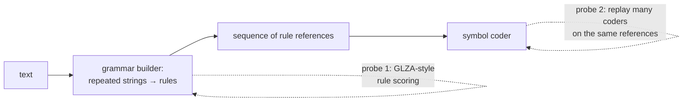

# Grammar probes: where does Statico lose to GLZA?

> **Verdict: better rule choice helps; better symbol coding helps less than hoped.** Choosing grammar rules the
> way GLZA does takes Statico on enwik8 from 26,346,968 to 23,774,125 bytes (−9.8%, now better than xz). Better
> coding of the rule numbers alone would give about −8% (24.3 MB); both together about 22.05 MB (estimate).
> GLZA itself reaches 20.07 MB, and our context mixer 17.81 MB.
>
> Part of [chapter 5](../../report/5-text.md) of the [report](../../report/README.md).

## Question

Statico (our grammar compressor) lost to xz on enwik8. Is the gap to GLZA, the best grammar compressor, in
*which rules are built* or in *how the rule numbers are coded*?

## How it works



- **Probe 1** ([`grammar_lab.cpp`](grammar_lab.cpp), [`gbuild.cpp`](gbuild.cpp)): rebuild the grammar with
  GLZA-style scoring (log profit + power × log saving/cost, strings ending in a single space discounted,
  whole words first), encode it with Statico's format and decode it to check.
- **Probe 2** ([`probe.cpp`](probe.cpp)): decode a Statico archive, record every rule reference together with
  what the decoder knows at that moment, and replay candidate coders as exact adaptive costs. Each context is
  checked with a shuffled control.

## Results

Full enwik8, carried over from November 23, 2026 (Statico M1 itself was re-verified in the benchmark rerun).

| Probe 1: rule choice | enwik8 bytes |
|---|---:|
| Statico M1 | 26,346,968 |
| GLZA-style scoring, power 8 | **23,774,125** (archive, decoded) |
| GLZA-style scoring, power 12 | 23,731,038 |
| xz -9e (1 GiB dictionary, published) | 24,703,772 |
| GLZA 0.12 (published) | 20,068,917 |

| Probe 2: coding the same rule references | enwik8 bytes | vs current |
|---|---:|---:|
| Current coder (replay) | 26,356,890 | 0 |
| First byte given previous byte, index within (class, first byte) | 25,118,921 | −4.7% |
| … same with the previous byte **shuffled** (control) | 25,442,491 | −3.5% |
| Recency queue of 1,024 recent rules | 25,220,285 | −4.3% |
| Order-1 on rule ids (ceiling) | 26,171,051 | −0.7% |
| … with previous ids shuffled (control) | 27,839,934 | +5.6% |
| Best combination | 24,307,607 | **−7.8%** |

The shuffled controls show that most of the "first byte" gain comes from the coding layout, not from the
context: the real context effect is about 1%. The grammar already absorbs pair statistics (order-1 on rule ids
adds only 0.7%). Most of the gap to GLZA is therefore in which rules are built, and the larger gap to context
mixing is that a grammar does not model *which* rule comes next nearly as well as a predictor models the next
byte.

<!-- GP-RERUN -->

## Run it

```sh
make -C research lab
head -c 10000000 "$CORPUS/enwik8/enwik8" > runs/e10m
research/statico/statico c runs/e10m runs/e10m.stc
GP_POWER=8 GP_SPACE=1 research/build/grammar-lab runs/e10m runs/e10m.glza.stc
research/statico/unstatico runs/e10m.glza.stc runs/e10m.back && cmp runs/e10m runs/e10m.back
research/build/m3probe runs/e10m.stc          # add a seed argument for the shuffled controls
```
