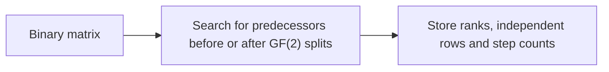
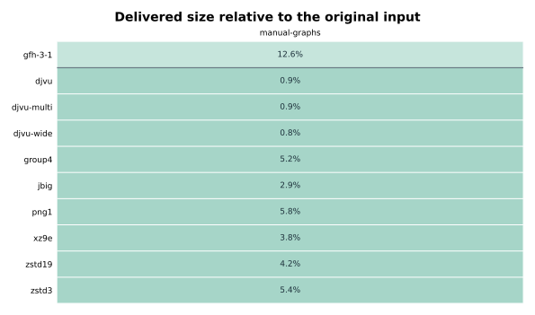

# Hierarchical GF(2) with checkerboard evolution

[Method diagram](#method-diagram) · [Charts and benchmark tables](#large-file-benchmark)

## Question and prior work

Can backward cellular evolution recover the low rank of a matrix before recursive factorization? GFH1 divides a file into 16 × 16 binary matrices. Its native predecessor search and independent Python decoder are ported from `lab/hutter/divisors/neif-2-condiviso/ricorsivi/esperimenti-per-struttura/gerarchico-gf2/{orbita.cpp,gerarchico.py}`. The ten original inputs and ten corresponding full-profile archives are included as compatibility vectors.

## Run the experiment

```sh
mkdir -p runs
python3 research/hierarchical-gf2/codec.py pack --profile full research/hierarchical-gf2/fixtures/rank-4-evolved.bin runs/matrix.gfh
python3 research/hierarchical-gf2/codec.py unpack runs/matrix.gfh runs/matrix.bin
cmp research/hierarchical-gf2/fixtures/rank-4-evolved.bin runs/matrix.bin
cmp research/hierarchical-gf2/fixtures/rank-4-evolved.gfh runs/matrix.gfh
python3 research/hierarchical-gf2/benchmark.py runs/gf2-replay
```

## Variants and format

The six profiles measure direct coding, automaton alone, a single factorization, recursive factorization, automata at leaves, and the full ordering with predecessor search before factorization. A factor node transmits a rank, a subset of independent row positions and recursively coded factor data. A predecessor carries the forward step count needed for reconstruction. GFH1 can fall back to the original file plus its 13-byte header. The benchmark uses up to 100 steps, depth 3 and a beam of 2 candidates. The previously published pilot explores a smaller search.

### Method diagram



**Mechanism and test.** A predecessor can turn dependent rows into a cheaper tree. Depth and beam limits constrain what is found. Only the measured large-file profile supports a file-scale claim here.

## Inputs and measurement

The primary trial measures `gfh-3-1` on the complete `manual-graphs` input (24,642,792 raw bytes). The runner invokes a separate decoder and compares the reconstructed file byte for byte. The earlier measurements below retain their original input sizes.

## Results

Each input is 8,192 bytes. On the evolved rank-four fixture, all restricted profiles gave 8,205 bytes. The full profile gave 4,492. On the hierarchical fixture, single-level factorization gave 6,471 and recursive factorization gave 5,514. Plain rank-four matrices already reached 4,267 bytes with one factorization. The uniform and Neif payload fixtures selected literal files. All 60 trials matched the original measured sizes, and all ten full-profile encodes reproduced the historical archive bytes exactly. [Replay with decoded node counts](results/replay/trials.csv)

## Large-file benchmark

On `manual-graphs` (24,642,792 raw bytes), `gfh-3-1` produced 3,098,408 archive bytes. Zstandard level 3 used 1,325,134 bytes on the same input. [Input and timing](../large-scale/results/by-dataset.md#manual-graphs) · [All project measurements](../large-scale/results/by-experiment.md#hierarchical-gf2)

<!-- BEGIN generated project measurements -->

Each archive passed a byte-for-byte round trip. Bytes saved subtracts the archive and any required reference from the raw input size. Timings are seconds from one run.

On the primary input `manual-graphs`, `gfh-3-1` delivers 3,098,408 bytes, 1,773,274 bytes larger than standalone Zstandard 3 (1,325,134 bytes).

### Archive comparison across inputs



Read down a column to compare methods on identical input. Lower is better. 100% is the raw file size. Where available, standard codecs appear below the dividing line. Near 100%, cells give the exact byte difference from raw (+ means larger). Below 0.1%, they give the exact delivered total. A dash means the combination was unmeasured.

This project's published large-file trials measure complete archives. The effect on gzip, Zstandard or XZ after an isolated preprocessing step is unmeasured here.

### manual-graphs · 24,642,792 raw bytes

**Standalone archives**

| Profile | Archive bytes | Bytes saved vs raw | Encode (s) | Decode (s) | Peak KiB (encode / decode) |
|---|---:|---:|---:|---:|---:|
| `gfh-3-1` | 3,098,408 | +21,544,384 | 82.681 | 65.656 | 27,816 / 18,960 |

Same-input baseline archives (bytes) · DjVu 214,067 · DjVu (separated foreground) 213,732 · DjVu (wide strips) 191,132 · CCITT Group 4 1,270,850 · JBIG 707,797 · 1-bit PNG 1,418,635 · XZ 9 extreme 930,864 · Zstandard 19 1,034,431 · Zstandard 3 1,325,134

[Input hash and all measured codecs](../large-scale/results/by-dataset.md#manual-graphs)

### Reproduce the large-file comparison

From the repository root, with the pinned inputs and project dependencies installed, replay all published standalone profiles for this folder into a fresh directory.

```sh
python3 research/large-scale/primary.py runs/replay-hierarchical-gf2 --project hierarchical-gf2 --all-profiles
```

[Dataset preparation](../large-scale/README.md#inputs) · [Archive hashes and settings](../large-scale/results/archives.jsonl)

<!-- END generated project measurements -->

## Connections

[Reversible 3D automata before GF(2) panel coding](../tensor-orbits/README.md) · [Four-dimensional automata with noisy binary matrix factors](../four-dimensional-factors/README.md)
