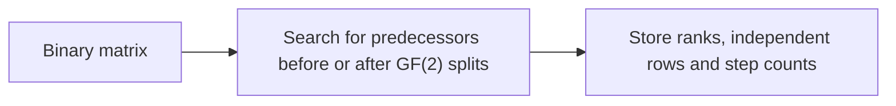

# Hierarchical GF(2) with checkerboard evolution

> **Verdict: loses on real data.** Best real input: Scanned manual: Graphviz guides, 16.2× larger vs DjVu.
>
> Part of [chapter 2](../../report/2-dynamics.md) of the [report](../../report/README.md). Terms: [glossary](../../report/glossary.md).

## Question

Does running a cellular automaton backwards before factoring a bit matrix expose low rank that factoring alone misses?

## How it works



Files are cut into 16×16 bit matrices; each matrix may be evolved backwards, then factored recursively as basis rows, coefficients and an error mask.

<details><summary>Technical details</summary>

Can backward cellular evolution recover the low rank of a matrix before recursive factorization? GFH1 divides a file into 16 × 16 binary matrices. Its native predecessor search and independent Python decoder are ported from `lab/hutter/divisors/neif-2-condiviso/ricorsivi/esperimenti-per-struttura/gerarchico-gf2/{orbita.cpp,gerarchico.py}`. The ten original inputs and ten corresponding full-profile archives are included as compatibility vectors.

**Mechanism and test.** A predecessor can turn dependent rows into a cheaper tree. Depth and beam limits constrain what is found. Only the measured large-file profile supports a file-scale claim here.

The six profiles measure direct coding, automaton alone, a single factorization, recursive factorization, automata at leaves, and the full ordering with predecessor search before factorization. A factor node transmits a rank, a subset of independent row positions and recursively coded factor data. A predecessor carries the forward step count needed for reconstruction. GFH1 can fall back to the original file plus its 13-byte header. The benchmark uses up to 100 steps, depth 3 and a beam of 2 candidates. The previously published pilot explores a smaller search.

</details>

## Results on 20 MiB inputs

Every archive below decoded byte-exact. *Our archive* is this project's own format. *Our transform → standard tool* reshapes the bytes reversibly and hands the result to gzip, zstd or xz; it is listed only where it beats that same tool on the raw bytes. *Best standard tool* is the smallest of gzip, bzip2, xz, Zstandard, Brotli and PPMd (plus domain codecs for images, scans and video) on the raw bytes. *Difference* compares the better of our two columns with it; negative = ours is smaller.

| Input | Kind | Raw bytes | Our archive | Our transform → standard tool | Best standard tool | Difference |
|---|---|---:|---:|---:|---:|---:|
| Scanned manual: Graphviz guides | real | 24,642,792 | 3,098,408 (`gfh-3-1`) | — | 191,132 (DjVu) | 16.2× larger |

<details><summary>All profiles, timings and entropy measurements</summary>

<!-- BEGIN generated project measurements -->

Each archive passed a byte-for-byte round trip. *Bytes saved* is raw size minus archive (and any reference the decoder needs). Timings are one run on a shared desktop.

These tables list every measured profile. The comparison with the best standard tool on each input (gzip, bzip2, xz, Zstandard, Brotli, PPMd and the domain codecs) is the Results table above.

### Archive comparison across inputs


Read down a column to compare methods on identical input. Lower is better. 100% is the raw file size. Where available, standard codecs appear below the dividing line. Near 100%, cells give the exact byte difference from raw (+ means larger). Below 0.1%, they give the exact delivered total. A dash means the combination was unmeasured.

This project's published large-file trials measure complete archives. The effect on gzip, Zstandard or XZ after an isolated preprocessing step is unmeasured here.

### manual-graphs · 24,642,792 raw bytes

**Standalone archives**

| Profile | Archive bytes | Bytes saved vs raw | Encode (s) | Decode (s) | Peak KiB (encode / decode) |
|---|---:|---:|---:|---:|---:|
| `gfh-3-1` | 3,098,408 | +21,544,384 | 82.681 | 65.656 | 27,816 / 18,960 |

Same-input baseline archives (bytes) · DjVu 214,067 · DjVu (separated foreground) 213,732 · DjVu (wide strips) 191,132 · CCITT Group 4 1,270,850 · JBIG 707,797 · 1-bit PNG 1,418,635 · XZ 9 extreme 930,864 · Zstandard 19 1,034,431 · Zstandard 3 1,325,134

[Input hash and all measured codecs](../large-scale/results/by-dataset.md#manual-graphs)

### Reproduce the large-file comparison

From the repository root, with the pinned inputs and project dependencies installed, replay all published standalone profiles for this folder into a fresh directory.

```sh
python3 research/large-scale/primary.py runs/replay-hierarchical-gf2 --project hierarchical-gf2 --all-profiles
```

[Dataset preparation](../large-scale/README.md#inputs) · [Archive hashes and settings](../large-scale/results/archives.jsonl)

<!-- END generated project measurements -->

</details>

## Small-scale results

The primary trial measures `gfh-3-1` on the complete `manual-graphs` input (24,642,792 raw bytes). The runner invokes a separate decoder and compares the reconstructed file byte for byte. The earlier measurements below retain their original input sizes.

Each input is 8,192 bytes. On the evolved rank-four fixture, all restricted profiles gave 8,205 bytes. The full profile gave 4,492. On the hierarchical fixture, single-level factorization gave 6,471 and recursive factorization gave 5,514. Plain rank-four matrices already reached 4,267 bytes with one factorization. The uniform and Neif payload fixtures selected literal files. All 60 trials matched the original measured sizes, and all ten full-profile encodes reproduced the historical archive bytes exactly. [Replay with decoded node counts](results/replay/trials.csv)

## Run it

```sh
mkdir -p runs
python3 research/hierarchical-gf2/codec.py pack --profile full research/hierarchical-gf2/fixtures/rank-4-evolved.bin runs/matrix.gfh
python3 research/hierarchical-gf2/codec.py unpack runs/matrix.gfh runs/matrix.bin
cmp research/hierarchical-gf2/fixtures/rank-4-evolved.bin runs/matrix.bin
cmp research/hierarchical-gf2/fixtures/rank-4-evolved.gfh runs/matrix.gfh
python3 research/hierarchical-gf2/benchmark.py runs/gf2-replay
```
