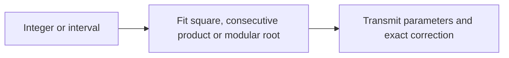
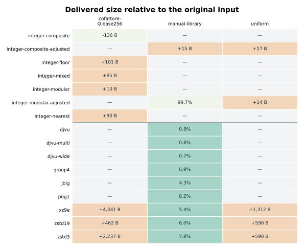

# Whole-file square, product and modular-square formulas

> **Verdict: no meaningful gain on real data.** Best real input: Q: the record archive as an integer, −0.0006% vs zstd -19.
>
> Part of [chapter 1](../../report/1-formulas.md) of the [report](../../report/README.md). Terms: [glossary](../../report/glossary.md).

## Question

Can a whole file, read as one huge integer, be written as a sum of squares, a product of consecutive integers or a modular square, with a short remainder?

## How it works



Greedy searches fit each formula family to the full integer and store the formula plus the exact remainder.

<details><summary>Technical details</summary>

What is left to send after fitting a whole integer with squares, products of consecutive integers, or a modular square preceded by a sparse polynomial?

**Mechanism and test.** A compact root helps a restricted residue class or a value near a simple product. Outliers need more correction bits. Comparing profiles on the full integer limits conclusions drawn from specially chosen mathematical examples.

QFE1 recursively describes the signed error after a floor square, a nearest square or the nearest of the allowed squares and consecutive products. QMS1 chooses a compact root modulo 2ᵇ for eligible odd integers congruent to 1 modulo 8. QFC1 transmits the width, prefix length, divisor, positions and values of sparse prefix coefficients, and the modular root of the suffix. The QMS1/QFC1 encoders require at least three significant bits and the stated congruence.

</details>

## Results on 20 MiB inputs

Every archive below decoded byte-exact. *Our archive* is this project's own format. *Our transform → standard tool* reshapes the bytes reversibly and hands the result to gzip, zstd or xz; it is listed only where it beats that same tool on the raw bytes. *Best standard tool* is the smallest of gzip, bzip2, xz, Zstandard, Brotli and PPMd (plus domain codecs for images, scans and video) on the raw bytes. *Difference* compares the better of our two columns with it; negative = ours is smaller.

| Input | Kind | Raw bytes | Our archive | Our transform → standard tool | Best standard tool | Difference |
|---|---|---:|---:|---:|---:|---:|
| Scanned manual: Graphviz library | real | 24,283,584 | 24,209,213 (`integer-modular-adjusted`) | — | 175,164 (DjVu) | 138.2× larger |
| Q: the record archive as an integer | derived from real | 96,994,187 | 96,994,051 (`integer-composite`) | — | 96,994,649 (zstd -19) | −0.0006% |
| Uniform random bytes | control | 25,165,824 | 25,165,838 (`integer-modular-adjusted`) | — | 25,166,414 (zstd -19) | −0.0023% |

<details><summary>All profiles, timings and entropy measurements</summary>

<!-- BEGIN generated project measurements -->

Each archive passed a byte-for-byte round trip. *Bytes saved* is raw size minus archive (and any reference the decoder needs). Timings are one run on a shared desktop.

These tables list every measured profile. The comparison with the best standard tool on each input (gzip, bzip2, xz, Zstandard, Brotli, PPMd and the domain codecs) is the Results table above.

### Archive comparison across inputs



Read down a column to compare methods on identical input. Lower is better. 100% is the raw file size. Where available, standard codecs appear below the dividing line. Near 100%, cells give the exact byte difference from raw (+ means larger). Below 0.1%, they give the exact delivered total. A dash means the combination was unmeasured.

This project's published large-file trials measure complete archives. The effect on gzip, Zstandard or XZ after an isolated preprocessing step is unmeasured here.

### cofattore-Q.base256 · 96,994,187 raw bytes

**Standalone archives**

| Profile | Archive bytes | Bytes saved vs raw | Encode (s) | Decode (s) |
|---|---:|---:|---:|---:|
| `integer-composite` | 96,994,051 | +136 | 225.062 | 27.288 |
| `integer-floor` | 96,994,288 | -101 | 95.815 | 24.662 |
| `integer-mixed` | 96,994,272 | -85 | 134.060 | 45.895 |
| `integer-modular` | 96,994,197 | -10 | 286.466 | 38.694 |
| `integer-nearest` | 96,994,277 | -90 | 119.752 | 34.661 |

Same-input baseline archives (bytes) · XZ 9 extreme 96,998,528 · Zstandard 19 96,994,649 · Zstandard 3 96,996,424

[Input hash and all measured codecs](../large-scale/results/by-dataset.md#cofattore-qbase256)

### manual-library · 24,283,584 raw bytes

**Standalone archives**

| Profile | Archive bytes | Bytes saved vs raw | Encode (s) | Decode (s) | Peak KiB (encode / decode) |
|---|---:|---:|---:|---:|---:|
| `integer-composite-adjusted` | 24,283,599 | -15 | 346.351 | 6.927 | 436,328 / 180,836 |
| `integer-modular-adjusted` | 24,209,213 | +74,371 | 89.804 | 11.867 | 378,504 / 178,516 |

Same-input baseline archives (bytes) · DjVu 202,780 · DjVu (separated foreground) 202,666 · DjVu (wide strips) 175,164 · CCITT Group 4 1,678,602 · JBIG 1,049,864 · 1-bit PNG 1,996,848 · XZ 9 extreme 1,304,420 · Zstandard 19 1,457,017 · Zstandard 3 1,903,366

[Input hash and all measured codecs](../large-scale/results/by-dataset.md#manual-library)

### uniform · 25,165,824 raw bytes

**Standalone archives**

| Profile | Archive bytes | Bytes saved vs raw | Encode (s) | Decode (s) | Peak KiB (encode / decode) |
|---|---:|---:|---:|---:|---:|
| `integer-composite-adjusted` | 25,165,841 | -17 | 106.419 | 23.725 | 377,976 / 185,312 |
| `integer-modular-adjusted` | 25,165,838 | -14 | 92.722 | 14.407 | 377,716 / 184,604 |

Same-input baseline archives (bytes) · XZ 9 extreme 25,167,136 · Zstandard 19 25,166,414 · Zstandard 3 25,166,414

[Input hash and all measured codecs](../large-scale/results/by-dataset.md#uniform)

### Reproduce the large-file comparison

From the repository root, with the pinned inputs and project dependencies installed, replay all published standalone profiles for this folder into a fresh directory.

```sh
python3 research/large-scale/primary.py runs/replay-integer-formulas --project integer-formulas --all-profiles
```

[Dataset preparation](../large-scale/README.md#inputs) · [Archive hashes and settings](../large-scale/results/archives.jsonl)

<!-- END generated project measurements -->

</details>

## Small-scale results

The entire 96,994,187-byte FX2 cofactor was encoded by each profile. Each independent decode was compared with canonical Q; the final archive includes all coefficients, signs and widths. Shared arithmetic software and the encoder’s temporary root are excluded.

Floor, nearest and mixed QFE1 descriptors gave 96,994,288, 96,994,277 and 96,994,272 bytes. QMS1 gave 96,994,197. The sparse prefix and modular suffix gave 96,994,051, saving 136 bytes. The original search identified 232 prefix bytes, 42 nonzero coefficients and divisor 12. [Full archive sizes, times and hashes](../large-scale/results/by-dataset.md)

## Run it

Run these commands from the repository root. The [large-suite instructions](../large-scale/README.md) give input preparation, dependencies and the complete benchmark command.

```sh
mkdir -p runs
# Use a Python environment containing gmpy2 for this project.
"${GMP_PYTHON:-python3}" research/integer-formulas/run.py composite "$Q" runs/q.qfc
"${GMP_PYTHON:-python3}" research/integer-formulas/run.py decode runs/q.qfc runs/q-formula.restored
cmp "$Q" runs/q-formula.restored
```

## Provenance

<details><summary>Where this code came from</summary>

The three archive formats come from `lab/hutter/divisors/q-formula-intera/{formula,quadrato_modulare,composta}.py`. The English source preserves their wire formats. The composite runner computes its own temporary modular root. Decoding QFC1 requires only the descriptor and gmpy2.

</details>
