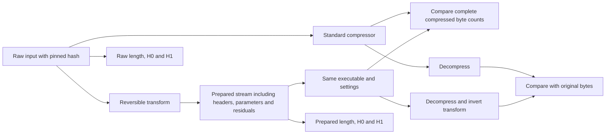
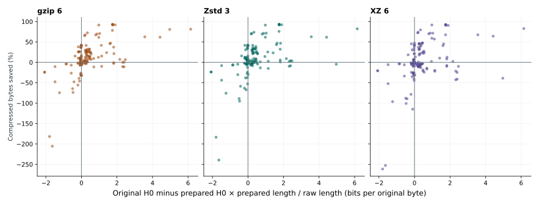

# When does reversible preprocessing help?

The practical test is whether a receiver can recover the original from fewer delivered bytes after applying the *same* final compressor. The most informative experiments here vary one feature of the input or method while keeping the rest fixed. They can distinguish a representation that exposes real structure from one that happens to produce a small archive on one file.

## Experimental design

For a raw input of length *N* and prepared stream of length *M*, the normalized zero-order cost is *H0(prepared) × M/N*. It estimates how many bits per original byte a model using byte frequencies would spend before accounting for its model and framing. H1 measures next-byte uncertainty given one preceding byte. A reversible change of representation can change both empirical quantities. Zstandard can also exploit sequences of literals and backward matches, so two streams with similar histograms can compress differently. [Measurement implementation](entropy_bench.py) · [Zstandard format, section 3.1.1](https://www.rfc-editor.org/rfc/rfc8878.html#section-3.1.1)

## All paired trials

<!-- BEGIN paired analysis -->

The paired set contains **178 input/profile comparisons on 27 distinct input hashes**. Each raw file is at least 20 MiB. Each point represents one verified pair. The 178 pairs yield 158 distinct raw/prepared hash pairs. Profiles that produce identical streams occupy the same point.

Moving right means a lower estimated zero-order cost per original byte. Moving up means a smaller final file. Upper-left points are practical wins despite a worse H0 estimate. Lower-right points improve the H0 estimate and still increase the archive. Both differences use the fully serialized stream.

| Backend | Smaller / tied / larger | Smaller, with higher H0 cost | Larger, with lower H0 cost | Smaller among distinct streams | Mean share smaller within each input |
|---|---:|---:|---:|---:|---:|
| gzip 6 | 99 / 0 / 79 | 30 | 15 | 94/158 | 66.4% |
| Zstd 3 | 89 / 0 / 89 | 25 | 20 | 84/158 | 59.3% |
| XZ 6 | 66 / 0 / 112 | 20 | 38 | 63/158 | 47.2% |

Counts use exact integer byte comparisons. The last column first computes the fraction of measured profiles that save bytes on each input, then averages those fractions with equal weight per input hash. The selection of methods varies by input. Neither count estimates a success probability on new files.

<!-- END paired analysis -->

## Which mechanisms survive a control?

| Hypothesis | Controlled comparison | Interpretation and scope |
|---|---|---|
| Adjacent scanlines make empty quadrants predictable | XOR + occupancy tree saves 33.34% with Zstandard on the Graphviz guides. It increases size by 88.84% after a whole-scanline shuffle of the same pixels. | The shuffle preserves the byte histogram but breaks vertical adjacency. Raw occupied tiles rise from 11.4% to 37.7%. The gain depends on page geometry. [Bitmap measurements](../checkerboard-orbits/bitmap-trees.md) |
| The inverse cellular rule reveals repeated tiles | On evolved stamps, matching and rotated inverses followed by the same dictionary cost 622,700 and 5,366,106 Zstandard bytes. Changing the generator to the rotated rule reverses the ordering (5,441,366 and 622,584). | The crossover isolates rule agreement on two generated fields from the same latent pixels. It gives no estimate of how frequently real images follow these dynamics. [Generator and four-way comparison](../checkerboard-orbits/bitmap-trees.md) |
| Reverse evolution makes low-rank panels accessible | On noisy four-dimensional spacetime, orbit alone uses 19,601,212 bytes and factors alone use 25,120,549. The combination uses 9,414,787, a gain of 10,186,425 bytes over the better component. | In the planted field the factor stage adds a gain after the inverse. On numerical, Samba and uniform data it adds exactly zero bytes of savings over orbit alone. With whole-stream Zstandard on the plant, adding factors after the orbit saves a further 9,383,067 bytes. The encoder selected factors on 384/384 planted blocks and zero blocks across the three other inputs. [Four-dimensional factors](../four-dimensional-factors/README.md#large-file-benchmark) |
| Repeated formula leaves can pay for a tree | On hidden products the direct, factor-only and formula-only archives tie at 14,336,766 bytes. Inline composition uses 13,286,101 and shared recipes use 13,097,327. | The plant was constructed with a formula child behind a divisor. Composition exposes it and the dictionary saves a further 188,774 bytes. Inline and shared tie on the numerical and uniform inputs. [Shared factor forest](../shared-factor-forest/README.md#large-file-benchmark) |
| Whiteboard witness values can be recomputed from parameters | On the original records, columns alone use 2,306,827 bytes and recomputation plus columns uses 1,082,142. Shuffling value/cost pairs makes the joint profile tie columns at 3,721,398. | Exact equation structure adds value beyond column grouping. Preserved column distributions alone do not explain the extra 1,224,685 bytes saved on the original. [Witness census](../whiteboard-census/README.md#large-file-benchmark) |
| Corresponding text fields share useful prefixes | Same-field prefix coding saves 47.18% and 43.34% with Zstandard on the 1990 and 2020 NOAA samples. The same profile increases size by 3.28% on the Wikipedia transfer input. | The two 24 MiB samples are evidence of transfer across years within one record format. Alignment by field offers little rationale for generic prose. [Row layout, match probes and controls](../lattice-prediction/ragged-rows.md) |
| Reordering helps a backend exploit text context | Wikipedia BWT lowers H1 from 3.881 to 2.801 bits per byte. gzip saves 7.78%, Zstandard saves 1.87%, and XZ grows 9.15%. | The same reversible stream serves all three backends. Even a lower H1 on a nearly equal-length stream does not determine the sign of the final size change. [Text views](../text-views/README.md#large-file-benchmark) |

The scanline experiment has a precedent in PNG filtering, where a decoder can predict a byte from already reconstructed neighbors. This lab uses XOR and an occupancy tree on packed bits. The shuffle and tile counts above test what those additional choices contribute on the sampled pages. [PNG filtering specification](https://www.w3.org/TR/png-3/#9Filters)

## What the data can establish

- A paired endpoint compares one frozen representation and one backend on identical source bytes. It includes transform metadata, fallbacks and compressor framing. Encoder selection of a representation can favor the backend used to price its candidates.
- A standalone endpoint compares complete codecs. It can include internal compression, different block sizes and an external reference. For a fresh receiver the plotted total includes every reference the decoder actually requires. A small conditional patch answers a different delivery question.
- Planted, shuffled and mismatched controls identify plausible mechanisms. The corpus is purposive, and related datasets share generators or documents. Repeated profiles on a file are dependent observations. Sizes are exact for the recorded streams. Timings are single observations and support no run-to-run uncertainty estimate.
- Each of the 47 project folders includes its method, diagram, input assumptions, archive comparisons and exact local results. Paired coverage is narrower. Reproducing a result requires the corresponding pinned input, parameters and codec. [All project results](results/by-experiment.md) · [All datasets and controls](results/by-dataset.md) · [Paired commands, versions and hashes](results/preprocessing.jsonl) · [Reproduction protocol](README.md)
