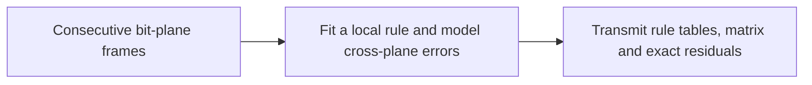
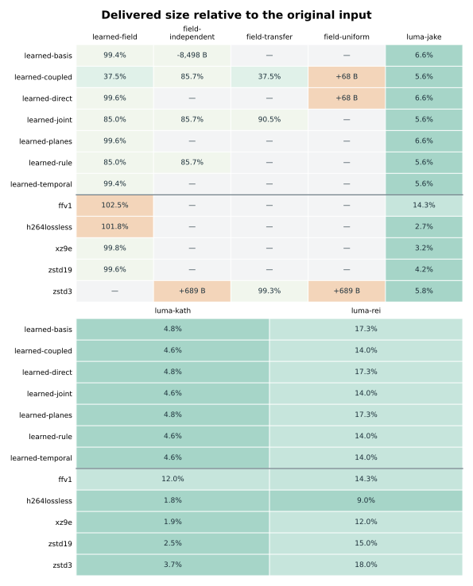
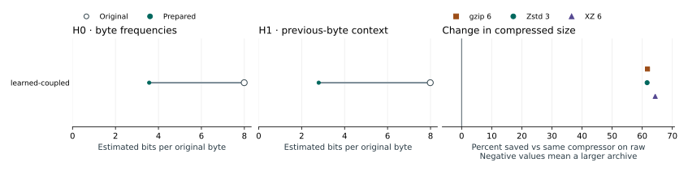
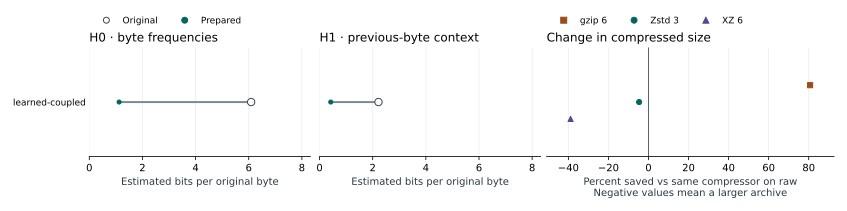

# Jointly learning a cellular rule and the matrix of its prediction errors

> **Verdict: detector only.** Best real input: Video clip 3 (grayscale frames), +55.2% vs H.264 lossless. Planted control: Field from a hidden cellular rule, −64.2% vs gzip -9.
>
> Part of [chapter 2](../../report/2-dynamics.md) of the [report](../../report/README.md). Terms: [glossary](../../report/glossary.md).

## Question

What if the automaton rule is unknown? Can it be learned from the data together with the way its errors are correlated?

## How it works



Per bit plane the encoder learns a 32-entry rule table and a change of basis for the residual byte, either one after the other or jointly.

<details><summary>Technical details</summary>

The original checkerboard and multidimensional automaton searches select a rule from a fixed family before factoring its output. What happens when the rule itself cannot be inferred until the error planes are considered together? This extension learns a 32-entry nonlinear truth table per bit plane and a triangular GF(2) change of basis for the residual byte. It compares independent training with joint training from the same raw frames.

**Mechanism and test.** Learning can exploit a shared pattern in prediction errors across planes. The independent-error control tests that explanation. On video a simple temporal XOR is a competing explanation for savings.

Each 16-frame bank chooses literal storage, a direct compressed stream, a temporal XOR, or a fitted cellular predictor. Five binary inputs from the preceding frame supply a lookup address for every bit. The inputs are the center cell and its four direct neighbors. A second-order option also XORs the cell from two frames earlier. The first frame is carried as part of the predictive residual. Each rule table costs four bytes per plane.

The triangular matrix has a unit diagonal, so an 8-byte row-mask descriptor suffices for its inverse. In the sequential `joint` profile the encoder fits each transition by majority vote and then fits a basis to its errors. In `coupled`, the encoder learns a plane's truth table conditional on the parity of already modeled error planes. A Walsh–Hadamard transform scores all eligible parities from a small contingency table. A penalty discourages spurious lookup entries in nearly balanced noise. The decoder needs only the selected tables and basis. Both profiles use the same candidate archive format, bit-plane layouts, framing and Zstandard 6.

</details>

## Results on 20 MiB inputs

Every archive below decoded byte-exact. *Our archive* is this project's own format. *Our transform → standard tool* reshapes the bytes reversibly and hands the result to gzip, zstd or xz; it is listed only where it beats that same tool on the raw bytes. *Best standard tool* is the smallest of gzip, bzip2, xz, Zstandard, Brotli and PPMd (plus domain codecs for images, scans and video) on the raw bytes. *Difference* compares the better of our two columns with it; negative = ours is smaller.

| Input | Kind | Raw bytes | Our archive | Our transform → standard tool | Best standard tool | Difference |
|---|---|---:|---:|---:|---:|---:|
| Video clip 1 (grayscale frames) | real | 29,491,200 | 1,647,841 (`learned-coupled`) | 1,712,131 (`learned-coupled → gzip-6`) | 803,426 (H.264 lossless) | 2.1× larger |
| Video clip 2 (grayscale frames) | real | 29,491,200 | 1,350,637 (`learned-coupled`) | — | 535,126 (H.264 lossless) | 2.5× larger |
| Video clip 3 (grayscale frames) | real | 29,491,200 | 4,139,127 (`learned-coupled`) | — | 2,666,233 (H.264 lossless) | +55.2% |
| Field from a hidden cellular rule | planted | 29,491,200 | 11,051,733 (`learned-coupled`) | 10,497,028 (`learned-coupled → xz-6`) | 29,358,227 (gzip -9) | **−64.2%** |
| field-independent | other | 29,491,200 | 25,262,111 (`learned-coupled`) | — | 29,491,253 (brotli -11) | **−14.3%** |
| field-transfer | other | 29,491,200 | 11,045,164 (`learned-coupled`) | — | 29,232,144 (zstd -19) | **−62.2%** |
| field-uniform | other | 29,491,200 | 29,491,268 (`learned-coupled`) | — | 29,491,253 (brotli -11) | +0.0001% |

<details><summary>All profiles, timings and entropy measurements</summary>

<!-- BEGIN generated project measurements -->

Each archive passed a byte-for-byte round trip. *Bytes saved* is raw size minus archive (and any reference the decoder needs). Timings are one run on a shared desktop.

These tables list every measured profile. The comparison with the best standard tool on each input (gzip, bzip2, xz, Zstandard, Brotli, PPMd and the domain codecs) is the Results table above.

### Archive comparison across inputs



Read down a column to compare methods on identical input. Lower is better. 100% is the raw file size. Where available, standard codecs appear below the dividing line. Near 100%, cells give the exact byte difference from raw (+ means larger). Below 0.1%, they give the exact delivered total. A dash means the combination was unmeasured.

The paired figures below measure preprocessing separately. H0 measures byte frequencies. H1 conditions on the previous byte. The tables give both in bits per byte of their own stream. The figures express model costs per original byte. H0 counts every byte. H1 counts each adjacent pair, omitting the first byte’s marginal cost. Positive compressor savings mean a smaller compressed file.

### learned-field · 29,491,200 raw bytes



Of 1 measured profiles on this input, 1 reduced gzip size, 1 reduced Zstandard size and 1 reduced XZ size. Exact ties count separately from improvements.

**Entropy before and after preprocessing**

| Profile | Prepared bytes | H0 before → after | H1 before → after | Post H0 per raw byte |
|---|---:|---:|---:|---:|
| `learned-coupled` | 29,491,588 | 7.9931 → 3.5692 | 7.9890 → 2.7951 | 3.5693 |

**Same compressor on original → prepared bytes**

| Profile | gzip 6 | Zstandard 3 | XZ 6 |
|---|---:|---:|---:|
| `learned-coupled` | 29,358,227 → 11,231,282 (+61.74%) | 29,389,440 → 11,276,527 (+61.63%) | 29,419,328 → 10,497,028 (+64.32%) |

**Standalone archives**

| Profile | Archive bytes | Bytes saved vs raw | Encode (s) | Decode (s) | Peak KiB (encode / decode) |
|---|---:|---:|---:|---:|---:|
| `learned-basis` | 29,325,778 | +165,422 | 9.919 | 2.929 | 94,416 / 81,780 |
| `learned-coupled` | 11,051,733 | +18,439,467 | 91.946 | 12.763 | 111,236 / 81,276 |
| `learned-direct` | 29,383,197 | +108,003 | 2.012 | 2.245 | 53,484 / 45,524 |
| `learned-joint` | 25,054,265 | +4,436,935 | 57.590 | 7.043 | 106,528 / 82,720 |
| `learned-planes` | 29,374,738 | +116,462 | 11.909 | 2.748 | 90,688 / 76,448 |
| `learned-rule` | 25,054,299 | +4,436,901 | 32.428 | 4.425 | 100,812 / 80,340 |
| `learned-temporal` | 29,300,409 | +190,791 | 11.052 | 4.771 | 94,500 / 78,332 |

Same-input baseline archives (bytes) · FFV1 30,218,590 · Lossless H.264 30,017,763 · XZ 9 extreme 29,419,268 · Zstandard 19 29,363,116

[Input hash and all measured codecs](../large-scale/results/by-dataset.md#learned-field)

<details>
<summary>field-independent · 29,491,200 raw bytes</summary>

**Standalone archives**

| Profile | Archive bytes | Bytes saved vs raw | Encode (s) | Decode (s) | Peak KiB (encode / decode) |
|---|---:|---:|---:|---:|---:|
| `learned-basis` | 29,482,702 | +8,498 | 15.709 | 3.640 | 92,800 / 78,384 |
| `learned-coupled` | 25,262,111 | +4,229,089 | 60.499 | 6.288 | 116,796 / 81,404 |
| `learned-joint` | 25,262,112 | +4,229,088 | 52.717 | 6.993 | 106,508 / 79,612 |
| `learned-rule` | 25,262,117 | +4,229,083 | 27.233 | 8.391 | 100,720 / 78,668 |

Same-input baseline archives (bytes) · Zstandard 3 29,491,889

[Input hash and all measured codecs](../large-scale/results/by-dataset.md#field-independent)

</details>

<details>
<summary>field-transfer · 29,491,200 raw bytes</summary>

**Standalone archives**

| Profile | Archive bytes | Bytes saved vs raw | Encode (s) | Decode (s) | Peak KiB (encode / decode) |
|---|---:|---:|---:|---:|---:|
| `learned-coupled` | 11,045,164 | +18,446,036 | 79.983 | 8.213 | 111,028 / 81,244 |
| `learned-joint` | 26,700,643 | +2,790,557 | 52.763 | 4.016 | 102,840 / 57,284 |

Same-input baseline archives (bytes) · Zstandard 3 29,281,604

[Input hash and all measured codecs](../large-scale/results/by-dataset.md#field-transfer)

</details>

<details>
<summary>field-uniform · 29,491,200 raw bytes</summary>

**Standalone archives**

| Profile | Archive bytes | Bytes saved vs raw | Encode (s) | Decode (s) | Peak KiB (encode / decode) |
|---|---:|---:|---:|---:|---:|
| `learned-coupled` | 29,491,268 | -68 | 59.692 | 1.163 | 108,368 / 42,056 |
| `learned-direct` | 29,491,268 | -68 | 2.757 | 1.593 | 50,136 / 39,944 |

Same-input baseline archives (bytes) · Zstandard 3 29,491,889

[Input hash and all measured codecs](../large-scale/results/by-dataset.md#field-uniform)

</details>

<details>
<summary>luma-jake · 29,491,200 raw bytes</summary>



Of 1 measured profiles on this input, 1 reduced gzip size, 0 reduced Zstandard size and 0 reduced XZ size. Exact ties count separately from improvements.

**Entropy before and after preprocessing**

| Profile | Prepared bytes | H0 before → after | H1 before → after | Post H0 per raw byte |
|---|---:|---:|---:|---:|
| `learned-coupled` | 29,491,324 | 6.0905 → 1.1219 | 2.2173 → 0.4218 | 1.1219 |

**Same compressor on original → prepared bytes**

| Profile | gzip 6 | Zstandard 3 | XZ 6 |
|---|---:|---:|---:|
| `learned-coupled` | 8,869,318 → 1,712,131 (+80.70%) | 1,716,540 → 1,796,738 (-4.67%) | 990,504 → 1,375,752 (-38.89%) |

**Standalone archives**

| Profile | Archive bytes | Bytes saved vs raw | Encode (s) | Decode (s) | Peak KiB (encode / decode) |
|---|---:|---:|---:|---:|---:|
| `learned-basis` | 1,947,559 | +27,543,641 | 21.523 | 1.112 | 92,452 / 40,516 |
| `learned-coupled` | 1,647,841 | +27,843,359 | 129.894 | 3.072 | 106,704 / 53,664 |
| `learned-direct` | 1,947,559 | +27,543,641 | 3.735 | 1.861 | 44,968 / 40,624 |
| `learned-joint` | 1,647,841 | +27,843,359 | 92.372 | 4.030 | 98,896 / 51,532 |
| `learned-planes` | 1,947,559 | +27,543,641 | 9.466 | 1.448 | 85,108 / 42,708 |
| `learned-rule` | 1,648,337 | +27,842,863 | 46.721 | 2.159 | 96,500 / 44,344 |
| `learned-temporal` | 1,648,337 | +27,842,863 | 13.764 | 2.434 | 94,364 / 46,572 |

Same-input baseline archives (bytes) · FFV1 4,229,103 · Lossless H.264 803,426 · XZ 9 extreme 956,552 · Zstandard 19 1,238,496 · Zstandard 3 1,716,544

[Input hash and all measured codecs](../large-scale/results/by-dataset.md#luma-jake)

</details>

<details>
<summary>luma-kath · 29,491,200 raw bytes</summary>

**Standalone archives**

| Profile | Archive bytes | Bytes saved vs raw | Encode (s) | Decode (s) | Peak KiB (encode / decode) |
|---|---:|---:|---:|---:|---:|
| `learned-basis` | 1,408,574 | +28,082,626 | 15.941 | 2.438 | 86,136 / 47,560 |
| `learned-coupled` | 1,350,637 | +28,140,563 | 108.587 | 4.550 | 109,876 / 47,844 |
| `learned-direct` | 1,410,196 | +28,081,004 | 2.655 | 1.622 | 45,000 / 40,452 |
| `learned-joint` | 1,350,637 | +28,140,563 | 74.353 | 4.032 | 101,620 / 50,080 |
| `learned-planes` | 1,410,196 | +28,081,004 | 9.320 | 1.870 | 87,612 / 42,408 |
| `learned-rule` | 1,351,318 | +28,139,882 | 38.685 | 3.390 | 98,548 / 46,268 |
| `learned-temporal` | 1,351,318 | +28,139,882 | 13.529 | 3.660 | 92,488 / 46,264 |

Same-input baseline archives (bytes) · FFV1 3,538,225 · Lossless H.264 535,126 · XZ 9 extreme 553,924 · Zstandard 19 732,848 · Zstandard 3 1,077,172

[Input hash and all measured codecs](../large-scale/results/by-dataset.md#luma-kath)

</details>

<details>
<summary>luma-rei · 29,491,200 raw bytes</summary>

**Standalone archives**

| Profile | Archive bytes | Bytes saved vs raw | Encode (s) | Decode (s) | Peak KiB (encode / decode) |
|---|---:|---:|---:|---:|---:|
| `learned-basis` | 5,116,313 | +24,374,887 | 24.936 | 1.720 | 92,236 / 41,404 |
| `learned-coupled` | 4,139,127 | +25,352,073 | 152.836 | 3.035 | 110,060 / 48,240 |
| `learned-direct` | 5,116,313 | +24,374,887 | 3.141 | 1.995 | 45,548 / 43,152 |
| `learned-joint` | 4,139,127 | +25,352,073 | 86.631 | 2.175 | 99,600 / 48,312 |
| `learned-planes` | 5,116,313 | +24,374,887 | 11.390 | 1.663 | 87,652 / 41,048 |
| `learned-rule` | 4,139,135 | +25,352,065 | 47.360 | 2.438 | 96,284 / 44,844 |
| `learned-temporal` | 4,139,135 | +25,352,065 | 27.884 | 3.849 | 94,708 / 44,900 |

Same-input baseline archives (bytes) · FFV1 4,208,993 · Lossless H.264 2,666,233 · XZ 9 extreme 3,550,008 · Zstandard 19 4,432,349 · Zstandard 3 5,307,286

[Input hash and all measured codecs](../large-scale/results/by-dataset.md#luma-rei)

</details>

### Reproduce the large-file comparison

From the repository root, with the pinned inputs and project dependencies installed, replay all published standalone profiles for this folder into a fresh directory.

```sh
python3 research/large-scale/primary.py runs/replay-learned-cellular-rules --project learned-cellular-rules --all-profiles
```

[Dataset preparation](../large-scale/README.md#inputs) · [Archive hashes and settings](../large-scale/results/archives.jsonl)

A separate paired run also records entropy, stream hashes and the three backend sizes.

```sh
mkdir -p runs/paired
python3 research/large-scale/entropy_bench.py learned-coupled runs/large/raw/learned-field runs/paired/learned-cellular-rules.json
```

[All paired stream hashes and compressor versions](../large-scale/results/preprocessing.jsonl)

<!-- END generated project measurements -->

</details>

## Small-scale results

The primary control contains eight separately generated banks of sixteen 640 × 360 frames and independent rule tables. Two dense innovation planes mix into six sparse ones. The other controls change the seed, shift each residual bit plane to break cross-plane alignment, or supply uniform noise. Three real grayscale clips use the same geometry and byte count. See the [input manifests](../large-scale/synthetic.json) and [video sources](../large-scale/videos.json).

On the 29,491,200-byte generated field, fixed-order training followed by a basis produced 25,054,265 bytes. Joint estimation of the rule and basis produced **11,051,733**. On a fresh seed the sequential and coupled archives were 26,700,643 and 11,045,164 bytes. Shifting each error plane independently reduced the coupled advantage to one byte, 25,262,112 versus 25,262,111. Uniform noise tied at 29,491,268. The real clips selected the same archive sizes under the two profiles, including 1,647,841 bytes on Jake and 4,139,127 on Rei. The planted result identifies a dependency the sequential model missed. The real-video measurements put a limit on its observed transfer. [Archives and ablations](../large-scale/results/by-dataset.md#learned-field)

## Run it

```sh
make -C research
python3 research/learned-cellular-rules/control.py runs/large/raw/learned-field
python3 research/large-scale/bench.py runs/large/raw/learned-field runs/learned-cellular.jsonl learned-direct learned-rule learned-basis learned-joint learned-coupled
```
