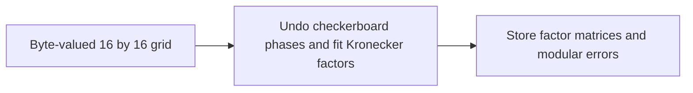
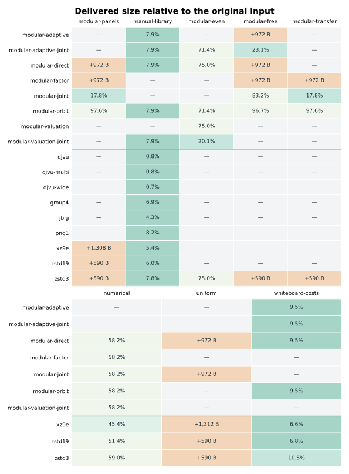
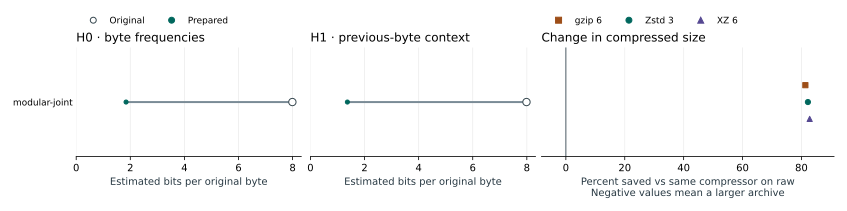
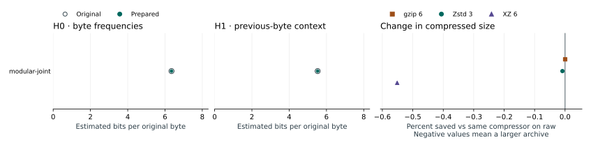
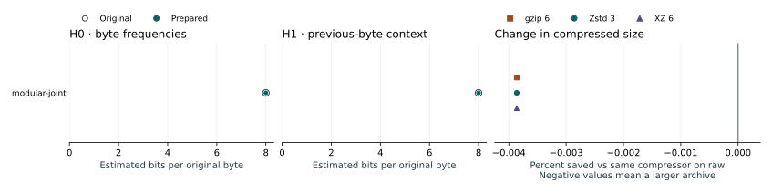

# Byte-valued cellular automata and Kronecker factors

> **Verdict: detector only.** Best real input: Silesia numerical files (mr + x-ray + sao), +28.2% vs xz -9e. Planted control: Byte orbit hiding a Kronecker product, −82.8% vs brotli -11.
>
> Part of [chapter 2](../../report/2-dynamics.md) of the [report](../../report/README.md). Terms: [glossary](../../report/glossary.md).

## Question

With byte-valued cells (arithmetic modulo 256), can reversing an automaton reveal that a panel is the product of two small 4×4 matrices?

## How it works



Panels are evolved backwards, fitted as a Kronecker product of two small matrices, and the exact byte differences are stored.

<details><summary>Technical details</summary>

The local discussion proposed larger cellular alphabets and Kronecker or tensor factors in topics 35 and 38. Can reversing a cellular rule expose a product of two small matrices when its cells carry full byte values? This implementation uses arithmetic modulo 256. The earlier binary, three-dimensional, and four-dimensional experiments are linked below. [Original idea register](../evidence/idea-atlas.md)

**Mechanism and test.** An aligned product lets two small matrices predict a large panel. Wrong dynamics or unsuitable pivots can leave expensive residuals. Compare the generated transfer, free and even-pivot controls with the real numerical stream.

A 16 × 16 periodic byte grid has two checkerboard phases. On each phase a cell adds its north neighbor, its east neighbor and three times its south neighbor modulo 256. The neighbors lie on the other color. Subtracting the same values in reverse phase order exactly inverts the step.

The factor model represents a 16 × 16 grid as two 4 × 4 byte matrices and a byte residual. For outer coordinates i,j and inner coordinates k,l, the predicted cell at (4i+k, 4j+l) equals A[i,j] × B[k,l] modulo 256. An odd pivot is invertible in this ring. The fixed fit uses the top-left pivot. The adaptive fit chooses an odd pivot anywhere in the rearranged grid. Only the actual factors travel in the stream, so the decoder needs no pivot location. The valuation variant strips the power of two common to every cell before inverting a pivot. It retains that scale in the first factor and needs no extra decoder fields. Even when a prediction fails, the stored residual recovers every cell.

Each 256 KiB bank pays for its mode, time, raw size and payload size. The encoder tests 0, 1, 2 and 4 reverse steps and compares whole candidate archives using the same Zstandard level. Literal and direct Zstandard modes are always available. A final partial grid travels verbatim within its bank payload.

</details>

## Results on 20 MiB inputs

Every archive below decoded byte-exact. *Our archive* is this project's own format. *Our transform → standard tool* reshapes the bytes reversibly and hands the result to gzip, zstd or xz; it is listed only where it beats that same tool on the raw bytes. *Best standard tool* is the smallest of gzip, bzip2, xz, Zstandard, Brotli and PPMd (plus domain codecs for images, scans and video) on the raw bytes. *Difference* compares the better of our two columns with it; negative = ours is smaller.

| Input | Kind | Raw bytes | Our archive | Our transform → standard tool | Best standard tool | Difference |
|---|---|---:|---:|---:|---:|---:|
| Scanned manual: Graphviz library | real | 24,283,584 | 1,910,515 (`modular-adaptive`) | — | 175,164 (DjVu) | 10.9× larger |
| Silesia numerical files (mr + x-ray + sao) | real | 25,696,748 | 14,949,292 (`modular-direct`) | 15,063,384 (`modular-joint → gzip-6`) | 11,662,476 (xz -9e) | +28.2% |
| Census tables printed by our enumerator | self-generated | 33,554,432 | 3,192,497 (`modular-adaptive`) | — | 2,203,672 (xz -9e) | +44.9% |
| Byte orbit hiding a Kronecker product | planted | 25,165,824 | 4,471,016 (`modular-joint`) | 4,327,872 (`modular-joint → xz-6`) | 25,165,869 (brotli -11) | **−82.8%** |
| Uniform random bytes | control | 25,165,824 | 25,166,796 (`modular-direct`) | — | 25,166,414 (zstd -19) | +0.0015% |
| modular-even | other | 25,165,824 | 5,067,269 (`modular-valuation-joint`) | — | 18,869,420 (zstd -3) | **−73.1%** |
| modular-free | other | 25,165,824 | 5,813,021 (`modular-adaptive-joint`) | — | 25,163,036 (gzip -9) | **−76.9%** |
| modular-transfer | other | 25,165,824 | 4,480,896 (`modular-joint`) | — | 25,165,869 (brotli -11) | **−82.2%** |

<details><summary>All profiles, timings and entropy measurements</summary>

<!-- BEGIN generated project measurements -->

Each archive passed a byte-for-byte round trip. *Bytes saved* is raw size minus archive (and any reference the decoder needs). Timings are one run on a shared desktop.

These tables list every measured profile. The comparison with the best standard tool on each input (gzip, bzip2, xz, Zstandard, Brotli, PPMd and the domain codecs) is the Results table above.

### Archive comparison across inputs



Read down a column to compare methods on identical input. Lower is better. 100% is the raw file size. Where available, standard codecs appear below the dividing line. Near 100%, cells give the exact byte difference from raw (+ means larger). Below 0.1%, they give the exact delivered total. A dash means the combination was unmeasured.

The paired figures below measure preprocessing separately. H0 measures byte frequencies. H1 conditions on the previous byte. The tables give both in bits per byte of their own stream. The figures express model costs per original byte. H0 counts every byte. H1 counts each adjacent pair, omitting the first byte’s marginal cost. Positive compressor savings mean a smaller compressed file.

### modular-panels · 25,165,824 raw bytes



Of 1 measured profiles on this input, 1 reduced gzip size, 1 reduced Zstandard size and 1 reduced XZ size. Exact ties count separately from improvements.

**Entropy before and after preprocessing**

| Profile | Prepared bytes | H0 before → after | H1 before → after | Post H0 per raw byte |
|---|---:|---:|---:|---:|
| `modular-joint` | 28,312,524 | 7.9918 → 1.6383 | 7.9873 → 1.2147 | 1.8432 |

**Same compressor on original → prepared bytes**

| Profile | gzip 6 | Zstandard 3 | XZ 6 |
|---|---:|---:|---:|
| `modular-joint` | 25,168,569 → 4,695,964 (+81.34%) | 25,166,413 → 4,478,573 (+82.20%) | 25,167,132 → 4,327,872 (+82.80%) |

**Standalone archives**

| Profile | Archive bytes | Bytes saved vs raw | Encode (s) | Decode (s) | Peak KiB (encode / decode) |
|---|---:|---:|---:|---:|---:|
| `modular-direct` | 25,166,796 | -972 | 1.573 | 1.192 | 35,688 / 33,260 |
| `modular-factor` | 25,166,796 | -972 | 4.084 | 0.930 | 37,888 / 35,276 |
| `modular-joint` | 4,471,016 | +20,694,808 | 15.742 | 8.164 | 42,048 / 35,512 |
| `modular-orbit` | 24,560,134 | +605,690 | 12.770 | 8.732 | 37,912 / 35,572 |

Same-input baseline archives (bytes) · XZ 9 extreme 25,167,132 · Zstandard 19 25,166,414 · Zstandard 3 25,166,414

[Input hash and all measured codecs](../large-scale/results/by-dataset.md#modular-panels)

<details>
<summary>manual-library · 24,283,584 raw bytes</summary>

**Standalone archives**

| Profile | Archive bytes | Bytes saved vs raw | Encode (s) | Decode (s) | Peak KiB (encode / decode) |
|---|---:|---:|---:|---:|---:|
| `modular-adaptive` | 1,910,515 | +22,373,069 | 6.095 | 1.028 | 40,328 / 33,452 |
| `modular-adaptive-joint` | 1,910,515 | +22,373,069 | 19.069 | 1.406 | 39,504 / 35,588 |
| `modular-direct` | 1,910,515 | +22,373,069 | 2.230 | 1.923 | 38,316 / 35,452 |
| `modular-orbit` | 1,910,515 | +22,373,069 | 18.372 | 2.139 | 37,804 / 33,268 |
| `modular-valuation-joint` | 1,910,515 | +22,373,069 | 8.934 | 0.400 | 41,620 / 35,512 |

Same-input baseline archives (bytes) · DjVu 202,780 · DjVu (separated foreground) 202,666 · DjVu (wide strips) 175,164 · CCITT Group 4 1,678,602 · JBIG 1,049,864 · 1-bit PNG 1,996,848 · XZ 9 extreme 1,304,420 · Zstandard 19 1,457,017 · Zstandard 3 1,903,366

[Input hash and all measured codecs](../large-scale/results/by-dataset.md#manual-library)

</details>

<details>
<summary>modular-even · 25,165,824 raw bytes</summary>

**Standalone archives**

| Profile | Archive bytes | Bytes saved vs raw | Encode (s) | Decode (s) | Peak KiB (encode / decode) |
|---|---:|---:|---:|---:|---:|
| `modular-adaptive-joint` | 17,965,503 | +7,200,321 | 17.343 | 4.783 | 41,856 / 37,992 |
| `modular-direct` | 18,871,144 | +6,294,680 | 0.590 | 0.567 | 38,084 / 35,996 |
| `modular-orbit` | 17,965,503 | +7,200,321 | 5.898 | 3.962 | 39,752 / 37,956 |
| `modular-valuation` | 18,871,144 | +6,294,680 | 1.820 | 0.541 | 41,508 / 35,920 |
| `modular-valuation-joint` | 5,067,269 | +20,098,555 | 15.874 | 6.125 | 42,576 / 37,608 |

Same-input baseline archives (bytes) · Zstandard 3 18,869,420

[Input hash and all measured codecs](../large-scale/results/by-dataset.md#modular-even)

</details>

<details>
<summary>modular-free · 25,165,824 raw bytes</summary>

**Standalone archives**

| Profile | Archive bytes | Bytes saved vs raw | Encode (s) | Decode (s) | Peak KiB (encode / decode) |
|---|---:|---:|---:|---:|---:|
| `modular-adaptive` | 25,166,796 | -972 | 5.929 | 1.853 | 39,980 / 35,308 |
| `modular-adaptive-joint` | 5,813,021 | +19,352,803 | 24.126 | 7.689 | 39,288 / 37,672 |
| `modular-direct` | 25,166,796 | -972 | 2.403 | 1.154 | 37,860 / 35,340 |
| `modular-factor` | 25,166,796 | -972 | 8.968 | 1.185 | 37,908 / 33,304 |
| `modular-joint` | 20,947,779 | +4,218,045 | 27.005 | 6.588 | 39,152 / 35,848 |
| `modular-orbit` | 24,347,838 | +817,986 | 8.505 | 4.031 | 39,996 / 37,476 |

Same-input baseline archives (bytes) · Zstandard 3 25,166,414

[Input hash and all measured codecs](../large-scale/results/by-dataset.md#modular-free)

</details>

<details>
<summary>modular-transfer · 25,165,824 raw bytes</summary>

**Standalone archives**

| Profile | Archive bytes | Bytes saved vs raw | Encode (s) | Decode (s) | Peak KiB (encode / decode) |
|---|---:|---:|---:|---:|---:|
| `modular-factor` | 25,166,796 | -972 | 5.346 | 1.726 | 40,728 / 33,392 |
| `modular-joint` | 4,480,896 | +20,684,928 | 21.046 | 8.150 | 42,100 / 37,648 |
| `modular-orbit` | 24,560,992 | +604,832 | 9.043 | 8.517 | 37,708 / 37,560 |

Same-input baseline archives (bytes) · Zstandard 3 25,166,414

[Input hash and all measured codecs](../large-scale/results/by-dataset.md#modular-transfer)

</details>

<details>
<summary>numerical · 25,696,748 raw bytes</summary>



Of 1 measured profiles on this input, 1 reduced gzip size, 0 reduced Zstandard size and 0 reduced XZ size. Exact ties count separately from improvements.

**Entropy before and after preprocessing**

| Profile | Prepared bytes | H0 before → after | H1 before → after | Post H0 per raw byte |
|---|---:|---:|---:|---:|
| `modular-joint` | 25,697,750 | 6.3494 → 6.3493 | 5.5271 → 5.5270 | 6.3495 |

**Same compressor on original → prepared bytes**

| Profile | gzip 6 | Zstandard 3 | XZ 6 |
|---|---:|---:|---:|
| `modular-joint` | 15,063,439 → 15,063,384 (+0.00%) | 15,163,679 → 15,164,986 (-0.01%) | 11,665,916 → 11,730,228 (-0.55%) |

**Standalone archives**

| Profile | Archive bytes | Bytes saved vs raw | Encode (s) | Decode (s) | Peak KiB (encode / decode) |
|---|---:|---:|---:|---:|---:|
| `modular-direct` | 14,949,292 | +10,747,456 | 4.457 | 1.416 | 36,296 / 35,856 |
| `modular-factor` | 14,949,292 | +10,747,456 | 6.033 | 1.608 | 41,204 / 34,116 |
| `modular-joint` | 14,949,292 | +10,747,456 | 20.881 | 0.998 | 41,468 / 36,032 |
| `modular-orbit` | 14,949,292 | +10,747,456 | 16.787 | 1.018 | 40,068 / 36,036 |
| `modular-valuation-joint` | 14,949,292 | +10,747,456 | 11.687 | 0.531 | 42,392 / 35,844 |

Same-input baseline archives (bytes) · XZ 9 extreme 11,662,476 · Zstandard 19 13,213,336 · Zstandard 3 15,163,683

[Input hash and all measured codecs](../large-scale/results/by-dataset.md#numerical)

</details>

<details>
<summary>uniform · 25,165,824 raw bytes</summary>



Of 1 measured profiles on this input, 0 reduced gzip size, 0 reduced Zstandard size and 0 reduced XZ size. Exact ties count separately from improvements.

**Entropy before and after preprocessing**

| Profile | Prepared bytes | H0 before → after | H1 before → after | Post H0 per raw byte |
|---|---:|---:|---:|---:|
| `modular-joint` | 25,166,796 | 8.0000 → 8.0000 | 7.9981 → 7.9981 | 8.0003 |

**Same compressor on original → prepared bytes**

| Profile | gzip 6 | Zstandard 3 | XZ 6 |
|---|---:|---:|---:|
| `modular-joint` | 25,169,682 → 25,170,654 (-0.00%) | 25,166,413 → 25,167,385 (-0.00%) | 25,167,136 → 25,168,108 (-0.00%) |

**Standalone archives**

| Profile | Archive bytes | Bytes saved vs raw | Encode (s) | Decode (s) | Peak KiB (encode / decode) |
|---|---:|---:|---:|---:|---:|
| `modular-direct` | 25,166,796 | -972 | 2.137 | 1.515 | 37,688 / 33,312 |
| `modular-joint` | 25,166,796 | -972 | 26.702 | 1.771 | 41,840 / 35,272 |

Same-input baseline archives (bytes) · XZ 9 extreme 25,167,136 · Zstandard 19 25,166,414 · Zstandard 3 25,166,414

[Input hash and all measured codecs](../large-scale/results/by-dataset.md#uniform)

</details>

<details>
<summary>whiteboard-costs · 33,554,432 raw bytes</summary>

**Standalone archives**

| Profile | Archive bytes | Bytes saved vs raw | Encode (s) | Decode (s) | Peak KiB (encode / decode) |
|---|---:|---:|---:|---:|---:|
| `modular-adaptive` | 3,192,497 | +30,361,935 | 9.046 | 1.192 | 41,472 / 35,744 |
| `modular-adaptive-joint` | 3,192,497 | +30,361,935 | 25.625 | 2.123 | 42,252 / 36,052 |
| `modular-direct` | 3,192,497 | +30,361,935 | 3.273 | 2.701 | 38,268 / 35,836 |
| `modular-orbit` | 3,192,497 | +30,361,935 | 22.578 | 1.187 | 38,196 / 33,732 |

Same-input baseline archives (bytes) · XZ 9 extreme 2,203,672 · Zstandard 19 2,286,184 · Zstandard 3 3,513,689

[Input hash and all measured codecs](../large-scale/results/by-dataset.md#whiteboard-costs)

</details>

### Reproduce the large-file comparison

From the repository root, with the pinned inputs and project dependencies installed, replay all published standalone profiles for this folder into a fresh directory.

```sh
python3 research/large-scale/primary.py runs/replay-modular-kronecker --project modular-kronecker --all-profiles
```

[Dataset preparation](../large-scale/README.md#inputs) · [Archive hashes and settings](../large-scale/results/archives.jsonl)

A separate paired run also records entropy, stream hashes and the three backend sizes.

```sh
mkdir -p runs/paired
python3 research/large-scale/entropy_bench.py modular-joint runs/large/raw/modular-panels runs/paired/modular-kronecker.json
```

[All paired stream hashes and compressor versions](../large-scale/results/preprocessing.jsonl)

<!-- END generated project measurements -->

</details>

## Small-scale results

Each generated input has 98,304 grids and exactly **25,165,824 raw bytes**. Every grid receives independently sampled factors and approximately one corrupted cell in 128 before evolution. The first two seeds constrain the top-left pivot to be odd. A third seed removes that condition. A fourth multiplies each noisy bank by 2, 4 or 8 before evolution, making every candidate pivot even. The real numerical corpus and uniform controls use the same encoder. [Seeds and source hashes](../large-scale/synthetic.json)

On the first seed, factors alone used 25,166,796 bytes and orbit reversal alone used 24,560,134. Combining them used **4,471,016 bytes**, a saving of 20,089,118 over the better component. A second seed yielded 4,480,896 bytes for the joint model and 24,560,992 for the orbit alone. All four fixed-pivot profiles tied at 14,949,292 bytes on the real Silesia numerical stream. Both direct and joint coding used 25,166,796 bytes on the matched uniform input.

Removing the planted odd top-left condition exposed a failure in the fixed normalization. The joint codec grew to 20,947,779 bytes. Choosing an odd pivot separately for each panel reduced it to **5,813,021 bytes** on the identical 25,165,824 bytes. The adaptive factor model alone used 25,166,796 bytes and orbit reversal alone used 24,347,838. On the Graphviz library raster and the original whiteboard cost tables, all the tested adaptive profiles tied their direct coding controls.

On the all-even control, orbit reversal alone and the adaptive odd-pivot joint encoder each used 17,965,503 bytes. Valuation-aware fitting alone used 18,871,144. Combining valuation-aware fitting and orbit reversal reduced the archive to **5,067,269 bytes**. The same valuation-aware joint profile matched direct coding exactly on the real numerical stream (14,949,292 bytes) and the Graphviz library raster (1,910,515 bytes).

## Run it

The codec requires Python, NumPy and python-zstandard. Run from the repository root.

```sh
mkdir -p runs/modular-input
python3 research/modular-kronecker/control.py runs/modular-input/modular-panels
python3 suite.py benchmark runs/modular-result --project modular-kronecker --raw runs/modular-input
python3 research/modular-kronecker/codec.py encode runs/modular-input/modular-panels runs/panels.mkr --profile adaptive-joint
python3 research/modular-kronecker/codec.py decode runs/panels.mkr runs/panels.out
cmp runs/modular-input/modular-panels runs/panels.out
```
