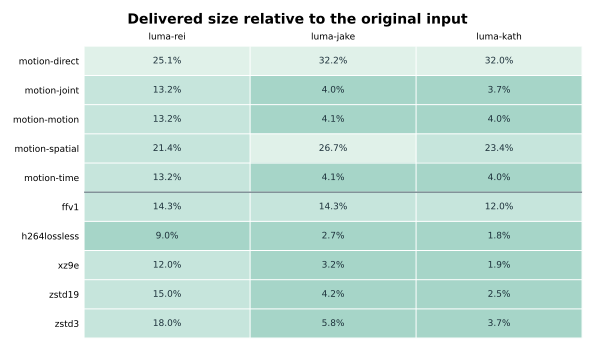

# Motion and spatial residuals on grayscale frame sequences

[Method diagram](#method-diagram) · [Charts and benchmark tables](#large-file-benchmark)

## Question and prior work

When consecutive planes are actual frames, does a motion vector improve prediction enough to pay for its two stored coordinates?

### Source files and compatibility

The nested-plane and stride experiments in `lab/shape/nested.py` motivated this transfer to a time axis. MVR1 adds an exact integer motion predictor and tests it against spatial-only and previous-frame baselines.

## Run the experiment

Run these commands from the repository root. The [large-suite instructions](../large-scale/README.md) give input preparation, dependencies and the complete benchmark command.

```sh
mkdir -p runs
python3 research/motion-residuals/codec.py encode runs/large/raw/luma-jake runs/movie.mvr --width 640 --height 360 --profile joint
python3 research/motion-residuals/codec.py decode runs/movie.mvr runs/movie.restored
cmp runs/large/raw/luma-jake runs/movie.restored
```

## Variants and format

The header supplies width, height and frame count. A frame can use literal pixels, spatial differences, the previous frame, or an integral motion vector per 32×32 tile. Coarse-to-fine search picks the vector using subsampled absolute differences. The joint profile can apply a left or median-edge predictor to temporal errors before ZigZag and Zstandard coding. The previous frame, vector field and residual determine the next frame exactly.

### Method diagram


**Mechanism and test.** Stable or translated content can be predicted from the last frame. Transmitting motion vectors pays off only if the improvement over a plain previous-frame residual exceeds the vector cost. A lossless video codec provides a separate deployment comparison.

## Inputs and measurement

Each source supplies its first 128 frames, scaled once to 640×360 unsigned 8-bit luma. The raw streams are 29,491,200 bytes each. FFV1 and lossless H.264 are compared by decoding back to identical luma bytes. The experiment measures compression of these canonical frames.

## Results

On Jake, spatial-only used 7,865,422 bytes, previous-frame prediction 1,201,348, and the combined codec 1,188,089. Lossless H.264 was smaller at 803,426. On Rei the combined archive gave 3,882,245, again above lossless H.264 (2,666,233). The time axis explained much more than the extra motion search on these clips. [Full archive sizes, times and hashes](../large-scale/results/by-dataset.md)


## Large-file benchmark

On `luma-rei` (29,491,200 raw bytes), `motion-joint` produced 3,882,245 archive bytes. Zstandard level 3 used 5,307,286 bytes on the same input. [Input and timing](../large-scale/results/by-dataset.md#luma-rei) · [All project measurements](../large-scale/results/by-experiment.md#motion-residuals)

<!-- BEGIN generated project measurements -->

Each archive passed a byte-for-byte round trip. Bytes saved subtracts the archive and any required reference from the raw input size. Timings are seconds from one run.

On the primary input `luma-rei`, `motion-joint` delivers 3,882,245 bytes, 1,425,041 bytes smaller than standalone Zstandard 3 (5,307,286 bytes).

Holding `motion-joint` fixed across the 3 measured input/reference settings with a standalone Zstandard 3 control gives **2 smaller, 0 equal and 1 larger** delivered archives. Each setting counts once.

### Archive comparison across inputs



Read down a column to compare methods on identical input. Lower is better. 100% is the raw file size. Where available, standard codecs appear below the dividing line. Near 100%, cells give the exact byte difference from raw (+ means larger). Below 0.1%, they give the exact delivered total. A dash means the combination was unmeasured.

This project's published large-file trials measure complete archives. The effect on gzip, Zstandard or XZ after an isolated preprocessing step is unmeasured here.

### luma-rei · 29,491,200 raw bytes

**Standalone archives**

| Profile | Archive bytes | Bytes saved vs raw | Encode (s) | Decode (s) | Peak KiB (encode / decode) |
|---|---:|---:|---:|---:|---:|
| `motion-direct` | 7,416,559 | +22,074,641 | 1.640 | 2.128 | 36,400 / 35,876 |
| `motion-joint` | 3,882,245 | +25,608,955 | 4.980 | 0.733 | 38,932 / 36,724 |
| `motion-motion` | 3,889,130 | +25,602,070 | 2.288 | 0.844 | 38,240 / 36,892 |
| `motion-spatial` | 6,297,844 | +23,193,356 | 2.692 | 2.234 | 38,096 / 36,780 |
| `motion-time` | 3,890,440 | +25,600,760 | 2.633 | 1.563 | 38,120 / 36,748 |

Same-input baseline archives (bytes) · FFV1 4,208,993 · Lossless H.264 2,666,233 · XZ 9 extreme 3,550,008 · Zstandard 19 4,432,349 · Zstandard 3 5,307,286

[Input hash and all measured codecs](../large-scale/results/by-dataset.md#luma-rei)

### luma-jake · 29,491,200 raw bytes

**Standalone archives**

| Profile | Archive bytes | Bytes saved vs raw | Encode (s) | Decode (s) | Peak KiB (encode / decode) |
|---|---:|---:|---:|---:|---:|
| `motion-direct` | 9,488,913 | +20,002,287 | 2.092 | 1.059 | 36,568 / 35,612 |
| `motion-joint` | 1,188,089 | +28,303,111 | 6.109 | 1.453 | 36,804 / 36,852 |
| `motion-motion` | 1,201,281 | +28,289,919 | 2.471 | 1.459 | 38,284 / 36,664 |
| `motion-spatial` | 7,865,422 | +21,625,778 | 4.687 | 1.899 | 38,300 / 36,892 |
| `motion-time` | 1,201,348 | +28,289,852 | 2.054 | 1.263 | 36,092 / 36,384 |

Same-input baseline archives (bytes) · FFV1 4,229,103 · Lossless H.264 803,426 · XZ 9 extreme 956,552 · Zstandard 19 1,238,496 · Zstandard 3 1,716,544

[Input hash and all measured codecs](../large-scale/results/by-dataset.md#luma-jake)

### luma-kath · 29,491,200 raw bytes

**Standalone archives**

| Profile | Archive bytes | Bytes saved vs raw | Encode (s) | Decode (s) | Peak KiB (encode / decode) |
|---|---:|---:|---:|---:|---:|
| `motion-direct` | 9,451,851 | +20,039,349 | 2.115 | 1.103 | 36,272 / 35,820 |
| `motion-joint` | 1,102,656 | +28,388,544 | 5.827 | 0.879 | 38,448 / 36,912 |
| `motion-motion` | 1,168,013 | +28,323,187 | 3.297 | 0.982 | 38,224 / 36,996 |
| `motion-spatial` | 6,898,428 | +22,592,772 | 3.978 | 2.190 | 38,268 / 36,716 |
| `motion-time` | 1,170,541 | +28,320,659 | 2.427 | 1.636 | 37,940 / 36,528 |

Same-input baseline archives (bytes) · FFV1 3,538,225 · Lossless H.264 535,126 · XZ 9 extreme 553,924 · Zstandard 19 732,848 · Zstandard 3 1,077,172

[Input hash and all measured codecs](../large-scale/results/by-dataset.md#luma-kath)

### Reproduce the large-file comparison

From the repository root, with the pinned inputs and project dependencies installed, replay all published standalone profiles for this folder into a fresh directory.

```sh
python3 research/large-scale/primary.py runs/replay-motion-residuals --project motion-residuals --all-profiles
```

[Dataset preparation](../large-scale/README.md#inputs) · [Archive hashes and settings](../large-scale/results/archives.jsonl)

<!-- END generated project measurements -->

## Connections

Compare [four-dimensional automata](../four-dimensional-factors/README.md) and [wavelet lifting](../reversible-wavelets/README.md) on static RGB images.
