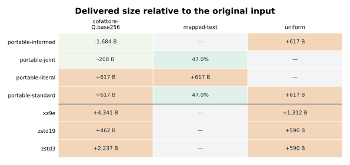

# Arithmetic packages that include their decoder

> **Verdict: no meaningful gain on real data.** Best real input: Q: the record archive as an integer, −0.0022% vs zstd -19.
>
> Part of [chapter 6](../../report/6-record-archive.md) of the [report](../../report/README.md). Terms: [glossary](../../report/glossary.md).

## Question

The record archive Q contains an executable and neural-network weights. If we rebuild those parts from their structure, how much does Q shrink once the decoder program is counted too?

## How it works


A self-contained Python package rebuilds Q: it regenerates the executable's tables and the model weights inside 12 × Q, stores the rest literally, and divides by 12.

<details><summary>Technical details</summary>

Does the small saving on an already compressed integer survive delivery of a working decoder? The original V15 package made the full cofactor independently recoverable. This experiment builds a new portable package from a supplied raw file, records the payload and delivery overhead, and compares the result with the separately verified V15 artifact.

**Mechanism and test.** A small arithmetic saving can disappear once extraction code is included. The end-to-end package comparison measures this overhead and makes the assumed Python runtime explicit.

The encoder prices deterministic ZIP applications with a literal payload, Zstandard, XZ, and the SCL1 whole-integer scale and sparse-interval representation. XZ is considered when its prefix screen saves at least 1%. The winning package includes Python extraction code, any arithmetic and interval decoder modules, ZIP metadata and the payload. Reproduction uses Python 3.14 with the standard compression modules. The application runs with isolated mode and site packages disabled.

The historical code separately rebuilds QWX8 from the preserved QWX7 weight branch and compares the reconstructed contents using both inverse implementations. It replays the pinned complete V15 package against canonical Q. Its original top-level V14 input is absent from the workspace. The tracked V15 result therefore records a fresh branch rebuild and full decode of the retained artifact. [Original branch and package verification](historical-result.json)

</details>

## Results on 20 MiB inputs

Every archive below decoded byte-exact. *Our archive* is this project's own format. *Our transform → standard tool* reshapes the bytes reversibly and hands the result to gzip, zstd or xz; it is listed only where it beats that same tool on the raw bytes. *Best standard tool* is the smallest of gzip, bzip2, xz, Zstandard, Brotli and PPMd (plus domain codecs for images, scans and video) on the raw bytes. *Difference* compares the better of our two columns with it; negative = ours is smaller.

| Input | Kind | Raw bytes | Our archive | Our transform → standard tool | Best standard tool | Difference |
|---|---|---:|---:|---:|---:|---:|
| Q: the record archive as an integer | derived from real | 96,994,187 | 96,992,503 (`portable-informed`) | — | 96,994,649 (zstd -19) | −0.0022% |
| Uniform random bytes | control | 25,165,824 | 25,166,441 (`portable-informed`) | — | 25,166,414 (zstd -19) | +0.0001% |
| mapped-text | other | 25,165,824 | 11,823,400 (`portable-joint`) | — | 10,023,454 (PPMd) | +18.0% |

<details><summary>All profiles, timings and entropy measurements</summary>

<!-- BEGIN generated project measurements -->

Each archive passed a byte-for-byte round trip. *Bytes saved* is raw size minus archive (and any reference the decoder needs). Timings are one run on a shared desktop.

These tables list every measured profile. The comparison with the best standard tool on each input (gzip, bzip2, xz, Zstandard, Brotli, PPMd and the domain codecs) is the Results table above.

### Archive comparison across inputs



Read down a column to compare methods on identical input. Lower is better. 100% is the raw file size. Where available, standard codecs appear below the dividing line. Near 100%, cells give the exact byte difference from raw (+ means larger). Below 0.1%, they give the exact delivered total. A dash means the combination was unmeasured.

This project's published large-file trials measure complete archives. The effect on gzip, Zstandard or XZ after an isolated preprocessing step is unmeasured here.

### cofattore-Q.base256 · 96,994,187 raw bytes

**Standalone archives**

| Profile | Archive bytes | Bytes saved vs raw | Encode (s) | Decode (s) | Peak KiB (encode / decode) |
|---|---:|---:|---:|---:|---:|
| `portable-informed` | 96,992,503 | +1,684 | 51.545 | 8.723 | 923,824 / 608,672 |
| `portable-joint` | 96,993,979 | +208 | 35.083 | 9.658 | 848,756 / 608,988 |
| `portable-literal` | 96,994,804 | -617 | 1.750 | 0.667 | 221,988 / 108,568 |
| `portable-standard` | 96,994,804 | -617 | 3.940 | 1.540 | 414,172 / 108,568 |

Same-input baseline archives (bytes) · XZ 9 extreme 96,998,528 · Zstandard 19 96,994,649 · Zstandard 3 96,996,424

[Input hash and all measured codecs](../large-scale/results/by-dataset.md#cofattore-qbase256)

### mapped-text · 25,165,824 raw bytes

**Standalone archives**

| Profile | Archive bytes | Bytes saved vs raw | Encode (s) | Decode (s) | Peak KiB (encode / decode) |
|---|---:|---:|---:|---:|---:|
| `portable-joint` | 11,823,400 | +13,342,424 | 409.590 | 4.131 | 333,856 / 84,068 |
| `portable-literal` | 25,166,441 | -617 | 1.504 | 0.915 | 83,832 / 38,696 |
| `portable-standard` | 11,823,400 | +13,342,424 | 47.171 | 2.593 | 191,800 / 82,968 |

[Input hash and all measured codecs](../large-scale/results/by-dataset.md#mapped-text)

### uniform · 25,165,824 raw bytes

**Standalone archives**

| Profile | Archive bytes | Bytes saved vs raw | Encode (s) | Decode (s) | Peak KiB (encode / decode) |
|---|---:|---:|---:|---:|---:|
| `portable-informed` | 25,166,441 | -617 | 12.871 | 0.618 | 285,848 / 38,704 |
| `portable-standard` | 25,166,441 | -617 | 2.349 | 0.997 | 133,768 / 38,628 |

Same-input baseline archives (bytes) · XZ 9 extreme 25,167,136 · Zstandard 19 25,166,414 · Zstandard 3 25,166,414

[Input hash and all measured codecs](../large-scale/results/by-dataset.md#uniform)

### Reproduce the large-file comparison

From the repository root, with the pinned inputs and project dependencies installed, replay all published standalone profiles for this folder into a fresh directory.

```sh
python3 research/large-scale/primary.py runs/replay-portable-arithmetic --project portable-arithmetic --all-profiles
```

[Dataset preparation](../large-scale/README.md#inputs) · [Archive hashes and settings](../large-scale/results/archives.jsonl)

<!-- END generated project measurements -->

</details>

## Small-scale results

Primary runs include canonical Q, uniform noise and transformed Wikipedia text. The informed profile admits factor 12 from the original investigation. The blind profile shortlists scales using samples. The standard-library interpreter represents the shared runtime in the delivery figures.

| Complete Q package | Bytes | Difference from 96,994,187 raw bytes |
|---|---:|---:|
| Literal application | 96,994,804 | +617 |
| Blind arithmetic selection | 96,993,979 | −208 |
| Informed arithmetic selection | 96,992,503 | −1,684 |
| Historical specialized V15 | 96,920,967 | −73,220 |

The two newly built arithmetic packages charged 2,088 bytes beyond their SCL1 payloads. The uniform control chose the literal package. [New primary measurements](../large-scale/results/by-dataset.md#cofattore-qbase256)

## Run it

```sh
python3 research/portable-arithmetic/pack.py "$Q" runs/new-q.pyz --profile informed
python3 -I -S runs/new-q.pyz runs/new-q.raw
cmp "$Q" runs/new-q.raw
python3 research/portable-arithmetic/historical.py .. runs/v15-check.json
```
