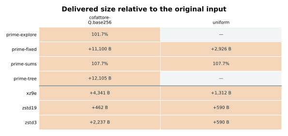

# Prime ordinal and product coding

> **Verdict: no meaningful gain on real data.** Best real input: Q: the record archive as an integer, +0.0110% vs zstd -19.
>
> Part of [chapter 1](../../report/1-formulas.md) of the [report](../../report/README.md). Terms: [glossary](../../report/glossary.md).

## Question

Many words of a file are primes or products of primes. Is it cheaper to store a word as the index of its prime (the 1,000th prime) than as the word itself?

## How it works


Words are replaced by prime ordinals or factor lists where that is shorter, with selectors marking which words were replaced.

<details><summary>Technical details</summary>

Do savings on many individual prime or factorable words survive the selectors needed for the whole file?

**Mechanism and test.** A prime index can be smaller than its value, but the partition and reconstruction instructions also consume bits. The uniform control tests whether those costs erase the numerical advantage on unstructured input.

Fixed, tree and exploratory profiles partition a source word, transmit the model choice, and use prime ordinals when the chosen grammar permits it. A fourth profile uses prime sums on 2-byte units. Small prime tables are deterministically rebuilt by the decoder. The mode and lengths of both arithmetic streams are in the archive.

</details>

## Results on 20 MiB inputs

Every archive below decoded byte-exact. *Our archive* is this project's own format. *Our transform → standard tool* reshapes the bytes reversibly and hands the result to gzip, zstd or xz; it is listed only where it beats that same tool on the raw bytes. *Best standard tool* is the smallest of gzip, bzip2, xz, Zstandard, Brotli and PPMd (plus domain codecs for images, scans and video) on the raw bytes. *Difference* compares the better of our two columns with it; negative = ours is smaller.

| Input | Kind | Raw bytes | Our archive | Our transform → standard tool | Best standard tool | Difference |
|---|---|---:|---:|---:|---:|---:|
| Q: the record archive as an integer | derived from real | 96,994,187 | 97,005,287 (`prime-fixed`) | — | 96,994,649 (zstd -19) | +0.0110% |
| Uniform random bytes | control | 25,165,824 | 25,168,750 (`prime-fixed`) | — | 25,166,414 (zstd -19) | +0.0093% |

<details><summary>All profiles, timings and entropy measurements</summary>

<!-- BEGIN generated project measurements -->

Each archive passed a byte-for-byte round trip. *Bytes saved* is raw size minus archive (and any reference the decoder needs). Timings are one run on a shared desktop.

These tables list every measured profile. The comparison with the best standard tool on each input (gzip, bzip2, xz, Zstandard, Brotli, PPMd and the domain codecs) is the Results table above.

### Archive comparison across inputs



Read down a column to compare methods on identical input. Lower is better. 100% is the raw file size. Where available, standard codecs appear below the dividing line. Near 100%, cells give the exact byte difference from raw (+ means larger). Below 0.1%, they give the exact delivered total. A dash means the combination was unmeasured.

This project's published large-file trials measure complete archives. The effect on gzip, Zstandard or XZ after an isolated preprocessing step is unmeasured here.

### cofattore-Q.base256 · 96,994,187 raw bytes

**Standalone archives**

| Profile | Archive bytes | Bytes saved vs raw | Encode (s) | Decode (s) |
|---|---:|---:|---:|---:|
| `prime-explore` | 98,625,024 | -1,630,837 | 30.739 | 9.643 |
| `prime-fixed` | 97,005,287 | -11,100 | 14.531 | 10.304 |
| `prime-sums` | 104,419,953 | -7,425,766 | 12.284 | 9.355 |
| `prime-tree` | 97,006,292 | -12,105 | 23.746 | 9.904 |

Same-input baseline archives (bytes) · XZ 9 extreme 96,998,528 · Zstandard 19 96,994,649 · Zstandard 3 96,996,424

[Input hash and all measured codecs](../large-scale/results/by-dataset.md#cofattore-qbase256)

### uniform · 25,165,824 raw bytes

**Standalone archives**

| Profile | Archive bytes | Bytes saved vs raw | Encode (s) | Decode (s) |
|---|---:|---:|---:|---:|
| `prime-fixed` | 25,168,750 | -2,926 | 3.099 | 1.869 |
| `prime-sums` | 27,092,567 | -1,926,743 | 5.314 | 3.472 |

Same-input baseline archives (bytes) · XZ 9 extreme 25,167,136 · Zstandard 19 25,166,414 · Zstandard 3 25,166,414

[Input hash and all measured codecs](../large-scale/results/by-dataset.md#uniform)

### Reproduce the large-file comparison

From the repository root, with the pinned inputs and project dependencies installed, replay all published standalone profiles for this folder into a fresh directory.

```sh
python3 research/large-scale/primary.py runs/replay-prime-index-trees --project prime-index-trees --all-profiles
```

[Dataset preparation](../large-scale/README.md#inputs) · [Archive hashes and settings](../large-scale/results/archives.jsonl)

<!-- END generated project measurements -->

</details>

## Small-scale results

The test includes all 96,994,187 bytes of canonical Q and a separate 24 MiB uniform control. Source and archive hashes identify the tested release.

The four whole-Q archives were 97,005,287 (fixed), 97,006,292 (tree), 98,625,024 (exploratory) and 104,419,953 bytes (sums). On this source the fixed representation came closest to raw size. [Full archive sizes, times and hashes](../large-scale/results/by-dataset.md)

## Run it

Run these commands from the repository root. The [large-suite instructions](../large-scale/README.md) give input preparation, dependencies and the complete benchmark command.

```sh
mkdir -p runs
research/build/prime-indices tree "$Q" runs/q.qpi
research/build/prime-indices decode runs/q.qpi runs/q-primes.restored
cmp "$Q" runs/q-primes.restored
```

## Provenance

<details><summary>Where this code came from</summary>

This is a port of `lab/hutter/divisors/q-fattori-ricorsivi/indici.cpp`. QPI1 uses the original range coder. Report 137 also describes a distinct 16-bit prime-index grammar and is indexed separately.

</details>
