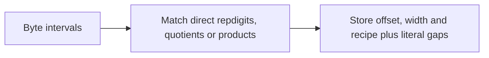
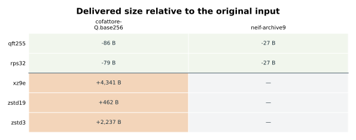

# Adaptive repdigit intervals

[Method diagram](#method-diagram) · [Charts and benchmark tables](#large-file-benchmark)

## Question and prior work

Do whiteboard formulas occur at profitable positions inside the real cofactor Q? This experiment tries each useful byte offset and selects a set of disjoint replacements by dynamic programming. The original RPS1 codec and native scanner are from `lab/hutter/ragc/repdigit_split`, the arithmetic records from `lab/hutter/ragc/rfce_check/repdigits.py`, and the QFT1 multiplier extension from `lab/hutter/ragc/entropy_base_tree/{quotient_trial.py,product_scan.cpp}`.

## Run the experiment

```sh
mkdir -p runs
python3 research/repdigit-intervals/benchmark.py runs/intervals --q "$Q"
python3 research/repdigit-intervals/quotient_trial.py bench "$Q" research/build/product-scan runs/products
python3 research/repdigit-intervals/quotient_trial.py decode runs/products/Q.qft runs/products/restored
cmp "$Q" runs/products/restored
```

The drivers generate seeded planted and random controls and preserve the winning real archive in the output directory. RPS1 also accepts a single file via `codec.py encode INPUT OUTPUT --scanner research/build/interval-scan` and `codec.py decode ARCHIVE RESTORED`.

## Variants and format

RPS1 caps each interval at 32 bytes and enumerates arithmetic descriptions up to 28 bits. It compares fixed 32-byte boundaries, movable intervals with direct repdigits, exact cross-base quotients and zero runs. A 12-byte header carries source size and record count. Every substitution pays for a 4-byte offset, a byte width, a recipe length and its packed recipe. Literal gaps fill the rest. QFT1 extends the maximum interval to 255 bytes and permits a small prime as a multiplier.

### Method diagram



**Mechanism and test.** A match must save more than its offset and parameters. Relaxing the allowed span can uncover longer profitable matches, but sparse hits on a large file still have little effect on its total size.

## Inputs and measurement

The primary trial measures `qft255` on the complete `cofattore-Q.base256` input (96,994,187 raw bytes). The runner invokes a separate decoder and compares the reconstructed file byte for byte. The earlier measurements below retain their original input sizes.

## Results

On full Q, fixed RPS1 blocks occupied 96,994,199 bytes. Moving the boundaries and enabling all families produced 96,994,108 bytes, saving 79 bytes over the input. The selected intervals were six direct repdigits and three zero runs. On the 184,958-byte plant, adding quotients reduced 148,418 bytes to 116,299. The random control paid only the header. [RPS1 replay](results/intervals.jsonl)

QFT1 reached 96,994,101 bytes on Q, saving 86 bytes over the input. The full-width solution used six direct repdigits and two zero runs. Enabling prime-scaled quotients added no savings to that solution. The same implementation selected them on its planted input. All distinct archive selections in the evaluation were reconstructed and compared in a separate process. [QFT1 replay and selected recipe families](results/products.json)

## Large-file benchmark

On `cofattore-Q.base256` (96,994,187 raw bytes), `qft255` produced 96,994,101 archive bytes. Zstandard level 3 used 96,996,424 bytes on the same input. [Input and timing](../large-scale/results/by-dataset.md#cofattore-qbase256) · [All project measurements](../large-scale/results/by-experiment.md#repdigit-intervals)

<!-- BEGIN generated project measurements -->

Each archive passed a byte-for-byte round trip. Bytes saved subtracts the archive and any required reference from the raw input size. Timings are seconds from one run.

On the primary input `cofattore-Q.base256`, `qft255` delivers 96,994,101 bytes, 2,323 bytes smaller than standalone Zstandard 3 (96,996,424 bytes).

### Archive comparison across inputs



Read down a column to compare methods on identical input. Lower is better. 100% is the raw file size. Where available, standard codecs appear below the dividing line. Near 100%, cells give the exact byte difference from raw (+ means larger). Below 0.1%, they give the exact delivered total. A dash means the combination was unmeasured.

This project's published large-file trials measure complete archives. The effect on gzip, Zstandard or XZ after an isolated preprocessing step is unmeasured here.

### cofattore-Q.base256 · 96,994,187 raw bytes

**Standalone archives**

| Profile | Archive bytes | Bytes saved vs raw | Encode (s) | Decode (s) | Peak KiB (encode / decode) |
|---|---:|---:|---:|---:|---:|
| `qft255` | 96,994,101 | +86 | 11.244 | 0.675 | 163,716 / 24,244 |
| `rps32` | 96,994,108 | +79 | 19.178 | 0.550 | 152,500 / 19,916 |

Same-input baseline archives (bytes) · XZ 9 extreme 96,998,528 · Zstandard 19 96,994,649 · Zstandard 3 96,996,424

[Input hash and all measured codecs](../large-scale/results/by-dataset.md#cofattore-qbase256)

### neif-archive9 · 89,346,392 raw bytes

**Standalone archives**

| Profile | Archive bytes | Bytes saved vs raw | Encode (s) | Decode (s) | Peak KiB (encode / decode) |
|---|---:|---:|---:|---:|---:|
| `qft255` | 89,346,365 | +27 | 8.741 | 0.680 | 156,652 / 24,264 |
| `rps32` | 89,346,365 | +27 | 18.771 | 0.326 | 145,024 / 19,820 |

[Input hash and all measured codecs](../large-scale/results/by-dataset.md#neif-archive9)

### Reproduce the large-file comparison

From the repository root, with the pinned inputs and project dependencies installed, replay all published standalone profiles for this folder into a fresh directory.

```sh
python3 research/large-scale/primary.py runs/replay-repdigit-intervals --project repdigit-intervals --all-profiles
```

[Dataset preparation](../large-scale/README.md#inputs) · [Archive hashes and settings](../large-scale/results/archives.jsonl)

<!-- END generated project measurements -->

## Connections

[Whiteboard quotients inside factor trees](../whiteboard-trees/README.md) · [Whole-file square, product and modular-square formulas](../integer-formulas/README.md)
