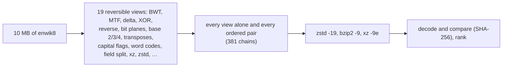

# Reshape tournament: 381 reversible chains × 3 compressors

> **Verdict: small gains for weak compressors only.** On the first 10 MB of enwik8 the best chain (word codes,
> then BWT) makes xz 5.7% and zstd 2.9% smaller. Nothing comes close to a strong model: plain PPMd is 15% smaller
> than the best xz chain. Expanding the data (base 2, 3, 4) or compressing twice never helps.
>
> Part of [chapter 3](../../report/3-reshaping.md) of the [report](../../report/README.md).

## Question

Rather than guess which transform might help text, try them all: every reversible reshape, alone and in pairs,
in front of every ordinary compressor, each checked by decoding.

## How it works



[`arena.py`](arena.py) runs the chains; [`view.cpp`](view.cpp) implements the byte-level views; word codes and
capital flags come from [`text-views/textfront.py`](../text-views/textfront.py). Chains that would grow the data
past a size cap or that fail the round trip are dropped and logged.

## Results

First 10,000,000 bytes of enwik8. Carried over from November 24, 2026
([log](results-2026-11-24/cheap.log)); the rerun is part of [`lab-reruns.sh`](../lab-reruns.sh).

| Chain | Bytes after the chain | zstd -19 | bzip2 -9 | xz -9e |
|---|---:|---:|---:|---:|
| none | 10,000,000 | 2,793,624 | 2,916,026 | 2,720,256 |
| **word codes → BWT** | 6,567,634 | **2,713,163** (−2.9%) | 2,913,909 | **2,564,696** (−5.7%) |
| word codes | 6,567,626 | 2,740,943 | **2,755,698** (−5.5%) | 2,639,496 |
| capital flags | 10,336,766 | 2,773,210 | 2,914,017 | 2,706,244 |
| BWT | 10,000,008 | 2,781,511 | 3,090,296 | 2,629,496 (−3.3%) |
| base 2 (8× larger) | 80,000,000 | 3,554,001 | 4,305,089 | 2,880,016 |
| xz, then xz again | 2,720,256 | 2,720,528 | 2,732,568 | 2,720,648 |
| *PPMd order 10 on the raw text* | | | | *2,302,184* |


## Run it

```sh
make -C research lab
head -c 10000000 "$CORPUS/enwik8/enwik8" > runs/e10m
python3 research/reshape-tournament/arena.py cheap runs/e10m runs/arena-work runs/arena.jsonl
```
