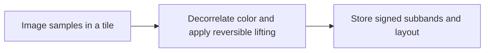
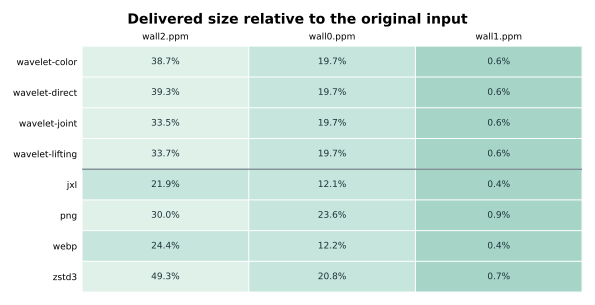

# Integer lifting and color differences

[Method diagram](#method-diagram) · [Charts and benchmark tables](#large-file-benchmark)

## Question and prior work

Does a reversible 2D wavelet become more useful when it sees color-difference planes instead of red, green and blue?

### Source files and compatibility

This combines the signal and Walsh topics of the dossier with the integer row/plane hypothesis from `lab/shape/nested.py`. The implementation uses the reversible integer 5/3 lifting transform and a green-centered reversible color transform. RWL1 is a new archive.

## Run the experiment

Run these commands from the repository root. The [large-suite instructions](../large-scale/README.md) give input preparation, dependencies and the complete benchmark command.

```sh
mkdir -p runs
python3 research/reversible-wavelets/codec.py encode runs/large/raw/wall2.ppm runs/image.rwl --profile joint
python3 research/reversible-wavelets/codec.py decode runs/image.rwl runs/image.restored.ppm
cmp runs/large/raw/wall2.ppm runs/image.restored.ppm
```

## Variants and format

Each tile can use direct, color-only, lifting-only or combined coding. The encoder tries one, two or three pyramid levels. Each subband retains signed coefficients using ZigZag mapping and low/high byte planes. Odd row and column counts reuse the nearest endpoint; the inverse reverses the predict/update steps. All variants use the same Zstandard backend.

### Method diagram



**Mechanism and test.** Neighboring pixels can yield small high-frequency coefficients. Color-only and lifting-only profiles isolate their contributions. One image selects identical outputs for every profile, so image structure matters even within the same corpus.

## Inputs and measurement

The three original wallpaper PNGs were decoded to canonical 8-bit P6 RGB before benchmarking. Every method restores that complete canonical byte stream, including its header. Timings and sizes cover encoding the raster, rather than reproducing the source PNG container. Dedicated baselines include PNG, lossless WebP and lossless JPEG XL.

## Results

On wall2, 96,560,657 raw bytes, direct coding gave 37,922,336, color 37,365,473, lifting 32,521,660 and their combination 32,392,630. Lossless JPEG XL gave 21,138,142. On wall1 every wavelet profile chose the same 644,213-byte result. [Full archive sizes, times and hashes](../large-scale/results/by-dataset.md)


## Large-file benchmark

On `wall2.ppm` (96,560,657 raw bytes), `wavelet-joint` produced 32,392,630 archive bytes. Zstandard level 3 used 47,585,586 bytes on the same input. [Input and timing](../large-scale/results/by-dataset.md#wall2ppm) · [All project measurements](../large-scale/results/by-experiment.md#reversible-wavelets)

<!-- BEGIN generated project measurements -->

Each archive passed a byte-for-byte round trip. Bytes saved subtracts the archive and any required reference from the raw input size. Timings are seconds from one run.

On the primary input `wall2.ppm`, `wavelet-joint` delivers 32,392,630 bytes, 15,192,956 bytes smaller than standalone Zstandard 3 (47,585,586 bytes).

Holding `wavelet-joint` fixed across the 3 measured input/reference settings with a standalone Zstandard 3 control gives **3 smaller, 0 equal and 0 larger** delivered archives. Each setting counts once.

### Archive comparison across inputs



Read down a column to compare methods on identical input. Lower is better. 100% is the raw file size. Where available, standard codecs appear below the dividing line. Near 100%, cells give the exact byte difference from raw (+ means larger). Below 0.1%, they give the exact delivered total. A dash means the combination was unmeasured.

This project's published large-file trials measure complete archives. The effect on gzip, Zstandard or XZ after an isolated preprocessing step is unmeasured here.

### wall2.ppm · 96,560,657 raw bytes

**Standalone archives**

| Profile | Archive bytes | Bytes saved vs raw | Encode (s) | Decode (s) |
|---|---:|---:|---:|---:|
| `wavelet-color` | 37,365,473 | +59,195,184 | 9.655 | 3.314 |
| `wavelet-direct` | 37,922,336 | +58,638,321 | 2.065 | 0.995 |
| `wavelet-joint` | 32,392,630 | +64,168,027 | 46.298 | 7.595 |
| `wavelet-lifting` | 32,521,660 | +64,038,997 | 27.505 | 9.034 |

Same-input baseline archives (bytes) · Lossless JPEG XL 21,138,142 · PNG 29,015,774 · Lossless WebP 23,532,898 · Zstandard 3 47,585,586

[Input hash and all measured codecs](../large-scale/results/by-dataset.md#wall2ppm)

### wall0.ppm · 99,532,817 raw bytes

**Standalone archives**

| Profile | Archive bytes | Bytes saved vs raw | Encode (s) | Decode (s) |
|---|---:|---:|---:|---:|
| `wavelet-color` | 19,619,307 | +79,913,510 | 7.321 | 1.932 |
| `wavelet-direct` | 19,630,612 | +79,902,205 | 2.269 | 2.472 |
| `wavelet-joint` | 19,619,307 | +79,913,510 | 41.836 | 1.109 |
| `wavelet-lifting` | 19,630,612 | +79,902,205 | 20.136 | 1.259 |

Same-input baseline archives (bytes) · Lossless JPEG XL 12,086,473 · PNG 23,521,445 · Lossless WebP 12,158,784 · Zstandard 3 20,699,049

[Input hash and all measured codecs](../large-scale/results/by-dataset.md#wall0ppm)

### wall1.ppm · 99,532,817 raw bytes

**Standalone archives**

| Profile | Archive bytes | Bytes saved vs raw | Encode (s) | Decode (s) |
|---|---:|---:|---:|---:|
| `wavelet-color` | 644,213 | +98,888,604 | 4.100 | 0.955 |
| `wavelet-direct` | 644,213 | +98,888,604 | 0.633 | 0.923 |
| `wavelet-joint` | 644,213 | +98,888,604 | 19.535 | 1.080 |
| `wavelet-lifting` | 644,213 | +98,888,604 | 13.506 | 1.244 |

Same-input baseline archives (bytes) · Lossless JPEG XL 407,227 · PNG 900,638 · Lossless WebP 436,166 · Zstandard 3 733,973

[Input hash and all measured codecs](../large-scale/results/by-dataset.md#wall1ppm)

### Reproduce the large-file comparison

From the repository root, with the pinned inputs and project dependencies installed, replay all published standalone profiles for this folder into a fresh directory.

```sh
python3 research/large-scale/primary.py runs/replay-reversible-wavelets --project reversible-wavelets --all-profiles
```

[Dataset preparation](../large-scale/README.md#inputs) · [Archive hashes and settings](../large-scale/results/archives.jsonl)

<!-- END generated project measurements -->

## Connections

Experiment 09 uses Walsh terms and XOR. The [lattice](../lattice-prediction/README.md) discovers integer widths, while [motion residuals](../motion-residuals/README.md) add a previous frame.
