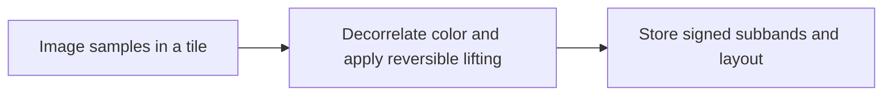

# Integer lifting and color differences

> **Verdict: loses on real data.** Best real input: Photo 3 (RGB), +53.2% vs JPEG XL.
>
> Part of [chapter 4](../../report/4-specialised.md) of the [report](../../report/README.md). Terms: [glossary](../../report/glossary.md).

## Question

Does a reversible colour transform followed by an integer wavelet compress photos better than PNG, WebP or JPEG XL?

## How it works



RGB is converted to reversible colour-difference planes, each plane goes through a multi-level integer wavelet, and coefficients are context-coded.

<details><summary>Technical details</summary>

Does a reversible 2D wavelet become more useful when it sees color-difference planes instead of red, green and blue?

**Mechanism and test.** Neighboring pixels can yield small high-frequency coefficients. Color-only and lifting-only profiles isolate their contributions. One image selects identical outputs for every profile, so image structure matters even within the same corpus.

Each tile can use direct, color-only, lifting-only or combined coding. The encoder tries one, two or three pyramid levels. Each subband retains signed coefficients using ZigZag mapping and low/high byte planes. Odd row and column counts reuse the nearest endpoint; the inverse reverses the predict/update steps. All variants use the same Zstandard backend.

</details>

## Results on 20 MiB inputs

Every archive below decoded byte-exact. *Our archive* is this project's own format. *Our transform → standard tool* reshapes the bytes reversibly and hands the result to gzip, zstd or xz; it is listed only where it beats that same tool on the raw bytes. *Best standard tool* is the smallest of gzip, bzip2, xz, Zstandard, Brotli and PPMd (plus domain codecs for images, scans and video) on the raw bytes. *Difference* compares the better of our two columns with it; negative = ours is smaller.

| Input | Kind | Raw bytes | Our archive | Our transform → standard tool | Best standard tool | Difference |
|---|---|---:|---:|---:|---:|---:|
| Photo 1 (RGB) | real | 99,532,817 | 19,619,307 (`wavelet-color`) | — | 12,086,473 (JPEG XL) | +62.3% |
| Photo 2 (RGB) | real | 99,532,817 | 644,213 (`wavelet-color`) | — | 407,227 (JPEG XL) | +58.2% |
| Photo 3 (RGB) | real | 96,560,657 | 32,392,630 (`wavelet-joint`) | — | 21,138,142 (JPEG XL) | +53.2% |

<details><summary>All profiles, timings and entropy measurements</summary>

<!-- BEGIN generated project measurements -->

Each archive passed a byte-for-byte round trip. *Bytes saved* is raw size minus archive (and any reference the decoder needs). Timings are one run on a shared desktop.

These tables list every measured profile. The comparison with the best standard tool on each input (gzip, bzip2, xz, Zstandard, Brotli, PPMd and the domain codecs) is the Results table above.

### Archive comparison across inputs


Read down a column to compare methods on identical input. Lower is better. 100% is the raw file size. Where available, standard codecs appear below the dividing line. Near 100%, cells give the exact byte difference from raw (+ means larger). Below 0.1%, they give the exact delivered total. A dash means the combination was unmeasured.

This project's published large-file trials measure complete archives. The effect on gzip, Zstandard or XZ after an isolated preprocessing step is unmeasured here.

### wall2.ppm · 96,560,657 raw bytes

**Standalone archives**

| Profile | Archive bytes | Bytes saved vs raw | Encode (s) | Decode (s) |
|---|---:|---:|---:|---:|
| `wavelet-color` | 37,365,473 | +59,195,184 | 9.655 | 3.314 |
| `wavelet-direct` | 37,922,336 | +58,638,321 | 2.065 | 0.995 |
| `wavelet-joint` | 32,392,630 | +64,168,027 | 46.298 | 7.595 |
| `wavelet-lifting` | 32,521,660 | +64,038,997 | 27.505 | 9.034 |

Same-input baseline archives (bytes) · Lossless JPEG XL 21,138,142 · PNG 29,015,774 · Lossless WebP 23,532,898 · Zstandard 3 47,585,586

[Input hash and all measured codecs](../large-scale/results/by-dataset.md#wall2ppm)

### wall0.ppm · 99,532,817 raw bytes

**Standalone archives**

| Profile | Archive bytes | Bytes saved vs raw | Encode (s) | Decode (s) |
|---|---:|---:|---:|---:|
| `wavelet-color` | 19,619,307 | +79,913,510 | 7.321 | 1.932 |
| `wavelet-direct` | 19,630,612 | +79,902,205 | 2.269 | 2.472 |
| `wavelet-joint` | 19,619,307 | +79,913,510 | 41.836 | 1.109 |
| `wavelet-lifting` | 19,630,612 | +79,902,205 | 20.136 | 1.259 |

Same-input baseline archives (bytes) · Lossless JPEG XL 12,086,473 · PNG 23,521,445 · Lossless WebP 12,158,784 · Zstandard 3 20,699,049

[Input hash and all measured codecs](../large-scale/results/by-dataset.md#wall0ppm)

### wall1.ppm · 99,532,817 raw bytes

**Standalone archives**

| Profile | Archive bytes | Bytes saved vs raw | Encode (s) | Decode (s) |
|---|---:|---:|---:|---:|
| `wavelet-color` | 644,213 | +98,888,604 | 4.100 | 0.955 |
| `wavelet-direct` | 644,213 | +98,888,604 | 0.633 | 0.923 |
| `wavelet-joint` | 644,213 | +98,888,604 | 19.535 | 1.080 |
| `wavelet-lifting` | 644,213 | +98,888,604 | 13.506 | 1.244 |

Same-input baseline archives (bytes) · Lossless JPEG XL 407,227 · PNG 900,638 · Lossless WebP 436,166 · Zstandard 3 733,973

[Input hash and all measured codecs](../large-scale/results/by-dataset.md#wall1ppm)

### Reproduce the large-file comparison

From the repository root, with the pinned inputs and project dependencies installed, replay all published standalone profiles for this folder into a fresh directory.

```sh
python3 research/large-scale/primary.py runs/replay-reversible-wavelets --project reversible-wavelets --all-profiles
```

[Dataset preparation](../large-scale/README.md#inputs) · [Archive hashes and settings](../large-scale/results/archives.jsonl)

<!-- END generated project measurements -->

</details>

## Small-scale results

The three original wallpaper PNGs were decoded to canonical 8-bit P6 RGB before benchmarking. Every method restores that complete canonical byte stream, including its header. Timings and sizes cover encoding the raster, rather than reproducing the source PNG container. Dedicated baselines include PNG, lossless WebP and lossless JPEG XL.

On wall2, 96,560,657 raw bytes, direct coding gave 37,922,336, color 37,365,473, lifting 32,521,660 and their combination 32,392,630. Lossless JPEG XL gave 21,138,142. On wall1 every wavelet profile chose the same 644,213-byte result. [Full archive sizes, times and hashes](../large-scale/results/by-dataset.md)

## Run it

Run these commands from the repository root. The [large-suite instructions](../large-scale/README.md) give input preparation, dependencies and the complete benchmark command.

```sh
mkdir -p runs
python3 research/reversible-wavelets/codec.py encode runs/large/raw/wall2.ppm runs/image.rwl --profile joint
python3 research/reversible-wavelets/codec.py decode runs/image.rwl runs/image.restored.ppm
cmp runs/large/raw/wall2.ppm runs/image.restored.ppm
```

## Provenance

<details><summary>Where this code came from</summary>

This combines the signal and Walsh design topics with the integer row/plane hypothesis from `lab/shape/nested.py`. The implementation uses the reversible integer 5/3 lifting transform and a green-centered reversible color transform. RWL1 is a new archive.

</details>
