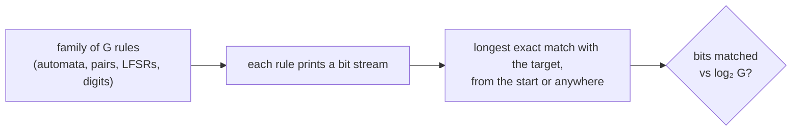

# Rules against noise, and digits of irrational numbers

> **Verdict: the counting argument, measured.** No family of rules reproduces compressed data, random bytes or
> text for longer than it costs to name the rule. Planted rule outputs are found completely.
>
> Part of [chapter 1](../../report/1-formulas.md) of the [report](../../report/README.md).

## Question

Could a big enough list of simple rules recreate data that already looks random, such as the output of xz or
PPMd, so that "compress, then find a rule" beats compressing? Can the digits of √2, √3, √5, e or π (or sums
of them) contain a useful piece of a real file?

## How it works



- [`noise_rules.py`](noise_rules.py): elementary cellular automata (all 256 rules, ring widths 8–71, any
  column, any start step: 2²⁷·³ programs), all pairs of distinct programs XORed (2³³·⁴), and every linear
  rule at once via Berlekamp–Massey. Targets: xz and PPMd output of the first MiB of enwik8, 1 KiB of seeded
  random bytes, and a control made by rule 30.
- [`irrational_digits.py`](irrational_digits.py): 4,194,304 binary digits each of √2, √3, √5, e and π plus their
  11 digit-wise XOR sums; for search spaces of 2¹⁶ to 2²² start positions, the longest prefix of each target
  found anywhere. Control: a 128-bit piece of √2 itself.

## Results

Re-verified November 28, 2026 ([logs](results)).

| Search | Bits to name | xz output | PPMd output | random | planted control |
|---|---:|---:|---:|---:|---:|
| one automaton | 27.3 | 24 | 26 | 25 | ≥ 64 (rule 30) |
| two automata XORed | 33.4 | 28 | 29 | 31 | ≥ 64 |
| shortest linear rule for 8,192 bits | — | 8,196 bits | 8,192 bits | 8,188 bits | 318 bits for 320 |

| Digits search: start positions | Bits to name | enwik8 text | xz output | random | piece of √2 |
|---|---:|---:|---:|---:|---:|
| 16 × 65,536 | 20 | 22 | 19 | 20 | 20 |
| 16 × 262,144 | 22 | 25 | 22 | 24 | 20 |
| 16 × 1,048,576 | 24 | 25 | 24 | 24 | 23 |
| 16 × 4,194,304 | 26 | 26 | 25 | 25 | **128 (all)** |

Each doubling of the search adds about one matched bit and exactly one bit of naming cost.

## Run it

```sh
head -c 1048576 "$CORPUS/enwik8/enwik8" > runs/e1m && xz -9e -c runs/e1m > runs/e1m.xz
7z a -t7z -m0=PPMd:mem=768m:o=10 runs/e1m.7z runs/e1m
python3 research/rules-vs-noise/irrational_digits.py runs/e1m runs/e1m.xz     # about 1 minute
python3 research/rules-vs-noise/noise_rules.py runs/e1m.xz runs/e1m.7z         # about 4 minutes
```
